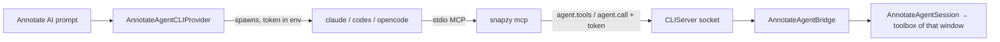

# Annotate AI Prompt (Ask)

Type what you want in Annotate's AI dock ("circle the Sign in button, number the 3 login steps, blur the email") and an agent adds or edits annotations and canvas settings with **Annotate's own tools**. Every change is a normal annotation: selectable, editable, one undo step per prompt.

Annotate window only (not inline Area Annotate, Combine, Mockup or Preview).

## Entry points

- AI dock (`AnnotateAIDockView`): orb → **Ask** (first section, rim-hue gradient) → prompt row: back, "Selected: N" chip, multi-line field (1–4 lines), provider chip, Send/Stop.
- Shortcut `.aiPrompt`, default **⌘K** (Annotate-local, Settings → Shortcuts, config `shortcuts.annotate_actions.ai_prompt`). Pressing it again on an empty prompt closes it.
- Esc: editing a text annotation → that edit; running → Stop; prompt open → close.
- Provider chip menu: current provider, Automatic / Apple Intelligence / custom endpoints / agent CLIs found on this Mac, **New Conversation**, **AI Settings…**.
- Result pill above the dock: reply + **Undo** (only while nothing was edited since), auto-hides after 6 s (stays while hovered). Setup errors (nothing configured, CLI missing, Apple Intelligence off) add **AI Settings…**.

Release builds show Ask only when a provider can run: Apple Intelligence ready, at least one custom endpoint, or an agent CLI found/selected. Debug builds always show it (mock provider when nothing else is available; `defaults write com.trongduong.snapzy.debug annotateAgent.useMockProvider -bool YES|NO`).

## Providers

| Provider | Selection value | Where it runs | Notes |
| --- | --- | --- | --- |
| Automatic | `automatic` | Apple Intelligence when ready | Never falls back to an off-device provider |
| Apple Intelligence | `apple` | On device (macOS 26, FoundationModels) | 4K context: compact scene, 5 coarse tools (`draw`, `blur_sensitive`, `edit`, `canvas`, `find_text`); text-only scene |
| Custom endpoint | `endpoint:<uuid>` | OpenAI-compatible server from the shared OCR/Translate list | Tools mode (17-tool catalog) or plan mode (`{"ops", "reply"}` JSON) when the model has no function calling; screenshot as `image_url` when it accepts images |
| Agent CLI | `cli:claude` · `cli:codex` · `cli:opencode` | Claude Code / Codex / OpenCode on this Mac, headless | Snapzy gives it one MCP server, `snapzy mcp`, bound to the run by a token |

`AnnotateAgentProviderResolver` resolves the stored selection (`annotateAgent.provider`); a removed endpoint reads as Automatic. Changing provider (dock menu or Settings) starts a new conversation.

### Endpoint capabilities

What an endpoint supports is learned per endpoint and model (`annotateAgent.endpointCapabilities`, keyed by endpoint id + `baseURL|model` fingerprint, so editing either forgets it):

- `tools`: `true` after a tool call, `false` after the server rejects `tools` on the first request (then plan mode). Settings → AI → **Test** sends a one-tool "ping" request; a text answer leaves it unknown.
- `vision`: `true` after an image goes through, `false` after the server rejects images (retry text-only). **Test** sends a 16×16 PNG.

### Agent CLIs

| CLI | Invocation (verified against Claude Code 2.1.325, Codex 0.169, OpenCode 2.1.0) |
| --- | --- |
| Claude Code | `claude -p --output-format stream-json --verbose --mcp-config <file> --strict-mcp-config --tools "" --allowedTools mcp__snapzy --permission-mode dontAsk --append-system-prompt <instructions> [--resume id] [--model m]`, prompt on stdin; screenshot via the `get_snapshot` tool |
| Codex | `codex exec [resume] --json --skip-git-repo-check -c mcp_servers.snapzy.* -c sandbox_mode="read-only" -c approval_policy="never" [--model m] [--image shot.jpg] [id] -`, prompt on stdin |
| OpenCode | `opencode run --standalone --format json [--model provider/model] [--file shot.jpg] [--session id] <prompt>` with `OPENCODE_CONFIG=<file>` (MCP `mcp.servers.snapzy`, built-in file/shell/web tools denied), stdin `/dev/null` |

- Detection (`AnnotateAgentCLIDetector`): the login shell's PATH (`$SHELL -l -i`, cached) plus common install folders (`~/.local/bin`, `~/.opencode/bin`, `~/.claude/local`, `~/.bun/bin`, npm/volta/pnpm, Homebrew). Settings → AI also reads `--version`. A path set by hand (`annotateAgent.cli.<kind>.path`) wins when it is executable.
- Model override per CLI: `annotateAgent.cli.<kind>.model` (empty = the CLI's default; OpenCode uses `provider/model`).
- Process (`AnnotateAgentCLIProcess`): `posix_spawn` in its own process group, working directory `~/Library/Application Support/Snapzy/AgentWork/<kind>` (0700, stable so `--resume` finds the conversation); per-run config/prompt/screenshot files (0600) are deleted after the run. Stop or time limit (`annotateAgent.cliTimeout`, default 180 s) → SIGTERM to the group, SIGKILL after 2 s. Last 4 KB of stderr become the error message.
- Follow-ups resume the CLI's own session id from the previous turn; if resume fails before any change, the run starts fresh with a summary of earlier turns.
- Login, model, quota and credentials belong to the CLI; Snapzy never reads them.

## `snapzy mcp`

Hidden subcommand of the embedded helper (`Snapzy.app/Contents/Helpers/snapzy mcp`). See [CLI.md](CLI.md#snapzy-mcp).



- Token: 256-bit random, created per run (`AnnotateAgentBridge`), expires when the run ends, is stopped, or the window closes. Without a valid token the `agent.*` methods return an error the model can read.
- `agent.*` methods skip per-app approval (the token is the authorization). While a run is in flight the socket also opens when Command Line access is off, in agent-only mode (`system.status` reports `cliEnabled=false`, everything else refused).
- Tools: the shared catalog (`AnnotateAgentToolCatalog`) plus `get_snapshot` (JPEG ≤1568 px, ≤900 KB base64 to fit the 1 MiB frame).

## Privacy

- Automatic never chooses an endpoint or CLI. The first prompt to each off-device provider asks once ("Send this screenshot to …?"); the consent id is `endpoint:<uuid>@<scheme:host:port>` (pointing the endpoint at another server asks again) or `cli:<kind>`. Stored in `annotateAgent.consentedProviders`; Settings → AI → Sending permissions → **Reset**.
- **Send screenshot image** (`annotateAgent.sendImage`, default on): off sends only the scene text (recognized text blocks, detected elements, annotations, canvas).
- The tools only touch the canvas; there is no export/upload/send tool. Text in a screenshot can still try to steer the model (prompt injection), which is why every run is one undo step.
- Known limit: Codex and OpenCode still merge the user's global config, so **their other MCP servers stay available** to the model; Claude Code still loads the user's hooks, `CLAUDE.md` and skills. The CLI consent message and Settings → AI say so.

## Settings → AI (`PreferencesAISettingsView.swift`)

| Section | Rows |
| --- | --- |
| Provider | Ask AI with (Automatic, Apple Intelligence, endpoints, Claude Code, Codex, OpenCode) + warning when the pick can't run |
| Apple Intelligence | On-device model status (ready / requires macOS 26 / not eligible / off / not ready) + **Open System Settings…** |
| Custom Endpoints | One row per shared endpoint: model id, Tools/Vision badges (✓ / ✗ / ?), **Test**; **Manage Endpoints…** opens Capture → OCR |
| Agent CLIs | Per CLI: version · path or "Not found", expandable Model and Location (with **Choose…**); **Refresh** rescans; MCP/hooks warning |
| Privacy | Send screenshot image, Agent CLI time limit (1–15 min), Sending permissions count + Reset |

Deep link: `snapzy://settings/ai` (aliases `ask`, `ask-ai`).

## Configuration

`[annotate.ai]` in `config.toml` (see [CONFIGURATION.md](CONFIGURATION.md)):

```toml
[annotate.ai]
provider = "automatic"      # automatic | apple | endpoint:<uuid> | cli:claude | cli:codex | cli:opencode
send_image = true
cli_timeout = 180           # seconds, 30...1800
claude_model = ""           # empty = the CLI's default
codex_model = ""
opencode_model = ""
```

CLI paths, consent and learned endpoint capabilities are per-Mac and never exported.

## Source map

| Path | Owns |
| --- | --- |
| `Snapzy/Features/Annotate/Agent/AnnotateAgentToolbox.swift`, `…ToolCatalog.swift`, `…Scene.swift`, `…Types.swift` | Tools, JSON schemas, scene for the model, coordinates, transactions/undo |
| `Snapzy/Features/Annotate/Agent/AnnotateAgentController.swift` | Prompt state, run loop, consent, notices, conversation |
| `Snapzy/Features/Annotate/Agent/AnnotateAgentProvider.swift` | Provider protocol, selection, resolver |
| `Snapzy/Features/Annotate/Agent/AnnotateAgentAppleIntelligenceProvider.swift` | Apple Intelligence provider and status |
| `Snapzy/Features/Annotate/Agent/AnnotateAgentEndpointProvider.swift`, `…EndpointProbe.swift` | Endpoint provider, capability store, Test |
| `Snapzy/Features/Annotate/Agent/AnnotateAgentBridge.swift`, `CLI/` | MCP session tokens, CLI detection, process, adapters, provider |
| `Snapzy/Features/Annotate/Agent/AnnotateAgentAISettings.swift` | Shared stored options (time limit, image, consent) |
| `Snapzy/Features/Annotate/Components/AnnotateAIDockView.swift`, `AnnotateAgentOverlayView.swift` | Dock, prompt, status line, canvas overlay, result pill |
| `Snapzy/Services/CommandLine/Handlers/CLIAgentHandlers.swift` | `agent.tools` / `agent.call` on the socket |
| `Packages/SnapzyCLIKit/Sources/SnapzyCLICore/Commands/MCPCommand.swift`, `MCP/` | `snapzy mcp` stdio server |

## Tests

- `AnnotateAgentToolboxTests`, `AnnotateAgentControllerTests` — tools, undo, run lifecycle.
- `AnnotateAgentAppleIntelligenceTests` — live opt-in `TEST_RUNNER_SNAPZY_LIVE_AI=1`.
- `AnnotateAgentEndpointProviderTests` — live opt-in `TEST_RUNNER_SNAPZY_LIVE_ENDPOINT="<base>|<model>"` (`…_MODE=plan`).
- `AnnotateAgentCLIProviderTests` — fixtures for all three CLIs; live opt-in `TEST_RUNNER_SNAPZY_LIVE_CLI="opencode|opencode-go/deepseek-v4.1-flash"`.
- `MCPServerTests` (SnapzyCLIKit) — `snapzy mcp` protocol.
