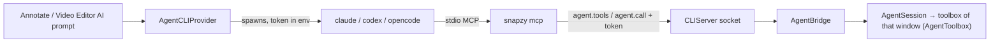

# AI Prompt (Annotate & Video Editor)

Two surfaces share one agent core (`Snapzy/Features/Agent/`): providers, endpoint/CLI plumbing, `snapzy mcp` bridge, consent. Each surface brings its own toolbox, scene and instructions (`AgentSurface`). Provider choice, endpoints, CLIs, time limit and **Send image** are app-wide (Settings → AI, keys still `annotateAgent.*`). Video Editor specifics: [Video Editor](#video-editor).

## Annotate

Type what you want in Annotate's AI dock ("circle the Sign in button, number the 3 login steps, blur the email") and an agent adds or edits annotations and canvas settings with **Annotate's own tools**. Every change is a normal annotation: selectable, editable, one undo step per prompt.

Available in the Annotate window and in Capture Markup (inline Area Annotate, ⇧⌘7). Not in Combine, Mockup or Preview.

Capture Markup differences: the same dock floats on the free side of the selection (see [ANNOTATE.md](ANNOTATE.md#inline-area-annotate-capture-markup-7)); `set_canvas` is refused (`AnnotateState.allowsAgentCanvasChanges = false`, nothing there previews canvas styling); the selection cannot be moved or resized while a run or a translation works; Return/⌘S are ignored during a run; finishing or cancelling the capture stops the run; **AI Settings…** lowers the overlay to a normal window level so Preferences can come forward (a click on the overlay raises it again).

### Entry points

- AI dock (`AnnotateAIDockView`): orb → **Ask** (first section, rim-hue gradient) → prompt row: back, "Selected: N" chip, multi-line field (1–4 lines), provider chip, Send/Stop.
- Shortcut `.aiPrompt`, default **⌘K** (Annotate-local, Settings → Shortcuts, config `shortcuts.annotate_actions.ai_prompt`). Pressing it again on an empty prompt closes it.
- Esc: editing a text annotation → that edit; running → Stop; prompt open → close.
- Provider chip menu: current provider, Automatic / Apple Intelligence / custom endpoints / agent CLIs found on this Mac, **New Conversation**, **AI Settings…**.
- Result pill above the dock: reply + **Undo** (only while nothing was edited since), auto-hides after 6 s (stays while hovered). Setup errors (nothing configured, CLI missing, Apple Intelligence off) add **AI Settings…**.

Release builds show Ask only when a provider can run: Apple Intelligence ready, at least one custom endpoint, or an agent CLI found/selected. Debug builds always show it (mock provider when nothing else is available; `defaults write com.trongduong.snapzy.debug annotateAgent.useMockProvider -bool YES|NO`).

## Video Editor

Type what you want in the Video Editor's AI dock ("cut the silences, speed up the build wait 4x, zoom where I type, gradient background padding 40") and the agent edits the timeline with **`VideoEditorState`'s own mutators**. One undo step per prompt. It never exports, saves, uploads or closes. Not available for GIFs (dimension-only).

### Entry points

- Layout (`VideoEditorAILayout`, Settings → AI → Video Editor → Assistant layout, key `videoEditor.ai.layout`): **Sidebar** (default) or **Floating dock**. Switching applies live to open editors.
- Dock (`VideoEditorAIDockView`, layout `dock`): glass capsule over the bottom of the player. Orb → prompt row: 1-line field, provider chip, Send/Stop. Status line + reading rim while running; result pill with **Undo** above the dock; quick-action chips over an empty, idle prompt. The dock can't be dismissed mid-run (its row holds the status and Stop). No toolbar AI button in this layout.
- Panel (`VideoEditorAIPanelView`, layout `sidebar`): glass panel on the right running the full window height (the editor, toolbar included, narrows beside it), toggled by the toolbar's AI button (top right) or the configurable ⌘K. Header (new conversation, close) sits on the toolbar line, its close button replacing the AI toggle (hidden while open) · transcript · composer (1-line field, provider chip with the same menu as Annotate, Send/Stop). The transcript (`VideoEditorAgentController.messages`) keeps the conversation: user bubbles, replies (markdown) and each reply's edits as steps (`VideoEditorAgentStepDescriber`, fed by `VideoEditorAgentToolbox.onExecuted`); clicking a step with a time moves the playhead there. A reply shows its change count and **Undo** while its undo entry is still the latest; undone replies strike their steps through. Empty state: one-click edits (quick actions) and example prompts. Closing the panel mid-run keeps the run going (pulsing dot on the toolbar button). Single-key editing shortcuts stand down only while the prompt field holds the keyboard.
- Rendering budget: the editor, toolbar and panel root don't observe the controller; they follow Equatable snapshots (`chromePublisher`, `transcriptPublisher`, `canUndoLastRunPublisher`, read one main-queue turn after `objectWillChange`). Typing re-renders only the composer/dock row; replies are `.equatable()` with cached markdown; the dock and panel never observe `VideoEditorState`. Opening the sidebar reserves its width in one non-animated layout pass and slides the panel in as a transform, so the player and timeline don't relayout every frame.
- Shortcut `.aiPrompt` (`VideoEditorShortcutManager`), default **⌘K**, editor-local, Settings → Shortcuts → Video Editor Actions, config `shortcuts.video_editor.ai_prompt`. Matched by `VideoEditorWindow.performKeyEquivalent` before SwiftUI: opens the prompt, puts the caret back, or closes it when the field already has the caret. Built-in editor combos (⌘Z, ⇧⌘Z, ⌘S, ⌘U, ⌘B, ⌘=, ⌘-, ⌘0, ⌘C/V/X/A, ⌘W/Q/M/H, ⌘,) are reserved and rejected by validation.
- Quick actions in the panel's empty state: **Remove silences** (video has audio), **Speed up idle parts** and **Zoom on activity** (Snapzy recording with cursor data; **Zoom on clicks** replaces it when a Studio recording captured clicks), **Add captions** (video has audio and no captions yet). The dock's chip row shows the first three. They call the high-level tools directly: no provider, no consent, one undo, no conversation turn (they still appear in the transcript, labeled). The toolbar AI button shows when a chip can run even with no provider configured.
- While the prompt is open, plain-key editor shortcuts (Z, S, I, O, ⌫) are off so typing never splits/zooms; Esc or the AI prompt shortcut (⌘K by default) closes the prompt.
- While a run is in flight: authoring is locked (toolbar, left rail/sidebar, timeline, bottom bar, cut/delete/insert in the transport); play/step still work, the playhead follows the agent's `seek`. Closing the window stops the run and invalidates its token.

Release builds show the toolbar AI button when Apple Intelligence is ready, an endpoint or agent CLI exists, or a quick action applies. Debug builds always show it (mock provider `VideoEditorAgentMockProvider` with the same `annotateAgent.useMockProvider` switch).

### Time and ids

- Times are **structural timeline seconds** (the ruler), number or `"m:ss.s"`; conversion to playable/source time happens inside the toolbox.
- Short ids `c1…` (clips), `z1…` (zooms), `s1…` (speeds), `t1…` (captions), `h1…` (hidden-camera stretches) map to UUIDs per run. Zoom centers are normalized top-left 0…1 (percent accepted).
- Clamps: clip 0.1 s, zoom/speed 0.5 s, rate 0.25–8, zoom level 1–4. ≤ 80 changes per turn (`VideoEditorAgentToolbox.maximumChangesPerRun`). Refused while exporting or for GIFs.

### Tools (`VideoEditorAgentToolCatalog`, 31)

| Group | Tools |
| --- | --- |
| Read (no pacing, no change count) | `get_timeline`, `seek`, `get_activity(start?, end?)`, `get_frame(time)`, `find_on_screen(text, start?, end?)`, `get_transcript(start?, end?, language?)`, `get_captions(start?, end?)` (80 per page, `next_start`) |
| Clips | `cut_range(start, end, shift_effects=true)`, `trim_clip`, `split(at)`, `move_clip(clip, position)`, `delete_clip` |
| Zoom | `add_zoom(start?, duration, level, center? \| follow_mouse? \| text?)`, `update_zoom`, `remove_zoom(ids)` |
| Speed | `add_speed(start, end, rate)`, `update_speed`, `remove_speed(ids)` |
| Frame / audio | `set_background(style, padding, shadow, corner_radius, alignment, aspect_ratio)`, `set_audio(muted?, volume 0–200, track all\|system\|microphone)` |
| Studio layers (`VideoEditorAgentToolbox+Studio.swift`) | `set_cursor(visible?, scale?, smoothing?, hide_when_idle?, idle_delay?, always_arrow?, click_effect?, click_color?, click_sound?, click_volume?)`, `set_camera(reset?, visible?, shape?, size?, position? \| center?, mirrored?, hide_start?+hide_end?, hide_during_zooms?, show_hidden?(ids \| all), clear_hidden?)` (Studio recordings only; otherwise an error the model relays). `reset` = the Camera panel's reset button (recorded layout, shown everywhere); other fields in the call apply on top |
| Captions (`VideoEditorAgentToolbox+Captions.swift`) | `generate_captions(language?, show_on_video=true)` (on device, replaces existing captions), `edit_caption(id?, text?, start?, end?, show_on_video?, position?, text_size?, bold?, text_color?, background_opacity?, hide_when_fast?)` (empty text deletes; no id = style only), `add_caption(start, end, text)` (over recording footage, no overlap), `remove_captions(ids \| all)`, `replace_in_captions(find, replace, match_case=false, whole_word=true)`, `translate_captions(language)` |
| High level (computed in app) | `remove_silences(min_duration=1, padding=0.25)`, `speed_up_idle(rate=4, min_duration=3)`, `auto_zoom_activity(source=motion\|clicks, level=2, max_zooms=8)` |

- `cut_range` shifts zooms/speeds after the cut back by its length, drops effects inside it and shortens ones across its edges (manual cuts leave effects in place). High-level tools cut from the end so earlier timestamps stay valid.
- `add_zoom(text:)` finds the words on screen from `start` on; the zoom begins when they appear and centers on their box. Not found → error listing frequent on-screen lines.
- `get_timeline` reports `studio` (cursor and/or camera recorded apart), `cursor` (with the recorded `clicks` count) / `camera` (with `hidden` stretches `h1…` in timeline time) only when they can be edited, and `captions` (style, language, count, first 40 with ids `t1…` and timeline times) once they exist.
- Studio clicks (`VideoEditorAgentToolbox+Clicks.swift`): `RecordingCursorCapture.clicks` (mouse-downs) mapped onto the timeline through the primary clips. `get_activity` lists them (≤ 60); `auto_zoom_activity(source: clicks)` groups clicks < 1.5 s apart inside a 0.35 square into one manual zoom (0.6 s lead, 1.2 s hold, centered on the clicks); idle stretches (`get_activity`, `speed_up_idle`) exclude 0.5 s around every click. The default `source: motion` is unchanged.
- Overlap notes: `add_zoom` / `update_zoom` / click zooms add `note` when a fixed center sits under the visible camera; `set_camera`, `edit_caption` and `generate_captions` add one when the camera covers the caption band. The model moves the camera or uses `hide_during_zooms` (hidden ranges = each enabled zoom's footage).
- `translate_captions` (`VideoEditorCaptionTranslator`): the engine picked for Snip to Translate (`TranslationEngineResolver`): Apple Translation on macOS 15+ through a hidden `.translationTask` host in the editor window (`VideoEditorCaptionTranslationHost`, same pattern as Annotate Auto Translate), or the user's endpoint (`RemoteBlockTranslator`, text leaves the Mac). Timing stays; word timings are dropped; one undo with the run. SRT/VTT export stays a user action (the agent never exports).
- Apple Intelligence (macOS 26) gets 6 coarse tools instead: `cut`, `zoom`, `speed`, `style` (also cursor and camera), `auto` (also `zoom_on_clicks`), `captions` (add / translate / fix / show / hide / clear) (`VideoEditorAgentAppleTools.swift`, `VideoEditorAgentAppleCaptionsTool.swift`), with a compact text scene.

### Perception (`VideoEditorAgentAnalyzer`, `…Vision`, `…Transcriber`)

| Signal | Source | Notes |
| --- | --- | --- |
| Silence / speech | `AVAssetReader` PCM 16 kHz mono, RMS per 50 ms, adaptive threshold; prefers the `microphone` track | Any video with audio |
| Idle / motion | `RecordingMetadata.mouseSamples` (idle ∩ silence when a mic exists; minus click moments) | Snapzy recordings only |
| Clicks | `RecordingMetadata.cursorCapture.clicks` (mouse-downs) | Studio recordings only |
| Frames | `AVAssetImageGenerator`, raw frame (no zoom/background), JPEG ≤ 1568 px | `get_frame`; sent only when **Send image** is on and the model accepts images |
| On-screen text | Vision OCR on sampled frames (≤ 60, ≥ 1 s apart, bisection to 0.25 s for the first hits) | Lazy, cached per file + source time |
| Transcript | `SFSpeechRecognizer` with `requiresOnDeviceRecognition`; asks for Speech Recognition permission on first use | Never leaves the Mac as audio; the text goes to the provider |

Analysis runs off the main actor, is cached by file + mtime, and is stored in **source time**; mapping through the current clip placements means cutting or reordering never re-analyzes. Clips inserted from other files are OCR-able but not analyzed for activity/transcript.

### Undo and state

- `VideoEditorState.beginUndoGroup()` / `endUndoGroup()` wrap a run (or a quick action) into one `EditorAction.group`; empty groups push nothing. ⌘Z/redo are ignored while a group is open; the preview composition rebuilds once when it closes.
- Stop keeps what was done; the pill's Undo reverts it.

## Providers

| Provider | Selection value | Where it runs | Notes |
| --- | --- | --- | --- |
| Automatic | `automatic` | Apple Intelligence when ready | Never falls back to an off-device provider |
| Apple Intelligence | `apple` | On device (macOS 26, FoundationModels) | 4K context: compact scene, 5 coarse tools (`draw`, `blur_sensitive`, `edit`, `canvas`, `find_text`); text-only scene |
| Custom endpoint | `endpoint:<uuid>` | OpenAI-compatible server from the shared OCR/Translate list | Tools mode (17-tool catalog) or plan mode (`{"ops", "reply"}` JSON) when the model has no function calling; screenshot as `image_url` when it accepts images |
| Agent CLI | `cli:claude` · `cli:codex` · `cli:opencode` | Claude Code / Codex / OpenCode on this Mac, headless | Snapzy gives it one MCP server, `snapzy mcp`, bound to the run by a token |

`AnnotateAgentProviderResolver` resolves the stored selection (`annotateAgent.provider`); a removed endpoint reads as Automatic. Changing provider (dock menu or Settings) starts a new conversation.

### Endpoint capabilities

What an endpoint supports is learned per endpoint and model (`annotateAgent.endpointCapabilities`, keyed by endpoint id + `baseURL|model` fingerprint, so editing either forgets it):

- `tools`: `true` after a tool call, `false` after the server rejects `tools` on the first request (then plan mode). Settings → AI → **Test** sends a one-tool "ping" request; a text answer leaves it unknown.
- `vision`: `true` after an image goes through, `false` after the server rejects images (retry text-only). **Test** sends a 16×16 PNG.

### Agent CLIs

| CLI | Invocation (verified against Claude Code 2.1.325, Codex 0.169, OpenCode 2.1.0) |
| --- | --- |
| Claude Code | `claude -p --output-format stream-json --verbose --mcp-config <file> --strict-mcp-config --tools "" --allowedTools mcp__snapzy --permission-mode dontAsk --append-system-prompt <instructions> [--resume id] [--model m]`, prompt on stdin; screenshot via the `get_snapshot` tool |
| Codex | `codex exec [resume] --json --skip-git-repo-check -c mcp_servers.snapzy.* -c sandbox_mode="read-only" -c approval_policy="never" [--model m] [--image shot.jpg] [id] -`, prompt on stdin |
| OpenCode | `opencode run --standalone --format json [--model provider/model] [--file shot.jpg] [--session id] <prompt>` with `OPENCODE_CONFIG=<file>` (MCP `mcp.servers.snapzy`, built-in file/shell/web tools denied), stdin `/dev/null` |

- Detection (`AnnotateAgentCLIDetector`): the login shell's PATH (`$SHELL -l -i`, cached) plus common install folders (`~/.local/bin`, `~/.opencode/bin`, `~/.claude/local`, `~/.bun/bin`, npm/volta/pnpm, Homebrew). Settings → AI also reads `--version`. A path set by hand (`annotateAgent.cli.<kind>.path`) wins when it is executable.
- Model override per CLI: `annotateAgent.cli.<kind>.model` (empty = the CLI's default; OpenCode uses `provider/model`).
- Process (`AnnotateAgentCLIProcess`): `posix_spawn` in its own process group, working directory `~/Library/Application Support/Snapzy/AgentWork/<kind>` (0700, stable so `--resume` finds the conversation); per-run config/prompt/screenshot files (0600) are deleted after the run. Stop or time limit (`annotateAgent.cliTimeout`, default 180 s) → SIGTERM to the group, SIGKILL after 2 s. Last 4 KB of stderr become the error message.
- Follow-ups resume the CLI's own session id from the previous turn; if resume fails before any change, the run starts fresh with a summary of earlier turns.
- Login, model, quota and credentials belong to the CLI; Snapzy never reads them.

## `snapzy mcp`

Hidden subcommand of the embedded helper (`Snapzy.app/Contents/Helpers/snapzy mcp`). See [CLI.md](CLI.md#snapzy-mcp).



- Token: 256-bit random, created per run (`AgentBridge`), expires when the run ends, is stopped, or the window closes. Without a valid token the `agent.*` methods return an error the model can read.
- `agent.*` methods skip per-app approval (the token is the authorization). While a run is in flight the socket also opens when Command Line access is off, in agent-only mode (`system.status` reports `cliEnabled=false`, everything else refused).
- Tools: the session's `toolSpecs` (Annotate: `AnnotateAgentToolCatalog` plus `get_snapshot`; Video: `VideoEditorAgentToolCatalog`). Images (snapshot, `get_frame`) are JPEG ≤1568 px, ≤900 KB base64 to fit the 1 MiB frame, and only cross when **Send image** is on (`open(…, allowsToolImages:)`).

## Privacy

- Automatic never chooses an endpoint or CLI. The first prompt to each off-device provider asks once ("Send this screenshot to …?"); the consent id is `endpoint:<uuid>@<scheme:host:port>` (pointing the endpoint at another server asks again) or `cli:<kind>`. Stored in `annotateAgent.consentedProviders`; Settings → AI → Sending permissions → **Reset**.
- Video Editor asks separately ("Send this video’s timeline to …?"): same id with `#video-media` (`AgentRemoteConsent.scope`), because it sends a timeline, on-screen text, transcript text and frames rather than one screenshot. Agreeing for Annotate does not cover video. Apple Intelligence and quick actions never ask (on device).
- **Send screenshot image** (`annotateAgent.sendImage`, default on): off sends only the scene text (recognized text blocks, detected elements, annotations, canvas). For video, off keeps `get_frame` images on the Mac (the tool still returns the text read off the frame).
- Captions (panel or `generate_captions`) are transcribed on this Mac (SpeechAnalyzer on macOS 26, otherwise on-device SFSpeech); no audio leaves the Mac. The remote transcription engine exists but is not offered in the UI yet; it will only run after an explicit opt-in.
- The tools only touch the canvas; there is no export/upload/send tool. Text in a screenshot can still try to steer the model (prompt injection), which is why every run is one undo step.
- Known limit: Codex and OpenCode still merge the user's global config, so **their other MCP servers stay available** to the model; Claude Code still loads the user's hooks, `CLAUDE.md` and skills. The CLI consent message and Settings → AI say so.

## Settings → AI (`PreferencesAISettingsView.swift`)

| Section | Rows |
| --- | --- |
| Provider | Ask AI with (Automatic, Apple Intelligence, endpoints, Claude Code, Codex, OpenCode) + warning when the pick can't run |
| Apple Intelligence | On-device model status (ready / requires macOS 26 / not eligible / off / not ready) + **Open System Settings…** |
| Custom Endpoints | One row per shared endpoint: model id, Tools/Vision badges (✓ / ✗ / ?), **Test**; **Manage Endpoints…** opens Capture → OCR |
| Agent CLIs | Per CLI: version · path or "Not found", expandable Model (picker from the CLI's model list, CLI default, or Custom…), Reasoning effort (needs a model; `annotateAgent.cli.<kind>.effort`) and Location (with **Choose…**); **Refresh** rescans; MCP/hooks warning |
| Privacy | Send screenshot image, Agent CLI time limit (1–15 min), Sending permissions count + Reset |

Deep link: `snapzy://settings/ai` (aliases `ask`, `ask-ai`).

## Configuration

`[annotate.ai]` in `config.toml` (see [CONFIGURATION.md](CONFIGURATION.md)):

```toml
[annotate.ai]
provider = "automatic"      # automatic | apple | endpoint:<uuid> | cli:claude | cli:codex | cli:opencode
send_image = true
cli_timeout = 180           # seconds, 30...1800
claude_model = ""           # empty = the CLI's default
codex_model = ""
opencode_model = ""
```

CLI paths, consent and learned endpoint capabilities are per-Mac and never exported.

## Source map

| Path | Owns |
| --- | --- |
| `Snapzy/Features/Agent/AgentToolbox.swift` | `AgentToolbox` protocol, `AgentToolSpec`/`AgentToolResult`/`AgentToolImage`, `AgentSurface` (instructions per surface), `AgentScene` |
| `Snapzy/Features/Agent/AgentProvider.swift` | `AgentSession`/`Turn`/`Request`/`Provider`, selection, `AgentProviderResolver` (surface passes on-device + mock factories) |
| `Snapzy/Features/Agent/AgentEndpointProvider.swift`, `AnnotateAgentEndpointProbe.swift` | Endpoint provider (tools + plan mode, tool images), capability store, Test |
| `Snapzy/Features/Agent/AgentBridge.swift`, `CLI/` | MCP session tokens, CLI detection, process, adapters, `AgentCLIProvider` |
| `Snapzy/Features/Agent/AgentRemoteConsent.swift`, `AnnotateAgentAISettings.swift` | Consent (with surface scope), shared stored options (time limit, image) |
| `Snapzy/Features/Annotate/Agent/AnnotateAgentToolbox.swift`, `…ToolCatalog.swift`, `…Scene.swift`, `…Types.swift`, `…Surface.swift` | Annotate tools, JSON schemas, scene, coordinates, transactions/undo, surface text |
| `Snapzy/Features/Annotate/Agent/AnnotateAgentController.swift` | Annotate prompt state, run loop, consent, notices, conversation |
| `Snapzy/Features/Annotate/Agent/AnnotateAgentAppleIntelligenceProvider.swift` | Apple Intelligence provider and status |
| `Snapzy/Features/Annotate/Components/AnnotateAIDockView.swift`, `AnnotateAgentOverlayView.swift` | Dock, prompt, status line, canvas overlay, result pill (building blocks reused by the video AI panel) |
| `Snapzy/Features/VideoEditor/Agent/VideoEditorAgentToolbox.swift`, `…ToolCatalog.swift`, `…Scene.swift`, `…Surface.swift` | Video tools, schemas, timeline scene, id map, one undo group per run |
| `Snapzy/Features/VideoEditor/Agent/VideoEditorAgentController.swift` | Video prompt state, run loop, consent (`video-media`), quick actions, Undo |
| `Snapzy/Features/VideoEditor/Agent/VideoEditorAgentAnalyzer.swift`, `…Vision.swift`, `…Transcriber.swift` | Silence/idle/motion, frames + OCR, on-device transcript |
| `Snapzy/Features/VideoEditor/Agent/VideoEditorAgentAppleTools.swift`, `…MockProvider.swift` | Apple Intelligence coarse tools, resolver, DEBUG mock |
| `Snapzy/Features/VideoEditor/Components/VideoEditorAIPanelView.swift`, `VideoEditorAIDockView.swift`, `Agent/VideoEditorAILayout.swift`, `Agent/VideoEditorAgentTranscript.swift`, `Services/VideoEditorShortcutManager.swift` | AI sidebar (transcript + edit steps) or floating dock (chips, result pill), layout setting; configurable ⌘K |
| `Snapzy/Services/CommandLine/Handlers/CLIAgentHandlers.swift` | `agent.tools` / `agent.call` on the socket |
| `Packages/SnapzyCLIKit/Sources/SnapzyCLICore/Commands/MCPCommand.swift`, `MCP/` | `snapzy mcp` stdio server |

## Tests

- `AnnotateAgentToolboxTests`, `AnnotateAgentControllerTests` — tools, undo, run lifecycle.
- `AnnotateAgentAppleIntelligenceTests` — live opt-in `TEST_RUNNER_SNAPZY_LIVE_AI=1`.
- `AnnotateAgentEndpointProviderTests` — live opt-in `TEST_RUNNER_SNAPZY_LIVE_ENDPOINT="<base>|<model>"` (`…_MODE=plan`).
- `AnnotateAgentCLIProviderTests` — fixtures for all three CLIs; live opt-in `TEST_RUNNER_SNAPZY_LIVE_CLI="opencode|opencode-go/deepseek-v4.1-flash"`.
- `MCPServerTests` (SnapzyCLIKit) — `snapzy mcp` protocol.
- `VideoEditorAgentToolboxTests`, `VideoEditorAgentControllerTests`, `VideoEditorAgentAnalyzerTests`, `VideoEditorAgentVisionTests`, `VideoEditorAgentAppleIntelligenceTests`, `VideoEditorShortcutManagerTests` — video tools, undo, perception (fixture recording), shortcut. Live opt-ins: `testLiveVideoPrompts`, `testLiveActivityPrompts`, `testLiveVisionPrompts` (`TEST_RUNNER_SNAPZY_LIVE_CLI` / `TEST_RUNNER_SNAPZY_LIVE_AI=1`).
