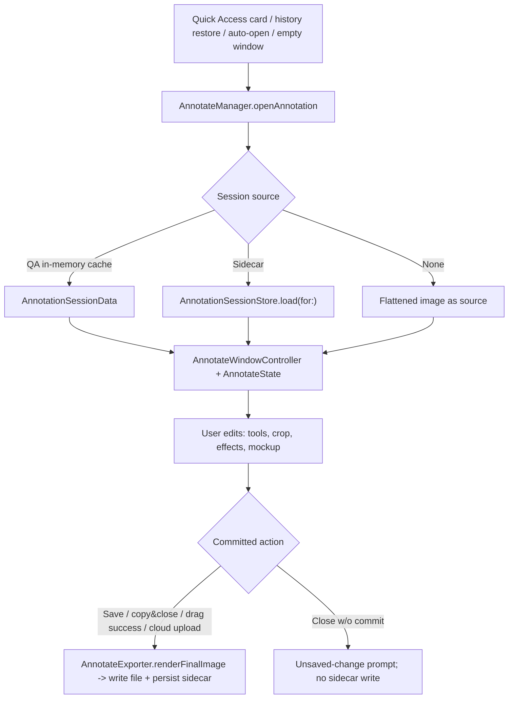
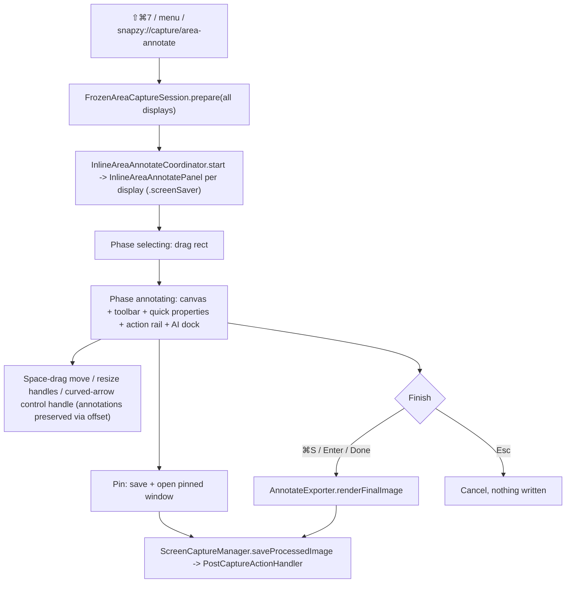

# Annotate Editor & Capture Markup

Snapzy's annotation subsystem: the full Annotate editor window (hybrid AppKit shell + SwiftUI chrome + AppKit drawing canvas) and the inline area-annotate overlay (Capture Markup) that reuses the same engine before save. Both render final output through one exporter path.

## Architecture

- `Snapzy/Features/Annotate/AnnotateManager.swift` — singleton window registry; session cache keyed by `QuickAccessItem.id`; activation policy bump to `.regular` on open; `openAnnotation(for:)` (QA item) / `openAnnotation(url:sessionData:)` / `openEmptyAnnotation()`.
- `Snapzy/Features/Annotate/Managers/AnnotateWindowController.swift` — per-window controller, owns save/copy/close notifications.
- `Snapzy/Features/Annotate/Managers/AnnotateWindow.swift` — `NSWindow` subclass; intercepts ⌘+scroll zoom, trackpad magnify, Space key (pan mode via `annotateSpaceDown/Up` notifications), drag events; level floats while key (`activeEditorLevel`) and restores `restingLevel` on resign; pin sets resting level `.floating`. `AnnotateWindowEventRouter` scopes these input notifications (and cloud-upload actions) to the originating window, so each full editor keeps isolated viewport and UI state.
- `Snapzy/Features/Annotate/AnnotateState.swift` — central `ObservableObject` (~4.8k lines): annotations, tools, undo/redo, zoom/pan, canvas effects, crop, cutout, mockup, combine, cloud state.
- Layout (`AnnotateMainView`): `AnnotateToolbarView` → `AnnotateQuickPropertiesBar` → `HStack(AnnotateSidebarView 240pt | AnnotateCanvasView)` → `AnnotateBottomBarView`.
- Rendering: `DrawingCanvasNSView` (AppKit event container) + 7 stacked `CanvasLayerView`s composited by CoreAnimation — spotlight overlay → selection underlay → static-below → dragged → static-above → gesture preview → selection chrome. Static layers redraw only when invalidated (CA reuses their backing store), so per-frame cost is flat in annotation count and colors always render through the standard pipeline (no offscreen bitmap color management). Deterministic export via `AnnotateExporter.renderFinalImage` (mockup: `renderMockupFlatImage` off-main + `compositeMockupImage` on main — `ImageRenderer` is main-only).
- Gesture handling: drag/resize/draw gestures mutate gesture-local `AnnotationItem` copies (no `@Published` churn) and commit once on `mouseUp` via the regular `AnnotateState` update methods + one undo checkpoint; the manipulated item draws in the dragged layer between the static layers (exact z-order). Invalidation: content publishers (`$annotations`, `$sourceImage`, …) redraw all layers; selection changes and zoom redraw only the cheap selection layers. Full redraw path culls items outside the dirty rect.
- Render z-order (`renderOrdered` in `AnnotateAnnotationItem.swift`, shared by canvas + exporter + hit-testing): embedded images bottom → blur/redact → markup (shapes, arrows, text, counters, …) top. Stable within tiers; model array order unchanged, so blur never covers shapes in canvas or export.
- `AnnotateState.EditorMode`: `.annotate` (flat editing), `.mockup` (3D transforms), `.preview` (hides editing UI).

### Save-and-close ordering (perf)

⌘S/close-with-save is ordered so the Quick Access card reappears with an unblocked main thread:

1. `markAsSaved` + session cache + `state.makeRenderSnapshot()` — freezes every render input into a value-type `AnnotateRenderSnapshot` (warms lazy embedded-CGImage caches, pre-resolves main-bound wallpaper/blur images).
2. Instant anti-flash thumbnail: `cacheDisplay` of the canvas region (`DrawingCanvasNSView`, no toolbar/sidebar chrome) downscaled to 200px — set on the card immediately; the pin window is NOT updated with it.
3. `forceClose()` — window hidden + closed, card reappear commits.
4. `Task.detached`: off-main `renderFinalImage(snapshot:)` → off-main 200px downscale → main push of the authoritative thumbnail + pin full-res update + `markCloudStale` (guarded by a per-item save generation, last-save-wins) → `saveToFileOffMain` (encode off-main; scoped write + history on main) → sidecar persist off-main (`AnnotationSessionStore.persistOffMain`) → clipboard re-copy off-main (`ClipboardHelper.copyImageOffMain`, serialized).

The `.accessory` activation-policy revert is deferred to a later runloop turn (shared by Annotate/VideoEditor) so it never stalls the reappear. Signposts (`perf.signposts` default + Instruments `com.snapzy.perf`): `AnnotateReturn`, `instantThumbCapture`, `windowClose`, `render`, `thumbnailScale`. Perf evidence: `plans/260718-1956-quick-access-annotate-return-perf/reports/`.

## Tools & Shortcuts

`AnnotationToolType` (`Models/AnnotateAnnotationToolType.swift`) — 19 tools, single-key defaults, all rebindable via `AnnotateShortcutManager`:

| Tool | Key | Tool | Key | Tool | Key |
| --- | --- | --- | --- | --- | --- |
| selection | `v` | arrow | `a` | blur | `b` |
| crop | `c` | line | `l` | spotlight | `s` |
| cutOut | `x` | text | `t` | counter | `n` |
| rectangle | `r` | highlighter | `h` | watermark | `w` |
| filledRectangle | `f` | pencil | `p` | mockup | `m` |
| oval | `o` | measure | `u` | magnifier | `z` |
| stamp | `g` | | | | |

- `drawableTools` shared with inline overlay so surfaces stay in sync; `supportsQuickPropertiesBar` false for selection/crop/cutOut/mockup.
- While a drawing tool is active, clicking an existing annotation's edge (a shape's outline, an arrow or line, a text box, a counter) selects it without leaving the tool; the quick properties bar then edits that item, and dragging its edge or handles moves or resizes it. Drags that start anywhere else — including inside an existing shape, on the item just drawn (until it is clicked or otherwise selected), or in the margin outside the image — draw a new annotation. A click inside an opaque item (filled rectangle, blur, combined image) never selects what lies beneath it. Hold Option to always draw, even on a selected item's resize handle. Combined images are never selected by drawing tools.
- In the full annotation window, `⌘C` copies selected annotation items to the session-local editable clipboard, `⌘V` pastes independent items centered under the canvas cursor when available, and `⌘D` duplicates the selection (see Arrange below for `⌘]` / `⌘[` stacking order). Repeated pastes add a predictable 10pt diagonal offset; duplicated items use the same fixed offset (all clamped to the editable canvas when possible). Each operation is one annotation undo/redo checkpoint. Text editors and input fields keep native copy/paste behavior, and the inline overlay keeps `⌘C` for copying the rendered image.
- Annotate sessions — both the inline screenshot overlay and full editor windows (`AnnotateWindowController`) — start with `annotate.defaultTool` (selection by default). When `annotate.rememberLastTool` is enabled, explicit toolbar or keyboard tool choices on either surface are stored in `annotate.lastUsedTool` and take precedence in the next session. Combine-mode activation and annotation-selection tool switches still force Selection and are never remembered.
- Quick properties bar (`AnnotateQuickPropertiesBar`): context controls — primary color, text background, blur type, arrow style/bend/heads, watermark text/style/opacity/rotation, annotation rotation angle, stroke width, font size, corner radius, line style, highlighter text snapping. Modes `hidden / toolDefaults / selectedItem`.
- Line style (`LineDashStyle` = solid / dashed / dotted): applies to rectangle, filledRectangle stroke, oval, line, and classic arrows (shaft dashed, heads stay solid; tapered/outlined arrows are filled silhouettes and don't qualify). Dash lengths scale with stroke width; dotted = zero-length segments + round caps. Persisted per tool and in session sidecars as optional `lineStyle` raw strings (default `.solid`, no schema bump).
- Hold Shift while drawing Rectangle, Filled Rectangle, or Oval to lock equal width and height; Line and Straight Arrow snap to 45-degree increments, while Curved Arrow remains unconstrained.
- "Sync tool defaults" pref (`annotate.quickPropertiesSyncEnabled`, default on): tool defaults (color, stroke width, font size, corner radius, watermark opacity/rotation) shared across compatible tools via `SharedAnnotationParameterDefaults` (`annotate.parameterDefaults.v1`) when nothing selected; per-tool defaults stay independent when off (`annotate.toolParameterDefaults.v1`). Selected-item numeric edits stay local; slider drags grouped into one undo checkpoint.
- Favorite colors capped at 4 per role (`AnnotateColorPaletteStore.maximumFavoriteColorCount`; custom colors cap 24).

## Arrows

- `ArrowGeometry` (`Models/AnnotateAnnotationItem.swift`): `ArrowStyle` = straight / curvedRight / curvedLeft; `ArrowType` = classic / tapered / outlined.
- Double-sided heads: `ArrowEndpointStyle` `startHead` / `endHead` (commit `b299bad`); applies to `.classic` — tapered/outlined bake the head into the body.
- Figma-style endpoint dragging for arrows + lines (commit `22766cb`).
- Curved arrows expose an external Bezier control-point handle while a single arrow is selected with the Selection tool. Dashed guides connect the handle to both endpoints; dragging it changes curvature without moving endpoints, clamps to the active drawing bounds, and synchronizes `curvedLeft` / `curvedRight` when it crosses the endpoint chord. Endpoint drags preserve the curve's normalized shape, straight arrows expose no control handle, and the existing persisted `controlPoint` field requires no schema migration.

## Blur / Pixelate

- `BlurType` — 8 effects: pixelated, gaussian, hexagonal, crystallized, pointillism, halftone, tape, washi.
- `AnnotateBlurEffectRenderer` — CoreImage/Metal rendering with quality tiers.
- `AnnotateBlurCacheManager` — non-blocking preview cache: miss draws lightweight placeholder, background work coalesced per annotation. Budgets: 1.6 MP per blur (`maxCachedPixelsPerBlur = 1_600_000`), 8 MP total (`maxTotalCachedPixels = 8_000_000`). Save/copy/share/export bypass the cache and render deterministically through `AnnotateExporter`.

## Spotlight

- `AnnotateSpotlightCompositor` — dim-with-holes compositing via transparency layers + clear blend mode; overlapping regions union. Each spotlight can optionally draw a rectangle-style border using its stroke color, width, corner radius, and line style; the border is transparent by default and stays below regular annotations. Choosing `None` is a Spotlight-local opt-out, even when shared tool defaults are enabled.
- Single global dim opacity clamped 0.1–0.9 (default 0.5), sourced from first committed region.

## Counter, Highlighter, Watermark, Crop

- Counter: click to place a numbered badge; drag to place the badge at the start and an attached straight tapered arrow pointing to the release point. Small pointer movements and targets inside the badge remain plain counters. Live preview matches export; hold Shift to snap the pointer to 45° increments. The quick properties bar shows a localized click/drag hint when space permits, with the same hint available on its context icon.
- Badge and pointer are one annotation: selection, movement, delete, undo/redo, copy/paste, color, rotation, and session restore apply together. With Selection active, drag the round arrow-tip handle to re-aim it; release inside the badge to remove the pointer. Corner handles and the Size control resize the badge while keeping the target fixed. Numbering remains max existing value + 1; copies retain their number. Diameter derives from stroke width. Plain counters from older session sidecars remain compatible.
- Highlighter: freehand with auto-straighten for near-straight strokes.
- Highlighter text snapping: while dragging, the stroke snaps to detected text lines — centered on each line, height `1.15 ×` the median detected line height of the drag (uniform across a multi-line sweep, carried by `strokeWidth` since highlights render at 3× stroke width), ends snapped to word edges. A drag across several lines of one block emits one bar per line with text-selection semantics in a single undo step. `AnnotateTextSnapDetector` (one Vision pass per image, computed when the highlighter is first activated, cached on `AnnotateState.textLineProfile`) feeds the pure math in `AnnotateTextSnapping`. Toggle in the highlighter's quick-properties bar (defaults context only — a committed highlight's geometry is fixed) or Settings → Annotate (`annotate.highlighterTextSnappingEnabled`, default on); hold ⌘ mid-drag to bypass. Falls back to freehand when no text is near the drag, the drag is vertical/short, or the path leaves the text band.
- Watermark: `WatermarkStyle` single / diagonal / tiled; editable text, opacity, size, rotation, color.
- Crop: shrink AND expand canvas (drag handles outside source creates annotatable empty canvas, included in export). See also auto-expanding canvas below. `CropAspectRatio` presets Free/1:1/4:3/3:2/16:9/21:9 + portrait toggle. Esc cancels, Return/⌘S commits; while cropping, `CropToolbarView` replaces the bottom-bar right side.
- Auto-expanding canvas (#492, Settings → Annotate → Expand Canvas Automatically, `annotate.autoExpandCanvasEnabled`, default on; config `[annotate] auto_expand_canvas`; open editors follow the toggle live): drawing, moving, resizing or nudging an annotation past the image (or applied crop) edge grows the canvas to fit it instead of clamping; moving it back in shrinks the canvas again. The new area is transparent, like a crop expanded past the image; Background styles pad around the grown canvas; save/copy/drag/upload/mockup export it (`makeRenderSnapshot` passes `appliedCanvasRect` as the snapshot's crop).
  - Model (`AnnotateState`): `baseCanvasRect` (`cropRect ?? sourceImageBounds`) ∪ `canvasFootprint` of every annotation that counts → `autoExpandedCanvasRect` (derived, so undo/redo and shrink-back need no extra state). `appliedCanvasRect` = live gesture canvas ?? grown canvas ?? crop; `activeAnnotationBounds` returns it outside crop editing, so paste/duplicate/AI placement land anywhere on the grown canvas (they stay clamped to it and never push it out).
  - Crop wins until an item is touched: `applyCrop` (and the cutout auto-crop) records every item's footprint in `cropBaselineFootprints`; an item still at its baseline footprint was cut by the crop and does not grow the canvas. Moving, resizing or restyling it makes it count again; undoing back to its crop-time geometry makes it stop. Rotate/flip/cut-out re-record the baseline for still-cut items (and image-transform undo restores it). Persisted in the sidecar (`cropBaselineFootprints`, UUID-string keys); sidecars without it treat every item as cut so old sessions never change size.
  - Entering Crop starts from the grown canvas (Return keeps it, Esc restores it, handles or `A` auto-crop tighten it).
  - Gestures reuse the Combine machinery (`beginCanvasGesture` / `updateLiveCanvas` / `endCanvasGesture`): the pointer is not clamped while drawing, dragging or resizing (except Cut Out, Measure and Translate Area), the live canvas grows to the gesture-local items or the in-progress drawing (built with `AnnotationFactory`), `AnnotateCanvasView` keeps the fit scale from `canvasFitBounds` and offsets so the pre-gesture area stays put (accounting for aspect-ratio padding and image alignment); release re-fits. Shift-constrained drawing uses unbounded constraint bounds.
  - Not in Capture Markup (`allowsCanvasAutoExpand = false`) or Combine mode (which always grows its own way).
- Crop edge snapping: while dragging resize handles in Free mode, edges snap to detected content borders (`CropContentAnalyzer` edge profile, computed once per image on crop entry). Toggle in `CropToolbarView` or Settings → Annotate (`annotate.cropSnapToEdgesEnabled`, default on); hold ⌘ mid-drag to temporarily bypass. Snapping skips fixed-aspect/Shift-locked resizes and body moves.
- Crop auto-crop to content: `A` (or the toolbar button) tightens the current crop rect to detected content borders; falls back to Vision subject-mask bounds on macOS 14+ when edge analysis finds nothing (`ForegroundCutoutService.extractForegroundResult` reuse). Toasts when nothing is detected; Esc still restores the pre-crop rect. A crop rect expanded beyond the source image tightens to the image bounds on the out-of-bounds side(s).

## Measure

- Tool `.measure` (`u`, icon `ruler`), in `drawableTools` so it is also in inline ⇧⌘7. Same engine and gestures as Screen Ruler (`SnapzyMeasureCore`): **hover** previews the span around the pointer, **click** pins it, **drag** measures a box that snaps to the content inside (hold ⌘ for the raw box). Click-to-place (`requiresDragToCreateAnnotation` false); measurements under 4 screen points of travel are clicks.
- Pixels: `AnnotateState.prepareMeasureMapperIfNeeded()` rasterizes `effectiveSourceImage` off-main into a `MeasureRaster` when the tool is selected (identity-guarded like the text-line profile) and `releaseMeasureMapper()` drops it on tool switch or image change (~59 MB at 5K). `AnnotateMeasureMapper` maps image points (bottom-left) ↔ raster pixels (top-left). Only source pixels are measured: other annotations and combined images are not in the raster.
- Item: `AnnotationType.measurement(MeasureGeometry)` (`Models/AnnotateMeasureGeometry.swift`). The measured extent is the item's `bounds`; a span adds `origin` (where its lines cross) and `axis` (zero-thickness bounds on an unmeasured axis). `pixelScale` (source px/pt at measuring time) and `unit` make the label (`label(for:)`) independent of later crops and of the export path. Spans move but never resize (a pinned value stays true); boxes resize and their label follows. Rotation moves the origin and swaps axis/scale; flip moves the origin only; cut-out moves the item as one piece.
- Drawing: `AnnotateMeasureRenderer` (from `AnnotationRenderer.draw`, so canvas, preview and every export match): lines with end ticks or a lightly filled box, plus a dark label capsule below-right of the span origin or under the box. Hit testing covers lines, the box edge and the label.
- Quick properties bar: color, **Axis** (both / width / height; tool defaults only) and **Unit** (pt / px; converts selected measurements in one undo step), plus a gesture hint. Prefs `annotate.measureUnit`, `annotate.measureAxis` (TOML `measure_unit`, `measure_axis`); edge tolerance is shared with Screen Ruler (`screenRuler.edgeTolerance`).

## Magnifier (Loupe)

- Tool `.magnifier` (`z`, icon `plus.magnifyingglass`), in `drawableTools` so it is also in inline ⇧⌘7. Gestures follow common screenshot tools (`MagnifierGeometry.creation`): a **click** (under 4 screen points of travel) drops a default-size lens right over the spot, like an in-place loupe (`defaultLensSize`, 72–220 pt, nudged inside the canvas); a **drag** draws the area to magnify (squared for the circle shape) and the lens appears beside it, showing exactly that area. The lens is the area × the style's zoom, with the zoom lowered (not below 1.5×) when the lens would pass 60% of the canvas's short side and raised (not above 8×) when it would be under 72 pt. `calloutLensBounds` tries right / left / above / below, roomiest side first, 24 pt from the area, slid inside the canvas and never overlapping the area; if no side fits it centers on the area. While the tool is idle a faint lens (70% opacity) follows the pointer, showing what a click would place.
- Item: `AnnotationType.magnifier(MagnifierGeometry)` (`Models/AnnotateMagnifierGeometry.swift`). `bounds` is the lens; the geometry stores `sourceCenter` (image points), `zoom` (1.5–8×) and the style (`MagnifierStyle`: shape circle / rounded rect, connector, shadow). The source area is always lens size ÷ zoom around `sourceCenter`, so resizing the lens keeps the zoom and changes how much it shows. Border = the item's stroke color and width.
- Editing: dragging the lens moves only the lens (`applyingResizeBounds`); the round grip at the source center (`ResizeHandle.magnifierSource`, single selection) moves only the source, with a dashed source outline as selection chrome. Rigid moves (`translatedBy`: paste/duplicate offsets, arrow-key nudges, inline selection moves, export offsets) carry both.
- Rendering: `AnnotateMagnifierRenderer` (from `AnnotationRenderer.draw`, so canvas, live preview and every export match). It samples the current source image at draw time — no cached copy — then clips to the lens and draws the source ×zoom (nearest-neighbour from 3×, smooth below), then the border. Connector on: the source gets an outline and a callout cone joins it to the lens: the two outer bridge edges of the convex hull of both outlines (`MagnifierGeometry.calloutCone`), stroked, with a 14% fill of the border color that skips the source area so the called-out pixels stay untinted. When the cone cannot be built (shapes overlap too much) a single center line is drawn; nothing is drawn while the lens covers the source center. Shadow on: an opaque fill under the content casts it. `renderBounds` includes shadow and source outline. Only source pixels are magnified (other annotations and combined images are not), like Measure.
- Export: annotations are shifted by the crop origin and padding, so `AnnotationRenderer.sourceImageOrigin` tells the magnifier where the source image sits in the export context (`(0,0)` on the canvas).
- Image transforms: crop changes no coordinates (the source still samples the full image, even outside the crop). Rotate 90° turns the source center with `AnnotateImageRotation.rotatePoint` (the lens bounds rotate like other boxes); flip mirrors it; Cut Out moves the lens with its half and the source with the pixels under it (`shiftPoint`). Undo goes through the normal image-transform snapshot.
- Zoom while editing: with magnifiers selected, the scroll wheel over a selected lens (`AnnotateWindow`, mouse notch = one step, trackpad every 24 pt, momentum ignored) and `+` / `−` (`=` / `-`, keypad too; canvas `keyDown`) step each selected lens to the next zoom preset (`steppedZoom`) as one undo step. A selected lens shows a blue `2×` pill inside its bottom edge (selection chrome, never exported).
- Quick properties bar: border color and width, **Zoom** menu (1.5, 2, 3, 4, 6, 8×), **Shape**, **Shadow** and **Connector** toggles, plus a gesture hint. With magnifiers selected the controls restyle them as one undo step; otherwise they set the style for new lenses, persisted as JSON in `annotate.magnifierStyle`.
- Sidecar: kind `magnifier` with `PersistedMagnifierGeometry` (`sourceCenter`, `zoom`, optional `shape`, `showsConnector`, `showsShadow`); schemaVersion stays 1. Builds before the Magnifier skip the item (unknown kind) and load the rest.

## Stamp

- Tool `.stamp` (`g`, icon `face.smiling`), in `drawableTools` so it is also in inline ⇧⌘7. **Click** places the current stamp at the default size, centered on the click; **drag** sizes it (content fit into the dragged box, pinned to the corner the drag started from). Clicking an existing stamp selects it (like Counter); hold Option to place on top of one.
- Item: `AnnotationType.stamp(StampAnnotation)` (`Models/AnnotateStamp.swift`): `content` = `.sticker(StampSticker)` | `.emoji(String)` | `.image(StampImage)` plus `isStickerStyle`. Size lives in `bounds` (content aspect-fit inside, so a free resize never distorts it), opacity in `properties.opacity`, rotation in `rotationDegrees` (rotatable like shapes). Moves, resizes, rotates, copies/pastes, duplicates, undoes and arranges like other markup.
- Stickers: 14 text badges (APPROVED, REJECTED, LGTM, DONE, TODO, WIP, BLOCKED, BUG, FIXED, NEW, BETA, HOT, NOTE, FYI) and 13 round icon stickers (thumbs up, heart, star, check, cross, warning, question, idea, pin, smile, eyes, party, fire), all vector and deliberately flat: one solid fill from `StampPalette` (no gradient, gloss or inner highlight), SF Symbol + SF Pro Rounded heavy label, white on color (dark brown on yellow). Badge labels stay English on purpose (shared reviewer vocabulary; a placed stamp renders the same everywhere); names/tooltips are localized. Raw ids are persisted — never rename one.
- Image stamps: any image file (NSOpenPanel), rasterized to ≤1024 px PNG with alpha (`AnnotateStampStore.makeStampImage`). The bytes travel inside the item (copy/paste, undo, sidecar), not the embedded-image asset store, so rotate/flip/cut-out treat it like any rotatable item.
- Rendering (`Services/AnnotateStampRenderer.swift`, from `AnnotationRenderer.draw`, so canvas, drag preview and every export match): one transparency layer with the item opacity. Sticker style adds a white die-cut outline (vector stroke for badges; the content silhouette stamped in a ring for emoji and images) and a hard drop shadow (no blur) whose offset is scaled by the CTM, so zoom and export resolution do not change it. Emoji, symbols and decoded images are rasterized at device pixel size in power-of-two buckets (32–1024 px) and cached in a thread-safe `NSCache` (`StampRasterCache`). `renderBounds` grows by the shadow overhang for redraw and crop culling.
- Picker (`Components/AnnotateStampPicker.swift`): quick properties bar (full editor and inline overlay) shows the current stamp button → popover with **Stickers** (Recent, Badges, Icons), **Emoji** (search by Unicode name, Recent, Popular, All — every single-codepoint emoji the system emoji font can draw, `AnnotateEmojiCatalog`) and **Image** (Choose Image…). Next to it: Size (long side, 24–480 pt), Opacity (20–100%) and a Sticker toggle (outline + shadow). With stamps selected the controls edit them (each slider drag is one undo step); with nothing selected they set tool defaults. While the Stamp tool is active they do both, and picking a stamp only changes what the next click places, so the auto-selected stamp just placed is never swapped. Under the Selection tool, picking a stamp swaps the selected stamps' content, keeping center and size. A free resize snaps the box to the content aspect, anchored on the edges that did not move.
- Tool defaults are app-wide (`AnnotateStampStore.shared`, UserDefaults `annotate.stamp.current|recents|size|opacity|stickerStyle`); recents keep the last 16 stickers/emoji. Image stamps are never stored in preferences.

## Cut Out (Remove / Add a Strip)

Toolbar `scissors` button or `x` (`Services/AnnotateCutOutTransform.swift`, pure). From issue #653: remove a full-crossing horizontal band (image shrinks vertically) or vertical band (shrinks horizontally) and join the halves — Snagit Cut Out parity.

- Orientation (`cutOutToolbar` H/V toggles) + mode (`cutOutToolbar` −/+: remove/insert). Drag across the canvas draws a full-crossing strip (drag's cross-axis span is discarded, extents forced); dimmed strip + `−N px` badge preview; Enter / toolbar Cut commits, Esc restores the previous tool. Mode stays active so several gaps can be cut in sequence (batch tall-page workflow).
- Commit builds a new `sourceImage` (and background-cutout overlay when applied) through one CGContext pass, integral-pixel slices so no seams; insert mode leaves the strip transparent (PNG alpha) exactly like crop-expansion. Retina point-size contract preserved.
- Annotations follow: point-based types (arrows, lines, paths, highlights) shift per point so geometry reconstructs across the band; bounds-based shapes (rectangles, ovals, blur, spotlight, text, counters, embedded images) follow the majority-of-area half, and crossing shapes stay whole (predictable, no data loss — effectively Snagit's semantics). `cropRect`, `originalCropRect`, `cutoutAutoAppliedCropRect` follow the same rule.
- One undo per commit via the image-transform snapshot (same entry as rotation); committed cuts bake into the saved file, so there is no sidecar schema change (schema v1).
- Known limits: shapes crossing the band are translated, not split; embedded-image bitmaps translate without being cut; and the inline area-annotate overlay does not include the tool (same deliberate exclusion as crop).

## Annotation Rotation

- Rotatable types (`AnnotationType.supportsRotation`): text, embedded image, rectangle, filled rectangle, oval, stamp. Each turns rigidly around its bounds center. Arrows, lines and strokes already set their own direction; blur, spotlight and counter stay axis-aligned. Watermark keeps its own ±45° rotation.
- Stored in the existing `AnnotationProperties.rotationDegrees` with no schema change. `AnnotationType.clampedRotationDegrees` wraps rotatable types into -180…180° and keeps the ±45° clamp for everything else. Older sidecars load at 0°.
- Rendering, hit-testing, edge bands and occlusion map through `AnnotationItem.rotationTransform`, drawing or testing the item's unrotated local frame (`unrotatedLocalItem`). `selectionBounds` is the axis-aligned box around the rotated shape. Export uses the same renderer.
- Rotation handle: shown only for a single selected item (`AnnotateState.canUserRotate`). It is a round grip 22 screen points beyond the middle of the local top edge, joined to the frame by a stem.
  - Dragging rotates by the pointer's angular delta around the center. Shift snaps to 15°; without Shift, angles within 3° of 0/±90/180° snap to them (`AnnotationRotationGesture`).
  - A degree label follows the pointer. Double-clicking the grip resets to 0°. Each drag is one undo checkpoint.
- The selection frame and corner handles turn with the item. Resizing runs in the unrotated frame and then shifts the bounds so the opposite corner stays fixed on screen. Shift keeps its aspect lock in that frame.
- Quick properties bar angle field (whole degrees): shown when the selection holds a rotatable item, including a lone embedded image. Mixed angles show "—". A committed value applies to rotatable items only, as one undo step.
- Text edits in the overlay at 0° and rotates again after commit. A callout's tail tip stays pinned to its target while the bubble rotates.
- Combine images are the canvas layout and never rotate. Rotating the image 90° keeps rectangles, ovals and embedded images correct at any angle; text stays upright. Flipping the image negates each rotatable item's angle (a mirror reverses the turn); watermarks keep their tilt.

## Undo/Redo

- `UndoEntry` = `.annotations(AnnotationSnapshot)` | `.imageTransform(ImageTransformSnapshot)` — image-transform undo (90° rotation, flip + cut-out strips) never disturbs the annotation path.
- Annotation snapshots include selection and embedded-layer metadata so object paste/duplicate undo is atomic and redo reselects the newly created items.
- Text-edit commits as one transaction; quick-properties slider gestures scoped to a single checkpoint (`quickPropertiesGestureUndoSnapshot`).

## Zoom & Pan

- Range 0.25–16x: `minimumZoomLevel 0.25`, default max 4.0, `hardMaximumZoomLevel 16.0`; `effectiveMaximumZoomLevel` grows to `1/fitScale` for very long captures.
- Input: pinch magnification, ⌘+scroll, Space+drag pan, ⌘=/⌘−/⌘0 (fit); zoom picker presets + `1:1` actual-pixels in bottom bar.
- Selection chrome is editor-only: resize/end-point grips stay 8pt, selection outlines stay 1pt with 4pt dashes, and freehand halos stay 4pt in screen space. Image-space draw geometry compensates for both fit scale and zoom while AppKit hit testing uses the matching canvas-local conversion; Retina backing density requires no separate multiplier.
- Annotation geometry remains in document/image coordinates. The fit-sized `DrawingCanvasNSView` is rendered through an outer SwiftUI zoom/pan transform; because that transform changes visual bounds without expanding the representable's AppKit hit frame, `CanvasInteractionProxy` covers the viewport and forwards only points within the canvas' transformed visual bounds (with a registered native inline text editor taking priority). The drawing view's normal AppKit conversion then inverts that transform before image-coordinate conversion applies the fit scale and canvas origin. Dynamic annotation hit tolerances and drag-to-create thresholds are derived from the combined fit scale × zoom scale, keeping lines, arrows, paths, handles, and small gestures visually aligned at every zoom level. Selection uses the canvas hit result directly instead of re-running the model's fixed image-space tolerance.
- Full-editor AppKit input is delivered through the per-window `AnnotateWindowEventRouter`; zoom, pan, and Space transitions update only the `AnnotateState` owned by the originating window. Session edits, viewport metrics, and undo state remain controller-local; shared shortcut, palette, and preset stores are preferences, not editor state.

## Backgrounds & Mockups

- `BackgroundStyle` (`Models/AnnotateBackgroundStyle.swift`): none / gradient (8 `GradientPreset`s) / wallpaper(URL) / blurred(URL) / solidColor. `BlurredBackgroundEffect`: soft / frosted / vivid / dim.
- `SystemWallpaperManager` (`Services/Wallpaper/`) — 12 bundled JPG wallpapers + custom wallpaper security-scoped bookmarks; thumbnail cache.
- Aspect ratio (`AspectRatioOption`: Auto/Free/1:1/4:3/3:2/16:9) + orientation toggle + 9-way `ImageAlignment`.
- Mockup mode: integrated 3D tilt — rotation X/Y/Z, perspective, shadow — via `AnnotateMockupTransformModifier` + `AnnotateMockup3DRenderer`; 8 `MockupPreset`s in `DefaultPresets.all` (flat, leftTilt, rightTilt, topView, isometricLeft, isometricRight, heroShot, dramatic); inline preset bar `MockupPresetBarInline`.
- Standalone `MockupManager` window (`Managers/AnnotateMockupManager.swift`) has no remaining callers — orphaned; mockup UX lives in editor mode.

## Remove Background (Cutout)

- Toolbar button, macOS 14+; `ForegroundCutoutService` (`Services/Media/`) runs Vision `VNGenerateForegroundInstanceMaskRequest`.
- Non-destructive overlay: original kept, cutout composited through `effectiveSourceImage`; revert restores original.
- Crop-aware auto-crop: `ForegroundAutoCropPolicy` heuristics → `ForegroundAutoCropDecision` enum; auto-crop applied only when `.suggested` and pref on; applied rect tracked (`cutoutAutoAppliedCropRect`) for exact revert on toggle-off.
- Global pref `backgroundCutout.autoCropEnabled` (default true), shared with capture-time cutout flow.

## Auto Sensitive-Data Redaction

- `AnnotateSensitiveRedactionService` — 100% on-device: Vision OCR → `AnnotateSensitiveDataDetector` deterministic matching. Detects emails/phone numbers/URLs (NSDataDetector), credit cards (Luhn + issuer prefixes + contextual multi-line parsing for number/expiry/cardholder rows), credential key=value pairs, Bearer/AWS/GitHub/Slack/Stripe/OpenAI/JWT tokens.
- Creates editable pixelated blur annotations in one undo checkpoint; recognized text never persisted; pixels bake only at export.
- Triggered from the blur tool's quick-properties bar; action shortcut `.autoRedactSensitiveData` ships unbound (`AnnotateShortcutManager`).
- **Faces / People** (`AnnotateVisualRedactionTarget`): `detectVisualRegions(in:target:)` runs on-device Vision — `VNDetectFaceRectanglesRequest` for faces, `VNDetectHumanRectanglesRequest` for people (`upperBodyOnly = false` on macOS 12+, so full-body boxes). `visualRegions(fromVisionBoundingBoxes:target:imageSize:)` converts boxes straight to annotate space (`VisionImageGeometry.annotateRect`, no flip), pads them (faces get extra room above, since Vision's face box stops at the brow), clamps them to the image, and drops tiny boxes. Each detection becomes one blur item of the current blur type; all go through `applySensitiveRedactionRegions`, so one scan is one undo checkpoint. A toast reports "No faces/people found." when Vision returns nothing.
- Entry points: the blur tool's Auto Redact group has three buttons (sensitive data, faces, people) in the full editor's quick-properties bar (`QuickAutoRedactControl`) and in the inline ⇧⌘7 properties bar (`InlineAreaAutoRedactControl`). They are plain buttons, not a menu, because the inline panel sits at `.screenSaver` level. All three scans share `AnnotateState.runAutoRedactionScan` (one scan at a time, cancelled when the base image changes).
- Coordinates: the analysis (row grouping, "cardholder below the card number" heuristics) runs in top-left image space; `annotateRegions(fromTopLeftRegions:imageSize:)` flips the final regions once into annotate space (bottom-left origin, like `AnnotationItem.bounds` and the blur renderer). Vision box conversions go through `VisionImageGeometry` (`Services/Media/OCR/`). Vision reads with the user's OCR language (`VisionOCRProfile.resolve`), like Capture Text.

## Auto Translate

- Entry: AI dock (`AnnotateAIDockView`) floating at the canvas bottom center, under the status pill. At rest a Liquid Glass orb with the multi-hue AI glyph (`TranslationCardMotion.rimHues`; hues turn and glow while a run is in flight). Click expands the glass horizontally into a toolbar: Translate (whole image, `.autoTranslate`, default ⌘⇧T), Area (`.translateArea`, default ⌥⌘T), target language menu, ⋯ options (current engine, Translation Settings…, Include Translations in Export, Remove Translations; Cancel while running). Each AI feature is its own section after the orb; the first is **Ask** (natural-language prompt, ⌘K) — see [AI.md](AI.md). Both shortcuts are dispatched by `AnnotateWindow.performKeyEquivalent`. Esc cancels a run or leaves Translate Area. Annotate mode only (not Combine/Mockup/Preview, not while cropping or cutting out).
- Translate Area: `beginTranslateAreaSelection()` makes the next canvas drag pick the area (`AnnotateCanvasDrawingView` hands press/drag/release to `updateTranslateAreaDrag` / `finishTranslateAreaDrag` before any tool routing; crosshair cursor). `AnnotateTranslateAreaSelectionView` dims the image with the area cut out, rim light and size badge; the pill says what to do and offers Whole Image / Cancel. A click (area under 8 pt) keeps waiting; choosing a tool or Esc leaves the mode. The run OCRs only the selected pixels (`AnnotateAutoTranslateLayout.regionCrop`), maps boxes back with the area's origin and samples styles from the full image. The loading overlay focuses the area (darker outside, sweep and rim inside). An area run replaces only translations that overlap the area; "Translate with <endpoint>" retries the same area.
- Settings are Snip to Translate's (`TranslationEngineResolver`, `translate.targetLanguage`; when no target is stored the app language is used, else English). Same privacy rule: no automatic Apple → endpoint fallback; a failed Apple run offers "Translate with <endpoint>" for that run only.
- Detection always runs Vision: custom OCR endpoints return no geometry. `OCRService.recognizeLayout` inherits the OCR language, profiles and contrast recovery, and skips the vertical-CJK pass (its normalized image has different geometry). `OCRTextLayoutFormatter.blocks(_:)` groups lines into positioned blocks without joining across columns or far-apart labels on one row; `format(_:)` is unchanged.
- `AnnotateAutoTranslateLayout` maps blocks to annotate space (`VisionImageGeometry`), pads them into cover rects, skips symbols/numbers, links and long text already in the target language, and detects alignment. `AnnotateTranslationStyleSampler` samples the background (median of a ring around the block), text color (farthest ink from it; falls back to black/white below 3:1 contrast), cover style (`.frosted` on noisy backgrounds) and weight.
- Translation: Apple → `AppleBlockTranslator` (one batch, `clientIdentifier` = block index) through a hidden `.translationTask` host on `AnnotateMainView` (`AnnotateAppleTranslationHost`); endpoint → `RemoteBlockTranslator` (JSON `{"items":[{"id","text"}]}` in and out, ≤40 blocks per call, results mapped back by id).
- Result: `.translation(TranslatedTextBlock)` annotations (source + translated text, languages, cover, alignment, bold, `baseFontSize`, `isFontSizeManual`, `groupID`); `strokeColor` = text, `fillColor` = cover. `AnnotateTranslationTextLayout.fit` picks the largest size in [0.6×, 1×] of the source size that wraps inside the box, growing the box downward by up to 50% if needed. One undo step; a whole-image run replaces earlier translations.
- Interaction: select, move (cover moves with it; the source text shows again underneath), resize (text refits unless the size was set by hand), delete, duplicate, arrange like other items. Double-click or the quick-properties pencil opens an editor (translation editable, original read-only). Quick properties: text/cover color, cover style, size −/+, bold, alignment, Fit Text. Hold ⌥ (no mouse button down) or press-and-hold "Show Original" in the result pill to hide translations temporarily.
- Export: "Include Translations in Export" (default on, per session, persisted as `excludesTranslationsFromExport`). `makeRenderSnapshot()` drops `.translation` items when off, which covers save, copy, drag-to-app, cloud upload and mockup export; the canvas keeps them.
- Motion (`AnnotateAutoTranslateOverlayView`, one `Canvas` per frame, same vocabulary as the Snip to Translate card): reading = veil + light band sweeping across the image; blocks light up in reading order with a turning multi-hue rim; translating = source dimmed under a half cover with light sweeping inside each block; resolving = covers settle and each translation resolves blur → sharp, staggered, then the annotations take over at the same frames. A status pill under the canvas shows progress (Esc to cancel), then the result (Show Original, Undo) or the error with its action. Reduce Motion: fades only.

## Extract Text

In the normal Annotate mode, right-click the underlying image and choose **Extract Text**.
Snapzy runs the configured OCR provider from Capture → OCR, copies the recognized text to
the general pasteboard, and reports the result through the existing OCR notification/toast
flow. The action does not modify annotations, crop state, or saved files. It is disabled in
Combine, Mockup, and Preview modes because those modes do not identify one unambiguous OCR
source image.

## Combine Images

- `CombineImagesCoordinator` (`Features/Annotate/CombineImagesCoordinator.swift`) — picker entry from status bar menu or `snapzy://open/combine?file=...`; requires ≥2 images.
- One model, like other screenshot editors: an image is placed once (beside an edge, or where dropped), then it is a free embedded-image layer that only moves when the user moves it. No mode picker; the sidebar keeps only Image Gap. `combineMode` is always `.freeCanvas` (the enum stays for reading old sidecars).
- Drop placement: `CombineDropResolver` maps a canvas point to `.stitch(anchor, edge)` (within 22% of an image edge, or anywhere outside the images → nearest image, side by position) or `.overlay(at:)` (deeper inside an image). Anchors are the base image plus every embedded image (`combineImageLayerRects`). A drop on a single image starts combine mode. External drops go through `AnnotateCanvasDropDelegate`; multi-file drops chain in provider order, each on the same side of the previous image (the batch extends outward).
- `AnnotateState.besideBounds` sizes and places an edge drop: matched to the anchor's height (left/right) or width (top/bottom), never upscaled, top-/left-aligned with it, one Image Gap away, and pushed further out past any image already on that side. `.overlay` drops float centred on the pointer, fitted to half the host image (`overlayBounds`). Images added without a position (Combine picker, paste, menu import) use the same rule as a right-edge drop on the rightmost image. Canvas space is y-up (visual top = maxY).
- `AnnotateState.combineDropPreview` drives the drop preview: the target image tinted, plus an insertion line on the edge the image will sit against (gap and push-past included; size estimated from the anchor since the file's size is unknown until it drops).
- Dragging an image moves it freely; a single dragged image snaps to neighbouring image edges at Image Gap (`CombineSnapping`). Changing Image Gap affects later drops and snapping only; placed images stay put.
- Canvas hugs its content: `combineContentBounds` is the union of the base image, every embedded image frame, and each markup item's visible footprint (`canvasFootprint`: geometry + half stroke, arrowhead, callout tail, measure label), recomputed on every `annotations` change. Moving, resizing or nudging a layer past the edge grows the canvas; moving it back in shrinks it. Export uses the same bounds.
- Live growth during a gesture: `beginCanvasGesture` freezes the bounds (`frozenCanvasBounds`, also the fit-scale source `canvasFitBounds`); while dragging/resizing, pointer input is unclamped and `liveCanvasBounds` grows to the gesture-local layers. `AnnotateCanvasView` keeps the fit scale and offsets the canvas so the pre-gesture area stays put on screen; release re-fits.
- Session persisted as `PersistedCombineSession` inside the sidecar manifest. New saves write `freeCanvas` with per-image free bounds. Sidecars saved with `autoStitch` (stitch rows, overlay ids, `layoutRevision`; missing `layoutRevision` = legacy upward vertical strips) are laid out once on restore by the old justified-rows engine (`CombineImagesLayout`) and then migrated to free layers in the same positions (`migrateAutoStitchToFreeLayers`).

## Arrange (z-order)

- Right-click (selects the layer under the pointer) → Arrange, or `⌘]` Bring Forward, `⌘[` Send Backward, `⌥⌘]` Bring to Front, `⌥⌘[` Send to Back (key codes, layout-independent; handled in `AnnotateWindow.performKeyEquivalent`).
- The canvas always paints images, then blurs, then markup (`renderOrdered`), so Arrange reorders within each tier. Every combined image is a free layer and can be reordered among images.
- Forward/Backward step past the next layer that actually overlaps the selection, so each press is visible; a no-op is reported as unavailable (menu item disabled). One undo checkpoint per command.

## Session Sidecars

- `AnnotationSessionStore` root: `~/Library/Application Support/Snapzy/AnnotationSessions/<SHA256(normalizedPath)>/`.
- Package: `manifest.json` (`PersistedAnnotationSession`, schemaVersion 1, `PersistedFileSignature` = size + modifiedAt + extension) + `original.bin` + optional `cutout.png` + `assets/` (embedded images). Signature mismatch (replaced file at same path) → sidecar ignored, never restores annotations onto wrong pixels.
- The manifest also carries `sourceLogicalSize` — the authoring-time point-space size of the source image, i.e. the coordinate space annotations live in. Session restores apply it verbatim (`AnnotateWindowController.restoredSessionImage`), so native-density (1×) captures reopen with matching annotation positions on any display arrangement; sidecars written before the field existed fall back to the legacy main-screen scale heuristic. Optional key, schemaVersion stays 1.
- File opens without a sidecar (`AnnotateState.loadImageWithCorrectScale`) derive density from the file's own DPI metadata (`fileDensityScaleFactor`, DPI ÷ 72 — Snapzy writes `scale × 72` on save); only files without usable DPI (e.g. WebP) fall back to the legacy main-screen heuristic.
- `.translation` items persist as kind `translation` with `PersistedTranslatedTextBlock`; `excludesTranslationsFromExport` is an optional manifest key (schemaVersion stays 1).
- `.stamp` items persist as kind `stamp` with `PersistedStamp` (`content` = sticker/emoji/image, sticker id or emoji, inline base64 PNG + pixel size for image stamps, `isStickerStyle`). Builds before the Stamp tool skip these items; an unknown sticker id drops only that item.
- Unknown `type.kind` values (written by a newer Snapzy) decode as `.unknown` and the item is skipped, so the rest of the session still loads. Builds before Measure dropped the whole sidecar on an unknown kind, so sessions with measurements need this version or later.
- Commit-based writes only: save, save-and-close, copy&close, successful drag-to-app, cloud upload/re-upload, inline annotate finish, default-preset auto-apply. NO draft autosave; unsaved windows keep the normal unsaved-change prompt.
- Restore order: QuickAccess in-memory session cache → sidecar → flattened file.
- Cleanup paths: QA delete, Annotate delete-image, history delete, clear-history, retention sweep (incl. orphan sidecars), move-on-save (temp→export moves sidecar to new path hash).

## Drag-to-App

- `AnnotateDragHandleView` + `DragHandleNSView`: lazy `NSFilePromiseProvider` (`AnnotateDragFilePromiseProvider`) + guaranteed rendered file-URL fallback staged under `Captures/AnnotateDrag/` so file-url-only targets accept the first drag.
- `DragFallbackSignature` invalidates/renders the staged fallback when editor state changes.
- Completion policy: `annotate.closeAfterDrag` (default true — saves edits, dismisses QA card) and `annotate.bringForwardAfterDrag` (default false — reactivate preserved editor).

## Bottom Bar

- Left: quiet Liquid Glass zoom picker + mode segmented toggle (annotate/mockup/preview), both at
  the shared 28pt bottom-bar control height; the neutral active glass keeps focus on the canvas.
- Center: drag handle (compacts when tight).
- Right: new window, share (`NSSharingServicePicker`), cloud upload, pin (⌃⌘P), copy&close (⌘⇧C), delete (confirm; clears history record + sidecar + QA card, trashes file).
- Cloud button gated by `CloudManager.shared.isConfigured && QuickAccessActionConfigurationStore.shared.isEnabled(.uploadToCloud)`; ⌘U posts `annotateCloudUpload`; overwrite confirmation when item has a `cloudKey` and is stale. Note: commit `dd4ccd5` removed only the after-capture auto-upload preference — manual uploads here stay.
- Edits after upload mark item cloud-stale (`isCloudStale`) until re-upload clears it.

## Rotate, Flip & Canvas Presets

- Toolbar "Rotate & flip" menu (`rectangle.landscape.rotate`, `AnnotateImageTransformToolbarButton` pops a native `NSMenu` so the glyph matches `ToolbarButton` and shortcut hints show) (next to Cut Out; also in the canvas right-click menu, `AnnotateImageTransformMenuItems`): Rotate 90° left/right (`⌘L` / `⌘R`) and Flip horizontal/vertical (`⌃⌘H` / `⌃⌘V`, `AnnotateState.flipImage`); key codes, handled in `AnnotateWindow.performKeyEquivalent`, menu items only render the hints. Gated by `canRotateImage` (no crop/cut-out editing, no cutout request in flight).
- Both transform the source, cutout and embedded image bitmaps plus annotations, crop rects and auto-crop rect. Flip mirrors placement only: text and watermark glyphs stay readable; measure spans keep axis/scale; magnifier sources move with the pixels, so the lens shows the transformed image.
- Dedicated image-transform (`ImageTransformSnapshot`) undo entries, shared with the Cut Out tool.
- `AnnotateCanvasPresetStore` (`annotate.canvasPresets.v1`): background style, blur effect, spacing, shadow, corner radius, aspect ratio + orientation. One preset can be default (`annotate.defaultCanvasPresetId.v1`).
- Default preset auto-applies to new screenshots during post-capture via `ScreenshotPresetAutoApplier` — lightweight `AnnotateExporter.renderCanvasEffects` without constructing full `AnnotateState`, returns editable session data. Inline area annotate does NOT auto-apply.

## Inline Area Annotate (Capture Markup, ⇧⌘7)

Select region and annotate before saving, inside per-display overlays sharing one desktop coordinate space. Same engine/tools as the full editor minus crop and mockup.

### Inline shortcuts

| Key | Action | Key | Action |
| --- | --- | --- | --- |
| `Enter` / `⌘S` | Finish & save | `B` | Blur |
| `⌘C` | Copy rendered image | `S` | Spotlight |
| `Esc` | Cancel | `N` | Counter |
| `Space` (hold) | Move selection | `W` | Watermark |
| `V`/`R`/`F`/`O` | Selection / Rect / Filled / Oval | `P` | Pencil |
| `A`/`L`/`T`/`H` | Arrow / Line / Text / Highlighter | `U` / `Z` / `G` | Measure / Magnifier / Stamp |
| `⌘K` | Ask AI (prompt) | `⇧⌘T` / `⌥⌘T` | Auto Translate / Translate Area |
| `⌥` (hold) | Peek at text under translations | | |

`⌘K`, `⇧⌘T`, `⌥⌘T` are the Annotate action shortcuts (Settings → Shortcuts), so a rebinding applies here too. `Esc` unwinds one layer at a time: AI run → translation → area pick → prompt → dock tools → cancel the capture. `Enter`/`⌘S` do nothing while a run or translation works.

- `InlineAreaAnnotateSession` owns the selecting→annotating state machine; panels at `.screenSaver` level with `canJoinAllSpaces` work across Spaces.
- Move/resize refreshes the cropped source via `replaceSourceImagePreservingAnnotations(_:annotationOffset:)`; cross-display crops use `FrozenAreaCaptureSession.cropCompositeImage`.
- Chrome (`InlineAreaPanelChrome`): capsule panels on an in-window HUD blur with a specular hairline — a backdrop, not Liquid Glass, like the Annotate window's toolbar backdrop. The glass is on the controls: tools, undo/redo and the rail use the shared `ToolbarButton` (bare at rest, neutral glass on hover and on the selected tool; Done is accent-tinted glass), property pickers use `liquidGlassControl(activeGlassTint: nil)`, each row in a `liquidGlassGroup`. Do not put `.glassEffect` on the panels: glass on glass renders as a flat dark slab and drops the tint. Toolbar width is derived from its items (`InlineAreaLayout.toolbarPreferredWidth`).
- Action rail: Done (accent) / Copy / Pin-to-Screen / hairline / Cancel. Pin runs the normal post-capture pipeline once, then opens the saved image in a pin window.
- AI dock: the Annotate window's `AnnotateAIDockView` (Ask, Translate, Translate Area, language, options) with its result pills, plus the agent / Auto Translate / Translate Area overlays on the canvas. `InlineAreaControlGeometry` puts it on the side of the selection the toolbar does not use, or inside the selection (12 pt from the edge away from the toolbar) when there is no room outside. See [AI.md](AI.md).
- Apple's translation task is hosted on one panel only (`InlineAreaTranslationHost`, first display of the session).
- No crop, no mockup, no canvas-preset auto-apply, no canvas styling from the AI prompt.

## Related docs

- [CAPTURE.md](CAPTURE.md) — capture flows feeding the editors
- [SCROLLING_CAPTURE.md](SCROLLING_CAPTURE.md) — long captures (dynamic zoom max)
- [QUICK_ACCESS.md](QUICK_ACCESS.md) — card edit action, pin windows, session cache
- [HISTORY.md](HISTORY.md) — restore flow and sidecar lifecycle
- [POST_CAPTURE.md](POST_CAPTURE.md) — routing incl. preset auto-apply
- [CLOUD.md](CLOUD.md) — manual upload + stale/re-upload semantics
- [PREFERENCES.md](PREFERENCES.md) — Annotate settings keys
- [SHORTCUTS.md](SHORTCUTS.md) — global shortcut registry
- [LOCALIZATION.md](LOCALIZATION.md) — L10n ownership
