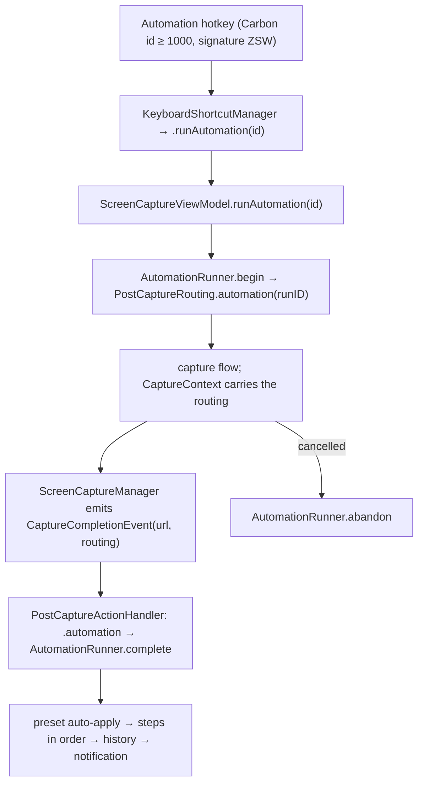

# Automations

An automation is a named capture pipeline: **trigger → source → ordered steps**. Milestone 1 (issue #675) ships keyboard-shortcut triggers, screenshot capture sources and five steps, with two built-in presets. The model is designed for later triggers (URL scheme, CLI, Shortcuts.app, Quick Access, after-capture default) and steps; see the roadmap in the issue thread.

## Concepts

| Part | M1 values | Stored as |
| --- | --- | --- |
| Trigger | `hotkey(ShortcutConfig)` | `{"kind":"hotkey","shortcut":{…}}` |
| Source | `capture(mode, saveToExportDirectory)`; modes `area`, `fullscreen`, `activeWindow`, `applicationWindow` | `{"kind":"capture","mode":"area","saveToExportDirectory":false}` |
| Steps | `copyImage`, `uploadAndCopyLink(url \| markdown)`, `showQuickAccess`, `openAnnotate`, `notify` | `{"id":…,"kind":"uploadAndCopyLink","format":"markdown","isEnabled":true,"onFailure":"stop"}` |

- **Forward compatibility**: a trigger, source or step kind this build does not know decodes to `.unsupported(raw JSON)` and re-encodes unchanged (`AutomationJSONValue`). Unsupported steps are skipped when run; an automation with an unsupported source is shown disabled ("made with a newer version").
- **Normalization** (`Automation.normalized()`): trimmed name (max 60, fallback "Automation"), one step per kind, `copyImage` moved before `uploadAndCopyLink`, at least one step, at most one hotkey.
- **Presets** (`AutomationPreset`): **Quick Copy** (area → copy image → notify) and **Cloud Share** (area → copy image → upload and copy link → notify). Seeded once (`automations.seeded`), shortcuts unbound, temp destination. Untouched preset names are stored in English and shown localized (`displayName`).
- **Store** (`AutomationStore`): JSON array in UserDefaults `automations.items`, cap 20, CRUD + move + duplicate (clears shortcut and preset id) + restore missing presets + `replaceAll` for config import.

## Run flow



- **Routing**: `PostCaptureRouting` (`.standard` / `.automation(runID)`) rides inside `CaptureContext`, which already travels from each capture entry point through every selection path to `saveImage`. Window selections rebuild the context from the window's PID and copy the routing over. Fullscreen calls the handler directly with the same routing.
- **Snapshot**: `begin` stores a copy of the automation under a run id; edits during a capture do not affect that run. Registrations older than 30 minutes are pruned; an unknown run id falls back to standard routing so the capture is never dropped.
- **Override semantics**: an automation capture skips the global after-capture matrix entirely, including Save: `saveToExportDirectory` picks export vs temp directory (`TempCaptureManager.resolveSaveDirectory(saveOverride:)`). The default Annotate canvas preset is still applied and history is always recorded.
- **Scope**: only area (incl. switching to window selection inside the overlay), application window, fullscreen and active window flows carry routing. OCR, scrolling, object cutout, smart element, area annotate, delayed and repeat-area captures stay standard.

## Runner and steps

`AutomationRunner` runs steps sequentially through `AutomationStepRegistry` handlers; handlers only wrap existing services via `AutomationRunEnvironment` (`LiveAutomationRunEnvironment` in the app, fakes in tests).

| Step | Effect |
| --- | --- |
| `copyImage` | `ClipboardHelper.copyImage` (respects image-only clipboard content); multi-display → file URLs |
| `uploadAndCopyLink` | `CloudShareService.upload` (first file only) → link text (`url` or ``); updates the Quick Access card's cloud link if one exists |
| `showQuickAccess` | `QuickAccessManager.addScreenshot`, keeps preset session data; attaches an earlier upload's link |
| `openAnnotate` | First file, through its Quick Access item when present |
| `notify` | One notification at the end with the outcome (toast fallback) |

- **Failure policy**: each step has `onFailure` (`stop` default, `continue`). The M1 editor does not expose it.
- **Upload fallback**: on failure or missing cloud setup the runner copies the image (if not copied yet), adds a Quick Access card (if none) for retry, and always posts an error notification.
- **Pasteboard guard**: the link is written only when the pasteboard change count still equals the run's own last write; otherwise the notification says the link is in Cloud Uploads.

## Shortcuts

- Registered in `KeyboardShortcutManager.registerAutomationShortcuts()` after the fixed kinds, re-registered when `AutomationStore.$automations` changes (enabled / hotkey). Fn combos go through `fnBindings` like global kinds.
- Validation (`ShortcutValidationService.validateAutomationShortcut`): requires a modifier; rejects collisions with enabled global shortcuts, other enabled automations, Annotate and Video Editor action shortcuts. Global shortcut validation also rejects combos used by an automation (no swap offer).

## Settings → Automations

`AutomationsSettingsView` (`Snapzy/Features/Automations/Settings/`): hero, list rows (shortcut recorder with enable toggle, summary, cloud-not-configured warning with link to Cloud, ⋯ menu: edit, duplicate, delete), drag reorder, New / Restore built-in buttons, cap message. `AutomationEditorSheet`: name, capture mode, save-to-export toggle, shortcut, step checklist in canonical order, link format. Deep link: `snapzy://settings?tab=automations`.

## Configuration (TOML)

One keyed table per automation (the parser has no arrays of tables); see `SnapzyConfigurationAutomationsCodec`.

```toml
[automations.8f0c2a6e-…]
order = 0
name = "Cloud Share"
preset = "cloud-share"
enabled = true
capture = "area"                # area | fullscreen | active_window | application_window
save_to_export = false
steps = ["copy_image", "upload_copy_link:markdown", "notify"]
shortcut_key = "4"
shortcut_modifiers = ["control", "shift"]
external_invocation = false
```

Each table also carries `data`, the automation's full JSON, so disabled or newer steps, failure policies and automations made by a newer Snapzy survive a sync. The flat keys win where they were edited (e.g. a changed `steps` list rebuilds the steps; a removed `shortcut_key` unbinds). The `[automations]` header is always written, so an empty list clears automations on import; without the section, import leaves them untouched. Invalid entries, unknown steps, modifier-less or duplicate shortcuts produce warnings, not errors. Fn shortcuts are not representable (same as global shortcuts).

The store also keeps stored entries it cannot decode and writes them back, so one bad entry never erases the rest.

## Key files

| File | Responsibility |
| --- | --- |
| `Snapzy/Features/Automations/Models/Automation.swift` | Model, Codable, normalization |
| `Snapzy/Features/Automations/Models/AutomationJSONValue.swift` | Raw JSON for unknown parts |
| `Snapzy/Features/Automations/Models/AutomationPreset.swift` | Built-in presets |
| `Snapzy/Features/Automations/Services/AutomationStore.swift` | Persistence, CRUD, seeding |
| `Snapzy/Features/Automations/Engine/AutomationRunner.swift` | Run registry, execution, fallback, outcome |
| `Snapzy/Features/Automations/Engine/AutomationStepHandlers.swift` | Step handlers, run state |
| `Snapzy/Features/Automations/Engine/AutomationRunEnvironment.swift` | Service seam + live implementation |
| `Snapzy/Services/Capture/PostCaptureRouting.swift` | Routing + completion event |
| `Snapzy/Services/Cloud/CloudShareService.swift` | Upload, link text, pasteboard write (shared with Quick Access) |
| `Snapzy/Services/Configuration/SnapzyConfigurationAutomationsCodec.swift` | TOML export/import |
| `Snapzy/Shared/Localization/L10n+Automations.swift` | Strings (`automations.` → `Features/Automations.xcstrings`) |

## Tests

`SnapzyTests/Features/Automations/` (model coding and normalization, store, runner with fake environment) and `SnapzyTests/Services/Configuration/SnapzyConfigurationAutomationsTests.swift`.

## Related docs

- [`POST_CAPTURE.md`](POST_CAPTURE.md) — standard routing and the after-capture matrix automations bypass
- [`SHORTCUTS.md`](SHORTCUTS.md) — hotkey engine and validation
- [`CLOUD.md`](CLOUD.md) — providers behind `CloudShareService`
- [`CONFIGURATION.md`](CONFIGURATION.md) — TOML sync
- [`PREFERENCES.md`](PREFERENCES.md) — Settings tabs
