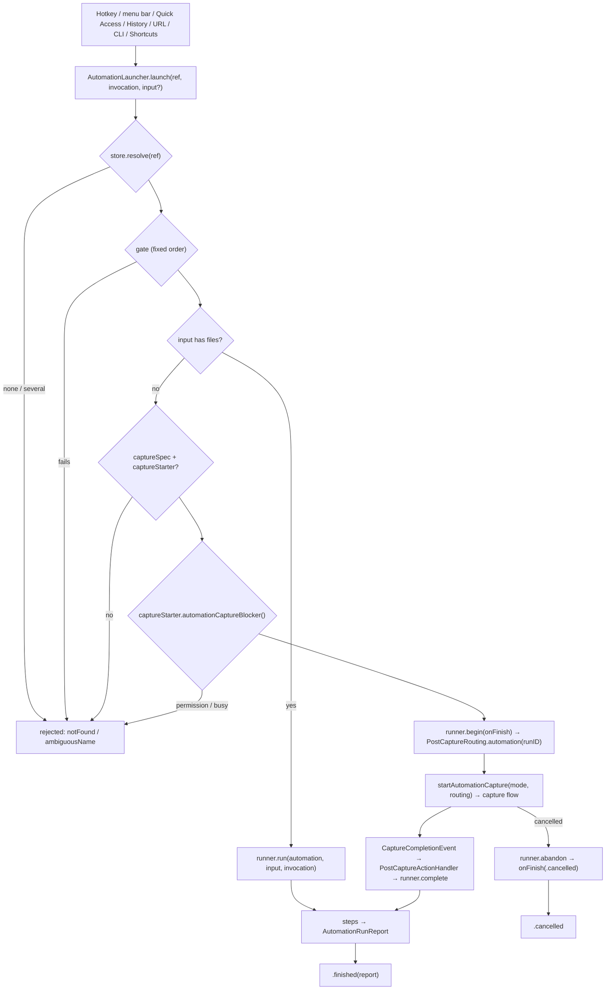

# Automations

An automation is a named pipeline: **trigger → source → ordered steps**. M1 (issue #675) shipped hotkey triggers, screenshot capture sources and five steps. M2 ("Triggers everywhere") adds menu bar, Quick Access, History, URL scheme, CLI and Shortcuts triggers, plus a source that runs on a handed-in file. M3 ("Transform & deliver") makes steps typed and composable (free order, repeats, per-step settings), adds transform and deliver steps, recording / GIF / scrolling / clipboard sources, a two-pane editor, an Activity log, notification actions and run cancellation. M5 ("Context & choice") adds control steps (condition, stop, run automation, ask), a richer run context (app bundle id, window title, capture mode), a run-time picker HUD, Finder's "Run Snapzy Automation…" service and drops on the menu bar icon. Every trigger goes through one entry point, `AutomationLauncher`.

## Concepts

| Part | Values | Stored as |
| --- | --- | --- |
| Trigger | `hotkey(ShortcutConfig)`, `menuBar`, `quickAccessAction`, `historyAction`, `finderQuickAction` (M5: Finder service + menu bar drop) | `{"kind":"hotkey","shortcut":{…}}`, `{"kind":"menuBar"}`, … |
| Source | `capture(mode, saveToExportDirectory, recordingOutput)` (screenshots `area`, `fullscreen`, `activeWindow`, `applicationWindow`, `scrolling`; recordings `recordingArea`, `recordingWindow` with `recordingOutput` `video` \| `gif`), `input` ("Run on a File"), `clipboardImage` | `{"kind":"capture","mode":"recordingArea","saveToExportDirectory":false,"recordingOutput":"gif"}`, `{"kind":"input"}`, `{"kind":"clipboardImage"}` |
| Steps | See [Steps](#steps). Each step: `id`, `kind`, optional `config` object, `isEnabled`, `onFailure` (`stop` \| `continue`) | `{"id":…,"kind":"resize","config":{"mode":"maxDimension","maxDimension":1600},"isEnabled":true,"onFailure":"stop"}` |
| `externalInvocation` | Bool: URL scheme, CLI and Shortcuts may run it (see [External gate](#external-gate)) | `external_invocation` |
| `schemaVersion` | `2` since M3 | |

- **Forward compatibility**: a trigger, source or step kind this build does not know decodes to `.unsupported(raw JSON)` and re-encodes unchanged (`AutomationJSONValue`). Unsupported steps are skipped when run; an automation with an unsupported source is shown disabled ("made with a newer version") and rejected by the launcher.
- **Schema 2 migration**: M1/M2 data (`schemaVersion` 1) decodes unchanged except `uploadAndCopyLink(format)`, which becomes `upload` (same step id) + `copyLink(url | markdown)` (deterministic derived id), both with the original `isEnabled` / `onFailure`. Encoding never writes the legacy kind. `Automation.migrated()` does the same in memory (the runner and editor call it).
- **Normalization** (`Automation.normalized()`): migrated, trimmed name (max 60, fallback "Automation"), steps keep the user's order and may repeat (max 20, at least one), at most one hotkey, one of each simple trigger. An `.input` automation loses `hotkey` and `menuBar` (nothing to run on); `clipboardImage` keeps them (`runsWithoutInput`). The chain itself is checked by the [validator](#chain-validation), not normalization.
- **Presets** (`AutomationPreset`): **Quick Copy** (area → copy image → notify), **Cloud Share** (area → copy image → upload → copy link → notify), **Docs Shot** (active window → canvas preset → resize 1600 → WebP 85 → save to folder `{date}-{appName}` → copy `` → notify; ships **disabled** with a "Needs setup" badge until a folder is picked), **GIF Share** (record area as GIF → upload → copy link → notify), **Translate Snip** (area → OCR → translate → copy text → notify), **Share Menu** (M5: area → ask [Quick Copy, Cloud Share, Docs Shot]), **Design Router** (M5: active window → condition(app is Figma / Sketch, else skip 3) → save to folder `{appName}/{datetime}` → notify → stop → save to export folder → notify; ships **disabled** until the design folder is picked). Presets are created in `AutomationPreset.creationOrder` so Share Menu's Ask choices resolve to the seeded automations' ids (`makeAutomation(resolve:)`). Seeded once (`automations.seeded`) on fresh installs; existing users get the new ones from "Restore built-in". Shortcuts unbound, temp destination, offered on Quick Access + History. Untouched preset names are stored in English and shown localized (`displayName`).
- **Store** (`AutomationStore`): JSON array in UserDefaults `automations.items`, cap 20, CRUD + move + duplicate (clears shortcut and preset id) + restore missing presets + `replaceAll` for config import. Lookup: `resolve(ref)` (id, or name trimmed + case-insensitive, matching stored or displayed name; several matches → `ambiguousName`), `duplicateNameIDs(for:)` (editor warning; names are not unique), `automations(for: slot, fileKind:)` (enabled, supported source, slot flag, and with `fileKind` at least one enabled step accepting it).

## Triggers

| Trigger | Invocation (`AutomationInvocation`) | Entry | External? | Capture source | Input file |
| --- | --- | --- | --- | --- | --- |
| Hotkey | `hotkey` | `ScreenCaptureViewModel.runAutomation(id:)` (rejections silent, logged) | no | yes | n/a |
| Menu bar → Automations submenu | `menuBar` | `AppStatusBarController.runAutomationMenuAction` (dispatched after menu tracking ends) | no | yes (`.input` never listed) | n/a |
| Quick Access card → Run Automation | `quickAccess` | `AutomationTriggerActions.runFromQuickAccess` | no | skipped (runs on the card's file) | card file |
| History item → Run Automation | `history` | `AutomationTriggerActions.runFromHistory` | no | skipped | record file |
| URL scheme `snapzy://automation/run?id=\|name=` | `urlScheme` | `SnapzyDeepLinkHandler.runAutomation` | yes + URL toggle | yes | never (`file=` ignored) |
| CLI `snapzy automation run` | `cli` | `CLIAutomationBridge.run` (`automation.run`; [CLI.md](CLI.md)) | yes + CLI approval | yes | `--file` (absolute paths) |
| Shortcuts / Spotlight / Siri | `appIntent` | `RunAutomationIntent` → `AutomationIntentSupport.launch` | yes | yes | `Files` parameter |
| Finder ▸ Quick Actions / Services ▸ Run Snapzy Automation… (M5) | `finder` | `AutomationServicesProvider.runAutomationService` → `AutomationFileTriggers.run` | no | skipped | selected files |
| Files dropped on the menu bar icon (M5) | `menuBarDrop` | `AutomationStatusItemDropTarget` → `AutomationFileTriggers.run` | no | skipped | dropped files |

- `AutomationInvocation.isExternal` = `urlScheme`, `cli`, `appIntent`. Every run logs `Automation run started` with `invocation` and `source` (`capture` / `input`).
- Menu bar: `MenuBarItemKind.automations` (capture group, symbol `bolt`), hidden when no automation has the menu bar flag; submenu lists them (symbol, display name, hotkey as key equivalent, disabled without Screen Recording permission) + "Manage Automations…" (opens Settings → Automations). Customizable like other items in Settings → Menu Bar.
- Quick Access / History show a "Run Automation" submenu only when the store has matching automations for the item's file kind (see [QUICK_ACCESS.md](QUICK_ACCESS.md#run-automation), [HISTORY.md](HISTORY.md#run-automation)).
- **Finder & menu bar drop** (M5, `Triggers/AutomationFileTriggers.swift`): `NSServices` entry in `Info.plist` (`NSMessage = runAutomationService`, `NSSendFileTypes` image / movie / GIF); `AutomationServicesProvider.install()` sets `NSApp.servicesProvider` in `AppCoordinator.applicationDidFinishLaunching` and calls `NSUpdateDynamicServices()` once per app version (`automations.servicesRegisteredVersion`). If the entry is missing, enable it under System Settings ▸ Keyboard ▸ Keyboard Shortcuts ▸ Services (the system caches Services; QA on a clean account with the app in /Applications). The status item's window is registered for `.fileURL` drags; supported files highlight the icon. Both paths keep only image / video / GIF file URLs (`supportedFiles`, no file promises: web images from Safari are out of scope), list automations with **Show in Finder & menu bar drop** (`showsInFinder`, slot `.finder`) whose steps accept **every** file kind, show the [picker](#picker-hud) (or run directly when only one fits and Advanced → **Skip the picker when one automation fits** is on, `automations.runSingleFileTriggerDirectly`), (never for an automation that reaches script / Shortcut steps: any app can invoke a Service), then launch an input run on all files (first-file semantics as for other input runs). Nothing eligible or no supported file → toast.
- Rejections from menu-less callers (URL, Quick Access, History) show an `AppToastManager` warning with `rejection.localizedMessage`; the menu bar path ignores the outcome; the CLI maps them to `CLIError`s; Shortcuts throws `AutomationIntentError`. Messages never list other automations' names.

## Launch flow

`AutomationLauncher.launch(_ ref, invocation:, input:) async -> AutomationLaunchOutcome` (`.finished(AutomationRunReport)`, `.cancelled`, `.rejected(reason)`). `AutomationLauncher.shared.captureStarter` is set to `environment.screenCaptureViewModel` in `AppCoordinator.init` (the `AutomationCaptureStarting` seam: `automationCaptureBlocker()` + `startAutomationCapture(spec:routing:)`).



Gate order (`AutomationLauncher.gate`, first failure wins):

1. `disabled` — automation off
2. `externalNotAllowed` — external invocation and `externalInvocation == false`
3. `urlSchemeDisabled` — `urlScheme` and the global toggle (`PreferencesKeys.urlSchemeEnabled`, default on) is off
4. `unsupportedSource`
5. `invalidChain` — `AutomationChainValidator` reports a `.needs` issue (nothing starts, no file is touched)
6. No files: `needsFile` when the source is neither a capture nor the clipboard. With files, per file: `fileMissing` → `unsupportedFile` (UTType is not image / GIF / movie) → `noStepAcceptsFile(kind)`

Then, for a capture run: `needsFile` if no `captureSpec`, `captureInProgress` if `captureStarter` is nil, then the capture blocker (`permissionRequired` after triggering the permission request, or `captureInProgress` while a selection or capture is active). Input runs skip the permission and busy checks. Rejections log `Automation launch rejected` (`invocation`, `reason`, `automation`). Passing `input` to a capture-source automation runs on the files and skips the capture; empty `files` counts as no input.

- **Awaitable**: `begin(_:invocation:onFinish:)` keeps a callback per run; `complete` calls it with the report, `abandon` (capture cancelled) and the 30-minute stale prune call it with `.cancelled`. The CLI holds the request open until then (server limit for `automation.run`: 15 min, `CLIConnection.automationRunTimeout`; other methods have none while running).
- **Routing** (capture runs): `PostCaptureRouting` (`.standard` / `.automation(runID)`) rides inside `CaptureContext`, which travels from each capture entry point through every selection path to `saveImage`. Window selections rebuild the context from the window's PID and copy the routing over. Fullscreen calls the handler directly with the same routing.
- **Snapshot**: `begin` stores a copy of the automation under a run id; edits during a capture do not affect that run. An unknown run id falls back to standard routing so the capture is never dropped.
- **Override semantics** (capture runs): skips the global after-capture matrix entirely, including Save: `saveToExportDirectory` picks export vs temp directory (`TempCaptureManager.resolveSaveDirectory(saveOverride:)`). The default Annotate canvas preset is applied (`prepareScreenshot`) and History is recorded.
- **Scope**: area (incl. switching to window selection inside the overlay), application window, fullscreen, active window, scrolling and recording (area / window) flows carry routing (see [Recording, GIF and scrolling sources](#recording-gif-and-scrolling-sources)). OCR, object cutout, smart element, area annotate, delayed and repeat-area captures stay standard; OCR is a step instead.
- **Clipboard source**: no capture; the clipboard image is saved and run as an input (see [Clipboard source](#clipboard-source)).

## External gate

Starting an automation from outside the app needs the per-automation opt-in **"Allow URL scheme, command line and Shortcuts"** (`externalInvocation`, default off, editor section "Run from Other Apps").

| Caller | Requires |
| --- | --- |
| URL scheme | `externalInvocation` + global URL scheme toggle (Settings → Advanced); no file input ever |
| CLI | `externalInvocation`; command line access on (`automation.*` is not in the agent-only router); the usual per-app CLI approval (`CLIAuthorizationCoordinator`) |
| Shortcuts / Spotlight / Siri | `externalInvocation`; entity list only shows opted-in automations |
| Hotkey, menu bar, Quick Access, History | nothing (user is at the app) |

A link or script cannot upload a local file: the URL route has no file parameter. CLI and Shortcuts may pass files because the user approved the caller. Importing `external_invocation = true` from `config.toml` is honored (user's own dotfile) and logged (`Automation imported with external invocation allowed`).

## Input source ("Run on a File")

`source = .input`: never captures; runs only on files a trigger hands in. Editor: Source picker → "Run on a File"; hides save-to-export and the shortcut recorder, disables "Show in menu bar". Started from Quick Access / History it works on that item; from CLI / Shortcuts on the passed files; without a file (hotkey, menu, URL, CLI without `--file`) the launcher rejects with `needsFile`.

Any automation, capture-sourced or not, can run on files when launched with `input`; the capture is skipped. `AutomationInput`:

| Field | Meaning |
| --- | --- |
| `files` | Files to run on; originals are never modified |
| `isAlreadyInHistory` | `true` from Quick Access / History: no new History row. `false` from CLI / Shortcuts: History records the files after the steps (screenshot or video/GIF by kind) |
| `sourceQuickAccessItemID` | Quick Access card the run started from; pre-seeds `quickAccessItemIDs` so `showQuickAccess` skips it and an upload sets the cloud link on that same card (no second card) |

Input runs differ from capture runs: no `prepareScreenshot`, so no default Annotate canvas preset or session data; `save_to_export` is ignored; the Quick Access countdown for the source card is paused while the run is in flight; Quick Access / History access the file inside `SandboxFileAccessManager` scoped access.

### Payload kinds

`AutomationFileKind` (`image`, `video`, `gif`) from the file's UTType: GIF → `gif`, image → `image`, movie/video → `video`; anything else → `unsupportedFile`. Steps work on **payload kinds**: the file kinds plus `text` (OCR / translation) and `link` (upload). Each handler declares `accepts(action)` (any-of) and `produces(action, given:)`; the runner hands a step only the files it accepts and skips it (warning log, `skipped` in the run log) when nothing it accepts is present. The launcher refuses a handed-in file no enabled step accepts (`noStepAcceptsFile`).

## Rejection reasons

`AutomationLaunchRejection.code` is the stable id used in logs; CLI maps codes to `CLIError`s ([CLI.md](CLI.md)); UI shows `localizedMessage`.

| Code | Meaning |
| --- | --- |
| `not_found` | No automation matches the id or name |
| `ambiguous_name` | Several share the name; carries their ids (CLI lists them; UI message says to use the id) |
| `disabled` | Automation is turned off |
| `external_not_allowed` | External caller, `externalInvocation` off |
| `url_scheme_disabled` | URL caller, global toggle off |
| `unsupported_source` | Source written by a newer Snapzy |
| `needs_file` | Source is `input` (or has no capture), no file passed |
| `unsupported_file` | File is not an image, video or GIF |
| `no_step_accepts_file` | No enabled step handles that file kind |
| `file_missing` | File path does not exist |
| `permission_required` | Capture needs Screen Recording permission (request is triggered) |
| `capture_in_progress` | A selection, capture, recording or scrolling session is active (also when no capture starter is wired) |
| `clipboard_empty` | Clipboard source, but the clipboard holds no image |
| `invalid_chain` | A step has nothing to work on (validator `.needs`); checked before any capture starts |
| `needs_review` | Imported (config file / recipe) with webhook, custom-uploader or script / Shortcut steps nobody reviewed yet; saving it from the editor clears it. Checked right after `disabled` |
| `code_steps_disabled` | Contains a script or Shortcut step while Settings → Automations → Advanced → "Allow script & Shortcut steps" is off |
| `external_code_not_allowed` | URL scheme or Shortcuts caller, automation has script / Shortcut steps, and its second opt-in ("Let other apps run its script steps") is off. The CLI is allowed (already approved per calling app) |

`.cancelled` (not a rejection): capture cancelled or saved no file; the CLI returns state `cancelled`.

## Runner and steps

`AutomationRunner` runs steps sequentially (capture runs: `begin` / `complete`; input runs: `run(_:input:invocation:)`; both share `execute`) through `AutomationStepRegistry` handlers; handlers only wrap existing services via `AutomationRunEnvironment` (`LiveAutomationRunEnvironment` in the app, fakes in tests). Pure image transforms (`AutomationImageTransforms`) are nonisolated and run off the main actor.

### Payload and working directory

`AutomationPayload { files: [AutomationFile(url, kind, original)], text, link, savedFile, savedFolder }`. Transform steps never touch the capture: they write into the run's working directory `Application Support/Snapzy/Captures/AutomationRuns/<runID>/` and swap the payload file (its `original` stays). At the end of the run, working files nothing still shows are deleted (and the folder when empty); files handed to Quick Access, Pin, Annotate or the pasteboard, and the final files of CLI / Shortcuts / URL runs (their reported output), are kept (temp-capture startup cleanup removes them later). History always records the original capture, never a working copy.

Capture runs still bake the default Annotate canvas preset into fresh screenshots (`prepareScreenshot`) **unless** the automation has an `applyCanvasPreset` step, which then decides.

### Steps

| Step | accepts → produces | Effect |
| --- | --- | --- |
| `applyCanvasPreset(presetID?)` | image → image | `ScreenshotPresetAutoApplier.apply(_:from:writingTo:)`; `nil` = default preset; a preset that changes nothing keeps the file; missing preset → error |
| `resize(maxDimension \| scalePercent)` | image → image | Optimize pipeline (`resized` + `encode`), keeps the format (PNG when this Mac can't write it), never upscales |
| `convert(format, quality, maxFileSizeKB \| optimizePresetID)` | image → image | `QuickAccessImageOptimizer.render`; unavailable encoder → PNG + run-log warning; size cap not met → warning |
| `stripMetadata` | image → image | Re-encodes in the same format with DPI only: EXIF, GPS, TIFF, IPTC, PNG text dropped; color profile kept |
| `ocr(language?, includeQR)` | image → +text | `OCRService` (+ `QRCodeService` / `OCRQRPayloadComposer`); empty → "No text found" |
| `translate(target?)` | text → text | `TranslationEngineResolver`: Apple → `HeadlessTranslationHost` (macOS 15+, offscreen non-activating panel hosting `.translationTask`, 30 s timeout, torn down after 60 s idle); endpoint → `RemoteTranslationProvider`; unavailable → error. Target `nil` = Snip to Translate target |
| `convertToGIF(fps, maxWidth)` | video → gif | `GIFConverter` on an APFS clone inside the working directory (never writes next to the recording) |
| `upload(destination)` | file → +link | `default`: `CloudShareService.upload` (first file); `customUploader(id)`: that Settings → Cloud custom uploader (`CustomUploaderEngine`), whatever the main Cloud provider is. Sets the Quick Access card's cloud link; failure → [fallback](#failures-fallback-cancel) |
| `copyLink(style)` | link | `url`, `markdown` (`CloudShareService.linkText`: escaping, `[name](url)` for video), `html`, `bbcode`, `custom` template |
| `copyText(template)` | text, or anything when the template has no `{text}` | Renders the template (default `{text}`) |
| `copyImage` / `copyFile` | files | `ClipboardHelper.copyImage` (image-only setting respected); one video/GIF → file reference; several → file URLs |
| `saveToFolder(folder, nameTemplate, conflict)` | files | Copies (never moves) into the folder; template may contain `/` sub-folders (kept inside the folder); `uniquify` → `name_2.ext`, `overwrite` → atomic replace (never the run's own input/capture: falls back to uniquify); sets `{saved.path}`, `{saved.relativePath}` |
| `reveal` | files | Last saved file, else the original capture (`FileRevealer`) |
| `pin` | image | `QuickAccessManager.pinScreenshot(url:)`; the working file is kept |
| `showQuickAccess` | files | `addScreenshot` (+ session data) or `addVideo`; shows the current (possibly transformed) file |
| `openAnnotate` | image | Through its Quick Access item when present |
| `notify` | any | One notification at the end with the outcome |
| `webhook(method, url, headers, body, timeout, responseToText, responseLink)` | any (multipart: file) → +text / +link | HTTP request through `environment.send`. URL must be `https://` (or `http://localhost` / `127.0.0.1` / `[::1]`), checked after rendering. Body: `none`, `json` (template rendered with JSON escaping), `form`, `multipart` (fields + the file as `file_field`, streamed from a temp file). URL, headers, JSON and field values allow `{secret:NAME}`. Non-2xx → failure with status + first 200 chars (secrets masked). Optional response → `{text}` (64 KB) and JSON path (`data.url`, `files[0].link`) → `{link}`. Presets: Slack, Discord, generic JSON. Inspector **Test** button (`AutomationWebhookTestRunner`) sends it once through the same `WebhookStepHandler.send` with sample token values (1×1 PNG for multipart) and shows status, masked response (2 KB) and extracted link |
| `runScript(script, shell, loginShell, timeout, output)` | any → +text / +link / file | `/bin/zsh -f` (or `bash --noprofile --norc`, `sh`; `-l` with login shell) `-c <script> snapzy <file paths…>` via `ProcessRunner` (posix_spawn, own process group, minimal environment, 1 MB output cap, SIGTERM→SIGKILL on timeout / cancel). Values only as environment variables: `SNAPZY_FILE`, `SNAPZY_FILES` (newline-separated), `SNAPZY_LINK`, `SNAPZY_TEXT`, `SNAPZY_AUTOMATION`, `SNAPZY_RUN_ID`, `SNAPZY_WORK_DIR`, `SNAPZY_SAVED_FILE`; never interpolated into the script. cwd = run working directory. Non-zero exit → failure with the stderr tail (512 chars). Output: ignore, text, link (first line, http(s)), file (last line: existing file in the working dir or home) |
| `runShortcut(name, input, output, timeout)` | file / text / link → +text / file | `/usr/bin/shortcuts run <name> [--input-path …] [--output-path …]` (no Apple Events entitlement). Text / link input is written to a temp file. Not found → "Couldn't find the shortcut". The first run of a shortcut may ask for Shortcuts privacy consent (covered by the timeout). The inspector lists `shortcuts list` (cached 60 s) |
| `shareSheet(service)` | any | `picker` (`NSSharingServicePicker` anchored to a 1×1 non-activating panel at the mouse), `airdrop`, `messages`, `mail`, or any `NSSharingService.Name` raw value. Files first, else the link, else the text. Waits until the user picks / dismisses (dismissing is not a failure). Unavailable service → failure |
| `openInApp(appBundleID, appName)` | files / link | `NSWorkspace.open(_:withApplicationAt:configuration:)`; missing app → failure with its name. The opened file is kept after the run |
| `condition(match, predicates, otherwise)` (M5) | any → passthrough | Evaluated by the runner (`AutomationConditionEvaluator`). Holds → next step; else `otherwise`: `stop` ends the run successfully, `skip:n` skips the next n steps of the list (disabled ones count). No predicates = holds |
| `stop` (M5) | any | Ends the run successfully (outcome message from the last delivery). Inside a nested run it returns to the caller |
| `runAutomation(automationID)` (M5) | any → target's output | Runs the target's **steps** (not its source / triggers) on the current payload, then continues. Target must exist, be enabled, not need review; depth ≤ 3 (`AutomationControlLimits.maxDepth`) and no cycles (checked at run time and by the validator). A nested abort fails this step (its `onFailure` applies); the run outcome counts the nested steps themselves (`StepRecord.leaves`). Code steps in the target are rechecked when it starts |
| `ask(prompt, choices)` (M5) | any | Shows the [picker](#picker-hud) (title = prompt or automation name, thumbnail = first image). Choices: `automation(id)` → runs it like `runAutomation`, then **ends** this run; `continue` → next step; `stop` → ends. Unavailable targets (missing, off, needs review, already running) are hidden; none left → failure. Cancel / Esc → run `cancelled` (no notification); for a capture run with nothing delivered yet, the capture gets a Quick Access card so it is never lost. Cancelling the run (HUD) closes the picker. No timeout; the run HUD shows "Waiting for choice" |

`uploadAndCopyLink` remains decodable (legacy) and runs as `upload` + `copyLink` if built in code.

### Variables

`AutomationVariables` renders `{token}`s; unknown tokens stay literal. Escape modes: `none`, `markdown`, `html`, `json`, `url`.

| Tokens | Value |
| --- | --- |
| `{link}` `{text}` | Upload URL, OCR / translated text |
| `{file.name}` `{file.basename}` `{file.ext}` `{file.path}` `{width}` `{height}` | First payload file (size for images) |
| `{saved.path}` `{saved.relativePath}` `{saved.relativeURL}` | Last `saveToFolder` output; relative to the chosen folder (`relativeURL` percent-encoded for Markdown / HTML links) |
| `{automation}` | Automation display name |
| `{app.name}` `{app.bundleID}` `{window.title}` `{capture.mode}` `{invocation}` (M5) | Run context: the captured window's app (else the frontmost app at trigger time), its window title when the capture knows it, capture mode raw value (empty for input runs), invocation raw value |
| Naming tokens | `{date}`, `{time}`, `{datetime}`, `{appName}`, `{windowTitle}` / `{window.title}` (`/` replaced), `{timestamp}`, … from `CaptureOutputNaming.tokenValues` |

### Run context (M5)

`AutomationRunContext` carries `appName`, `bundleID`, `windowTitle`, `captureMode` and `invocation`. `CaptureContext` gained `bundleID` (filled by `fromPID` / `fromFrontmostApp`). The runner snapshots the frontmost app (`AutomationAppSnapshot`, Snapzy itself excluded) when a capture run is registered (`begin`), because the capture overlay takes frontmost status; `ScreenCaptureManager` reports the saved capture's `CaptureContext` through `AutomationRunner.noteCaptureContext`, and capture-time facts win (`AutomationAppSnapshot.merged`: another app's capture drops the trigger-time name / title). Input runs have no bundle id or capture mode (`{appName}` is still the frontmost app). The run log diagnostics include `app`.

### Predicates (M5)

| `type` | Values | Holds when |
| --- | --- | --- |
| `frontmost_app` | `bundleIDs`, `negate` | Run context bundle id is one of them (case-insensitive); unknown app = no match |
| `capture_mode` | `modes` | Capture run with one of these modes |
| `invocation` | `invocations` | Started by one of these triggers |
| `file_kind` | `kinds` (image, video, gif) | First file's kind |
| `pixel_size` | `dimension` (width, height, longest), `comparison` (gt, lt), `value` | First file is an image of that size |
| `file_size` | `comparison`, `bytes` | First file's size on disk |
| `has_text` | `contains?` | Earlier OCR / script produced text (containing the value, case-insensitive) |
| anything else | kept as raw JSON | Never (forward compatible) |

### Picker HUD

`UI/AutomationPickerHUD.swift`: non-activating borderless `NSPanel` (`canBecomeKey`, level `.popUpMenu`, joins all spaces / full-screen apps) next to the cursor, clamped to that screen's visible frame; takes the keyboard without activating Snapzy. Rows: symbol, name, number badge 1–9; ↑/↓ + Return, 1–9, Esc or a click in another app / losing key cancels; more than nine rows add a search field (digits then type into it). `present(title:thumbnail:choices:) async -> AutomationPickerChoice?`; a second call cancels the first. Key handling lives in `AutomationPickerModel` (tested). Used by Ask, Finder and menu bar drops (`environment.pick`).


### Chain validation

`AutomationChainValidator.validate` walks enabled steps starting from the source's kinds (screenshot / scrolling / clipboard → image; recording → video or gif; input → any file kind): a step whose `accepts` has nothing available → `.needs(kinds)` (blocks Save and launch: `invalid_chain`); missing settings → `.missingConfig(folder | template | canvasPreset | uploader | webhookURL | script | shortcut | app | secret(name) | automation | choices | condition | skipRange)` ("Needs setup"; runs fail at that step; `condition` with an empty predicate **blocks**, since it would silently stop or skip every run). Example: `translate → …` without `ocr` is rejected; `ocr → translate → copyText` is valid.

M5 path analysis: the walk tracks a set of kind-sets per position. A condition sends its paths to the next step **and** to its `otherwise` target (`stop` → end, `skip:n` → n steps later; past the end → `skipRange`), so a step only one path can feed is still reported (`condition(else skip 1) · ocr · translate` flags Translate). Steps after `stop` are unreachable and not checked. `runAutomation` / `ask` follow the target with the current kinds (missing / unset → `missingConfig(.automation)`, disabled Run Automation target → same; cycle or depth > 3 → `.recursion`; target with blocking issues for these kinds → `.targetCannotRun`; both block). The kinds after them are what the target hands back (its end, stop or failed condition). The launcher validates with the store as lookup.

### Failures, fallback, cancel

- **Failure policy** per step: `stop` (default) or `continue`, set in the editor inspector.
- **Upload fallback**: on failure or missing cloud setup the runner copies the file (if not copied yet), adds a Quick Access card (if none) for retry, and always posts an error notification.
- **Pasteboard guard**: links and text are written only when the pasteboard change count still equals the run's own last write. `ClipboardHelper.copyText` is the one text writer for automations, Cloud Share and Snip to Translate.
- **Outcome message** follows what was delivered last (link copied / link ready / text copied / saved `name` / image or file copied); a failed step → "<step> failed: <reason>".
- **Cancel**: `AutomationRunner.cancel(runID:)` cancels the step task; handlers check cancellation after slow work. A cancelled run keeps its files, applies no fallback, posts no notification, and logs `cancelled`. The run HUD (`AutomationRunHUDController`, bottom-center non-activating panel) appears after 1.5 s with the automation, current step and a Cancel button (no global Esc: a global key monitor would need Input Monitoring).

## Trust, secrets and review (milestone 4)

Least privilege for steps that reach outside Snapzy (`Engine/AutomationTrust.swift`):

| Tier | Steps | Allowed when |
| --- | --- | --- |
| `local` | everything else, share sheet, open in app | Always |
| `network` | `upload`, `webhook`, `translate` | The destination is configured (Cloud, custom uploader, webhook URL) |
| `code` | `runScript`, `runShortcut` | Settings → Automations → Advanced → **Allow script & Shortcut steps** (`automations.allowCodeSteps`, off). Never set by an imported file |

- Each handler declares `trust`; `Automation.maxTrust` is the highest among enabled steps. The launcher refuses `code_steps_disabled`; the runner checks again (`environment.allowsCodeSteps`) so a direct run cannot bypass it.
- **External + code**: URL scheme and Shortcuts runs of an automation with code steps also need `Automation.allowExternalCode` (toggle under Run from Other Apps, shown only with code steps). It is cleared when `externalInvocation` is off and never imported. The CLI does not need it.
- **Secrets** (`Services/AutomationSecretStore.swift`): name → Keychain item (service `com.trongduong.snapzy.automations`, account = a UUID); UserDefaults `automations.secrets` holds only names and accounts. Templates reference them as `{secret:NAME}`; `AutomationVariables.renderAllowingSecrets` resolves them in the same pass as payload tokens, so a payload value containing `{secret:…}` (OCR text, a file name) stays literal. Allowed in webhook URL / headers / body and custom uploader templates only; never in pasteboard text. Resolved values go into `AutomationRunState.secretValues` and are masked (`••••`) in step errors, the run log, warnings, notifications and diagnostics. A missing secret is a "Needs setup" issue and fails the step. Settings → Automations → **Secrets**: add, replace value (write-only), copy `{secret:NAME}`, delete. Custom uploaders resolve secrets through the same store (`CustomUploaderSecrets.provider`, set at launch).
- **Referenced automations (M5)**: `Automation.reachableAutomations(lookup:)` follows Run Automation / Ask targets (each once). The launcher applies the code-step switch, the external-code opt-in and `needs_review` to all of them (`effectiveMaxTrust`), so an automation can't reach a script step through another one. The editor shows the external-code toggle when a referenced automation has code steps. `runAutomation` and `ask` count as review-sensitive on import (they may run the user's own automations from a trigger those don't allow).
- **Review flag**: `Automation.needsReview`. An import (TOML; recipes later) flags an automation whose review-relevant part — webhook, custom-uploader and code steps with their settings, plus `externalInvocation` — differs from the automation **already stored on this Mac** with the same id (or there is none). The file's own `data` JSON is never the baseline. Flagged automations are refused (`needs_review`), show "Imported — review before it can run" with a Review button, and the editor shows a banner; saving from the editor clears the flag. Re-importing what this Mac exported does not flag.

## Activity log and notification actions

- `AutomationRunLog` (`Engine/AutomationRunLog.swift`): newest-first ring buffer of 100 `AutomationRunRecord`s in `Application Support/Snapzy/automation-runs.json` (debounced write, flushed on quit). Record: run id, automation, invocation, start, duration, outcome (`succeeded`, `partial`, `failed`, `cancelled`), per-step kind / duration / status / error, `detail` (M5: "Condition met / not met", "Skipped by condition", chosen automation, "Choice cancelled") and nested `children` (Run Automation / Ask; shown indented, and counted for the outcome), input paths, link, text (truncated to 200), saved paths, warnings. No image data. Off switch `automations.activityLogEnabled`.
- Settings → Automations has an **Automations | Activity** segment (`AutomationSettingsNavigation`); Activity rows expand to steps and offer Show Input, Run Again (input run, `invocation: .retry`), Copy Link, Show Saved File, and Clear Activity.
- Notifications carry categories registered by `AutomationNotificationRouter.install()` at launch: `automation.failed` (Retry, Open Activity), `automation.succeeded.link` (Open Link), `automation.succeeded.file` (Show in Finder). Retry re-runs the automation on the run's input files (the capture), so an offline Cloud Share can be retried after reconnecting. Clicking the banner does the most useful action for that outcome. The toast fallback has no actions.

## Hotkeys

- Registered in `KeyboardShortcutManager.registerAutomationShortcuts()` after the fixed kinds, re-registered when `AutomationStore.$automations` changes (enabled / hotkey). Fn combos go through `fnBindings` like global kinds.
- Validation (`ShortcutValidationService.validateAutomationShortcut`): requires a modifier; rejects collisions with enabled global shortcuts, other enabled automations, Annotate and Video Editor action shortcuts. Global shortcut validation also rejects combos used by an automation (no swap offer). Hotkey press → `.runAutomation(id)` → `ScreenCaptureViewModel.runAutomation(id:)` → `AutomationLauncher.launch(.id, invocation: .hotkey)`; a rejected launch is only logged, never a toast.

## Shortcuts action (App Intents)

`Snapzy/Features/Automations/Triggers/AppIntents/AutomationAppIntents.swift`, in-process (no extension, `openAppWhenRun = false`), macOS 13+.

- `RunAutomationIntent` ("Run Snapzy Automation"): parameters `automation` (`AutomationEntity`) and optional `files` (`[IntentFile]`: image, movie, GIF; connects to the previous action's output). Phrases via `SnapzyAppShortcuts`: "Run Snapzy automation", "Run <automation> with Snapzy".
- `AutomationEntityQuery` (suggested, by id, string match) lists only `AutomationStore.automations(for: .external)`: enabled, supported source, `externalInvocation` on. Input-source automations are listed too; run without files they fail with `needs_file`.
- The store subscription in `AppCoordinator` calls `AutomationIntentSupport.refreshAppShortcuts()` (`updateAppShortcutParameters`, debounced 1 s) when an automation's id, name, enabled or external flag changes.
- Files are staged first (`AutomationIntentSupport.stage`): copied into `TempCaptureManager.tempCaptureRootDirectory()` under a unique name, because Shortcuts' copies are short-lived; normal temp-capture cleanup removes them unless History keeps them. Then `launcher.launch(.id, invocation: .appIntent, input: AutomationInput(files:, isAlreadyInHistory: false))`; no files → capture source.
- Result: `String` = the uploaded link when a step produced one, else the produced text (OCR / translation), else the first output file's path (the saved file, or the final transformed file; empty string if none), plus a dialog with the run message. `.cancelled` and rejections throw `AutomationIntentError` with the localized reason.

## Settings → Automations

`AutomationsSettingsView` (`Snapzy/Features/Automations/Settings/`): hero, list rows (shortcut recorder with enable toggle, or a plain toggle for input automations; summary; `link` badge when externally invocable; cloud-not-configured warning with link to Cloud; ⋯ menu: edit, duplicate, delete), drag reorder, New / Restore built-in buttons, cap message. Deep link: `snapzy://automations` or `snapzy://settings?tab=automations`.

`AutomationEditorSheet` (min 780×560) is two panes:

| Area | Contents |
| --- | --- |
| Header | Name (duplicate-name warning), **Source** menu (Screenshot: area, fullscreen, active window, window, scrolling; Recording: area, window; Clipboard Image; Run on a File) |
| Left: `AutomationStepListView` | "Source & Triggers" row, then the steps (icon, title, one-line config summary, issue badge, enable switch). Drag or ⌘↑ / ⌘↓ to reorder, ⌫ / "−" to delete, context menu duplicate. "+" menu grouped Transform / Deliver / Integrations / Control (Condition, Ask, Run Automation, Stop, Notify). Steps a condition can skip show an accent bracket on the left; deleting or inserting a step inside that range adjusts the skip count (`Automation.removeStep` / `insertStep`; moves don't). **Route by App…** (branch button, `AutomationRouteByAppSheet`) picks apps (running apps or "Choose App…" from /Applications) and steps and inserts `condition(app is …, else skip n) · steps · stop` after the selection |
| Right: inspector | Source & Triggers (`AutomationTriggersInspector`): recording output (video / GIF), save-to-export, shortcut, Show In toggles, **Run from Other Apps** (`AutomationExternalSection`). Step (`AutomationStepInspector`): description, issues, per-kind settings (`StepInspectors/*`: canvas preset, resize, convert / Optimize preset, OCR QR, translate target, GIF fps / width, link style + custom template, text template, folder picker + name template + conflict + preview; `AutomationIntegrationInspectors`: upload destination, webhook preset / method / URL / headers / body / response, script editor + shell + output + env-var cheat sheet, Shortcut picker + Open in Shortcuts, share service, app chooser; "Insert Secret" key menus; a lock banner on script / Shortcut steps while code steps are off; `AutomationControlInspectors`: condition match all / any, predicate rows (app chips with is / is not, multi-select menus for modes / triggers / file kinds, size fields, text contains), otherwise stop / skip n with an out-of-range warning and a readable sentence (`AutomationConditionText`); Run Automation picker (not itself, warns when the target is off); Ask title, ordered choices (automations, Continue, Stop Here; max 12)), "If this step fails: Stop / Continue". Template fields have a token help popover and a live preview |
| Footer | First validation issue (click selects the step); **Save is disabled while any `.needs` issue exists** |

List rows show a "Needs setup" badge with a Set Up… button when a step misses a setting (e.g. Docs Shot without a folder), or "Imported — review before it can run" with Review. The Source & Triggers inspector adds **Finder & menu bar drop** (M5) to Show In. Below the list: **Advanced** ("Allow script & Shortcut steps", "Skip the picker when one automation fits") and **Secrets** (`AutomationAdvancedSection.swift`).

## Configuration (TOML)

One keyed table per automation (the parser has no arrays of tables); steps are keyed sub-tables in run order; see `SnapzyConfigurationAutomationsCodec` and `SnapzyConfigurationAutomationStepCodec`.

```toml
[automations.8f0c2a6e-…]
order = 0
name = "Docs Shot"
preset = "docs-shot"
enabled = true
capture = "active_window"   # area | fullscreen | active_window | application_window | scrolling
                            # | recording_area | recording_window | clipboard | input
save_to_export = false      # capture sources only
# recording_output = "gif"  # recording sources: video | gif
shortcut_key = "4"
shortcut_modifiers = ["control", "shift"]
menu_bar = false
quick_access = true
history = true
finder = false              # M5: Finder "Run Snapzy Automation…" + menu bar drop
external_invocation = false

[automations.8f0c2a6e-….steps.01]
kind = "apply_canvas_preset"
preset = "default"          # or a preset UUID

[automations.8f0c2a6e-….steps.02]
kind = "resize"
mode = "max_dimension"      # or scale_percent
max_dimension = 1600

[automations.8f0c2a6e-….steps.03]
kind = "convert"
format = "webp"             # original | png | jpeg | webp | heic | avif
quality = 85
# max_file_size_kb = 500
# optimize_preset = "<uuid>"

[automations.8f0c2a6e-….steps.04]
kind = "save_to_folder"
folder = "~/repo/docs/img"  # or "export"
name = "{date}-{appName}"
conflict = "uniquify"       # or overwrite

[automations.8f0c2a6e-….steps.05]
kind = "copy_text"
template = ""
on_failure = "continue"     # optional; enabled = false to keep a step off
```

Step kinds: `copy_image`, `copy_file`, `show_quick_access`, `open_annotate`, `notify`, `apply_canvas_preset`, `resize`, `convert`, `strip_metadata`, `ocr` (`language`, `include_qr`), `translate` (`target`), `convert_to_gif` (`fps`, `max_width`), `upload` (`destination` = custom uploader UUID, omitted for the Cloud default), `copy_link` (`style` url | markdown | html | bbcode | custom, `template`), `copy_text` (`template`), `save_to_folder`, `reveal`, `pin`, `webhook`, `run_script`, `run_shortcut`, `share_sheet` (`service` picker | airdrop | messages | mail | a sharing service name), `open_in_app` (`app` bundle id, `app_name`). Unknown keys warn.

```toml
[automations.8f0c2a6e-….steps.03]
kind = "webhook"
method = "POST"                         # GET | POST | PUT | PATCH | DELETE
url = "{secret:SLACK_WEBHOOK}"          # https:// (or http://localhost); secrets allowed
headers = ["Authorization: Bearer {secret:API_TOKEN}"]
body = "json"                           # none | json | form | multipart
template = "{\"text\": \"{link}\"}"       # json body; form / multipart use fields = ["name=value"], file_field
timeout = 30
# response_to_text = true
# response_link = "data.url"

[automations.8f0c2a6e-….steps.04]
kind = "run_script"
script = "pngquant --force --output \"$SNAPZY_FILE\" \"$SNAPZY_FILE\""   # newlines as \n
shell = "zsh"                           # zsh | bash | sh
login_shell = true
timeout = 30
output = "ignore"                       # ignore | text | link | file

[automations.8f0c2a6e-….steps.05]
kind = "run_shortcut"
shortcut = "Post to Notion"
input = "file"                          # file | text | link | none
output = "text"                         # ignore | text | file

# Milestone 5 control steps
[automations.8f0c2a6e-….steps.06]
kind = "condition"
match = "any"                           # all | any
otherwise = "skip:2"                    # stop | skip:<n>

[automations.8f0c2a6e-….steps.06.predicates.01]
type = "frontmost_app"                  # frontmost_app | capture_mode | invocation | file_kind
bundle_ids = ["com.figma.Desktop"]      # | pixel_size | file_size | has_text
# negate = true

[automations.8f0c2a6e-….steps.06.predicates.02]
type = "pixel_size"
dimension = "longest"                   # width | height | longest
comparison = "gt"                       # gt | lt
value = 1600

[automations.8f0c2a6e-….steps.07]
kind = "run_automation"
target = "3b1e…"                        # id, or a name (the file's own automations first, then this Mac's; ambiguous → warning)

[automations.8f0c2a6e-….steps.08]
kind = "ask"
prompt = "Share how?"
choices = ["3b1e…", "Cloud Share", "continue", "stop"]

[automations.8f0c2a6e-….steps.09]
kind = "stop"
```

Predicate keys: `modes` (capture tokens as for `capture`), `invocations` (`hotkey`, `menuBar`, `quickAccess`, `history`, `finder`, `menuBarDrop`, `urlScheme`, `cli`, `appIntent`), `kinds` (`image`, `video`, `gif`), `bytes`, `contains`. An unknown predicate `type` is written with `json` and survives a round trip. Targets are always exported as ids.

Secret values are never written (only `{secret:NAME}`). `allow_code_steps` is not a config key; importing never turns script steps on. Imported webhook / custom-uploader / script / Shortcut steps that differ from this Mac's copy are flagged for review (see [Trust, secrets and review](#trust-secrets-and-review-milestone-4)). A step kind this build doesn't know is written as `kind` + `json` and survives a round trip.

- **Import precedence**: step sub-tables win; else the M1 form `steps = ["copy_image", "upload_copy_link:markdown", …]` (migrated); else `data`. Step ids are kept when the step at the same position has the same kind.
- **Folders** are device-local bookmarks (`AutomationFolderAccessStore`, UserDefaults `automations.folders`). Export writes the path (`~` abbreviated); import registers a bookmark when the folder exists, otherwise warns ("choose it again") and the step shows "Needs setup".
- `menu_bar`, `quick_access`, `history`, `finder` are the Show In flags; absent keys keep the value from `data`. Importing `external_invocation = true` is kept and logged.

Each table also carries `data`, the automation's full JSON, so automations or sources made by a newer Snapzy survive a sync. The `[automations]` header is always written, so an empty list clears automations on import; without the section, import leaves them untouched. Invalid entries, unknown steps, modifier-less or duplicate shortcuts produce warnings, not errors. Fn shortcuts are not representable (same as global shortcuts).

The store also keeps stored entries it cannot decode and writes them back, so one bad entry never erases the rest.

## Recording, GIF and scrolling sources

- `startAutomationCapture(spec:routing:)` maps `recordingArea` / `recordingWindow` to `startRecordingFlow(initialInteractionMode:routing:)` and `scrolling` to `captureScrolling(routing:)`. Every early exit or cancelled selection abandons the run.
- `RecordingCoordinator` keeps the routing for the session (restart keeps it). The toolbar's output mode is set from the automation's `recordingOutput`. Stop → `completeAutomationRecording`: GIF output converts quietly (source video deleted), studio recordings flatten, then `AutomationRunner.complete` — no Quick Access card or after-capture actions unless steps add them. Delete / cancel → `cleanup()` abandons. Save location follows the automation's save choice (`makeRecordingSavePlan(saveOverride:)`).
- `ScrollingCaptureCoordinator.beginSession(…, routing:)` passes the routing in the save `CaptureContext`, so the completion event reaches the runner; cancel abandons.
- Pending registrations expire after 30 min for screenshots; recordings never expire (they last until stopped or deleted).

## Clipboard source

`AutomationSource.clipboardImage`: the launcher saves the clipboard image as a PNG into the temp capture folder (`ClipboardHelper.readImageFile`, image file references are read too) and runs it as an input that History records. No image → `clipboard_empty`. Usable from a hotkey, the menu bar, URL scheme, CLI and Shortcuts.

## Key files

| File | Responsibility |
| --- | --- |
| `Snapzy/Features/Automations/Models/Automation.swift` | Model, Codable, normalization |
| `Snapzy/Features/Automations/Models/AutomationJSONValue.swift` | Raw JSON for unknown parts |
| `Snapzy/Features/Automations/Models/AutomationPreset.swift` | Built-in presets |
| `Snapzy/Features/Automations/Services/AutomationStore.swift` | Persistence, CRUD, seeding |
| `Snapzy/Features/Automations/Engine/AutomationLauncher.swift` | Single entry point: resolve, gate, capture or input run, outcome; `AutomationCaptureStarting` seam |
| `Snapzy/Features/Automations/Engine/AutomationInvocation.swift` | Invocation kinds, `AutomationRef`, file kinds, `AutomationInput`, rejections, run report, trigger slots |
| `Snapzy/Features/Automations/Engine/AutomationRunner.swift` | Run registry (`begin` / `complete` / `abandon` with `onFinish`), `run(input:)`, execution, fallback, outcome |
| `Snapzy/Features/Automations/Models/AutomationStepConfigs.swift` | Payload kinds, per-step config structs (tolerant decoding) |
| `Snapzy/Features/Automations/Engine/AutomationStepHandlers.swift` | Handler protocol (`accepts` / `produces` / trust), registry, run state, M1 handlers |
| `Snapzy/Features/Automations/Engine/AutomationPayload.swift` | Payload, files with originals, run context + working directory |
| `Snapzy/Features/Automations/Engine/AutomationVariables.swift` | Template tokens and escaping |
| `Snapzy/Features/Automations/Engine/AutomationChainValidator.swift` | Static chain validation |
| `Snapzy/Features/Automations/Engine/AutomationRunLog.swift` | Activity log store + record |
| `Snapzy/Features/Automations/Engine/AutomationRunHUD.swift` | Run HUD with Cancel |
| `Snapzy/Features/Automations/Engine/AutomationNotificationRouter.swift` | Notification categories / actions, Settings page navigation |
| `Snapzy/Features/Automations/Steps/AutomationTransformSteps.swift` | Canvas preset, resize, convert, strip metadata, convert to GIF |
| `Snapzy/Features/Automations/Steps/AutomationImageTransforms.swift` | Nonisolated file → file image transforms |
| `Snapzy/Features/Automations/Steps/AutomationDeliverSteps.swift` | Upload, copy link / text, save to folder, reveal, pin |
| `Snapzy/Features/Automations/Steps/AutomationTextSteps.swift` | OCR, translate, live recognizer / translator |
| `Snapzy/Features/Automations/Services/AutomationFolderAccessStore.swift` | Folder bookmarks for Save to Folder |
| `Snapzy/Features/Automations/Services/HeadlessTranslationHost.swift` | Apple Translation without a visible window |
| `Snapzy/Features/Automations/Engine/AutomationTrust.swift` | Trust tiers, code-step switch, review rule |
| `Snapzy/Features/Automations/Engine/AutomationIntegrationEnvironment.swift` | Upload destinations, HTTP, processes, share sheet presenter, open in app (live + defaults) |
| `Snapzy/Features/Automations/Models/AutomationIntegrationConfigs.swift` | Upload / webhook / script / Shortcut / share / open-in-app configs |
| `Snapzy/Features/Automations/Steps/AutomationIntegrationSteps.swift` | Webhook, script, Shortcut, share, open-in-app handlers; JSON path; multipart body; Shortcuts catalog |
| `Snapzy/Features/Automations/Services/AutomationSecretStore.swift` | Keychain-backed `{secret:NAME}` store and masking |
| `Snapzy/Services/Security/KeychainPasswordStore.swift` | Generic-password Keychain wrapper |
| `Snapzy/Services/Process/ProcessRunner.swift` | posix_spawn runner: process group, timeout, output cap |
| `Snapzy/Features/Automations/Settings/AutomationAdvancedSection.swift` | Advanced switch and Secrets list |
| `Snapzy/Features/Automations/Settings/StepInspectors/AutomationIntegrationInspectors.swift` | Inspectors for the integration steps |
| `Snapzy/Features/Automations/Settings/AutomationStepListView.swift`, `AutomationStepInspector.swift`, `AutomationTriggersInspector.swift`, `StepInspectors/*` | Two-pane editor |
| `Snapzy/Features/Automations/Settings/AutomationActivitySection.swift` | Activity page |
| `Snapzy/Services/Configuration/SnapzyConfigurationAutomationStepCodec.swift` | TOML step sub-tables |
| `Snapzy/Services/FileAccess/FileRevealer.swift` | Reveal in Finder (History, Quick Access, steps) |
| `Snapzy/Features/Automations/Engine/AutomationRunEnvironment.swift` | Service seam + live implementation |
| `Snapzy/Features/Automations/Triggers/AutomationTriggerActions.swift` | Quick Access / History "Run Automation" actions, toast on rejection |
| `Snapzy/Features/Automations/Triggers/AppIntents/AutomationAppIntents.swift` | Entity, query, intent, App Shortcuts provider, file staging |
| `Snapzy/Features/Automations/Settings/AutomationExternalSection.swift` | Editor "Run from Other Apps" section |
| `Snapzy/Features/Automations/Settings/AutomationEditorSheet.swift` | Editor container: header, source picker, validation footer |
| `Snapzy/Services/CommandLine/Handlers/CLIAutomationHandlers.swift` | `automation.list` / `automation.run` bridge ([CLI.md](CLI.md)) |
| `Snapzy/App/SnapzyDeepLinkHandler.swift` | `snapzy://automation/run` route, toast on rejection |
| `Snapzy/App/AppStatusBarController.swift` | Menu bar Automations submenu |
| `Snapzy/Features/Capture/CaptureViewModel.swift` | Hotkey entry, `AutomationCaptureStarting` conformance |
| `Snapzy/Services/Capture/PostCaptureRouting.swift` | Routing + completion event |
| `Snapzy/Services/Cloud/CloudShareService.swift` | Upload, link text, pasteboard write (shared with Quick Access) |
| `Snapzy/Services/Configuration/SnapzyConfigurationAutomationsCodec.swift` | TOML export/import |
| `Snapzy/Features/Automations/Models/AutomationControlConfigs.swift` | M5 condition / predicate / run automation / ask configs (tolerant coding, tokens) |
| `Snapzy/Features/Automations/Engine/AutomationControlFlow.swift` | M5 app snapshot, picker choice, condition evaluator, control handler, reachable automations / effective trust |
| `Snapzy/Features/Automations/UI/AutomationPickerHUD.swift` | M5 picker panel + `AutomationPickerModel` |
| `Snapzy/Features/Automations/Triggers/AutomationFileTriggers.swift` | M5 Finder service provider, menu bar drop target, eligible automations, launch |
| `Snapzy/Features/Automations/Settings/StepInspectors/AutomationControlInspectors.swift` | M5 Condition (predicate rows, app picker, sentence), Run Automation, Ask inspectors |
| `Snapzy/Features/Automations/Settings/AutomationRouteByAppSheet.swift` | M5 "Route by App…" helper (inserts `condition · steps · stop`) |
| `Snapzy/Features/Automations/Settings/AutomationConditionText.swift` | M5 readable condition sentences, invocation / file kind names |
| `Snapzy/Shared/Localization/L10n+Automations.swift` | Strings (`automations.` → `Features/Automations.xcstrings`) |

## Tests

| Area | Tests |
| --- | --- |
| Model coding, normalization, triggers, `.input` | `SnapzyTests/Features/Automations/AutomationModelTests.swift` |
| Store, ref resolution, slot queries | `SnapzyTests/Features/Automations/AutomationStoreTests.swift` |
| Runner (fake environment, input runs, file kinds) | `SnapzyTests/Features/Automations/AutomationRunnerTests.swift` |
| Launcher gate order, outcomes, intent support | `SnapzyTests/Features/Automations/AutomationLauncherTests.swift` |
| URL route parsing | `SnapzyTests/App/SnapzyDeepLinkHandlerTests.swift` |
| CLI bridge and routing | `SnapzyTests/Services/CommandLine/CLIAutomationBridgeTests.swift`, `CLIRequestRouterTests.swift` |
| TOML (v2 step tables, legacy array, folders) | `SnapzyTests/Services/Configuration/SnapzyConfigurationAutomationsTests.swift` |
| Schema 2 migration, config round trips, new sources | `SnapzyTests/Features/Automations/AutomationMigrationTests.swift` |
| M3 steps through the runner (working files, OCR / translate, templates, save to folder, cancel, run record) | `SnapzyTests/Features/Automations/AutomationStepsTests.swift` |
| Validator, variables, image transforms on real files, folder store, run log, notification routing | `SnapzyTests/Features/Automations/AutomationEngineV2Tests.swift` |
| M5: context variables and capture-context merge, predicate table, condition skip / stop, run automation (nesting, cycle, depth), ask (choice, continue, stop, cancel, hidden targets), path validation, cycles, trust propagation, picker keys, pasteboard parsing, eligible automations, recipes and seeding, JSON + keyed TOML round trips | `SnapzyTests/Features/Automations/AutomationControlFlowTests.swift` |
| M4: trust tiers at launch, external code opt-in, review flag (incl. forged `data`), secrets render / mask / store, webhook / script / Shortcut / share / open steps, real-shell no-interpolation, process timeout, TOML round trip of integration steps | `SnapzyTests/Features/Automations/AutomationIntegrationTests.swift` |

## Related docs

- [`POST_CAPTURE.md`](POST_CAPTURE.md) — standard routing and the after-capture matrix automations bypass
- [`SHORTCUTS.md`](SHORTCUTS.md) — hotkey engine and validation, `snapzy://automation/run`
- [`CLI.md`](CLI.md) — `snapzy automation list / run`
- [`QUICK_ACCESS.md`](QUICK_ACCESS.md), [`HISTORY.md`](HISTORY.md) — Run Automation menus
- [`CLOUD.md`](CLOUD.md) — providers behind `CloudShareService`
- [`RECORDING.md`](RECORDING.md), [`SCROLLING_CAPTURE.md`](SCROLLING_CAPTURE.md) — capture flows automations route
- [`CONFIGURATION.md`](CONFIGURATION.md) — TOML sync
- [`PREFERENCES.md`](PREFERENCES.md) — Settings tabs
