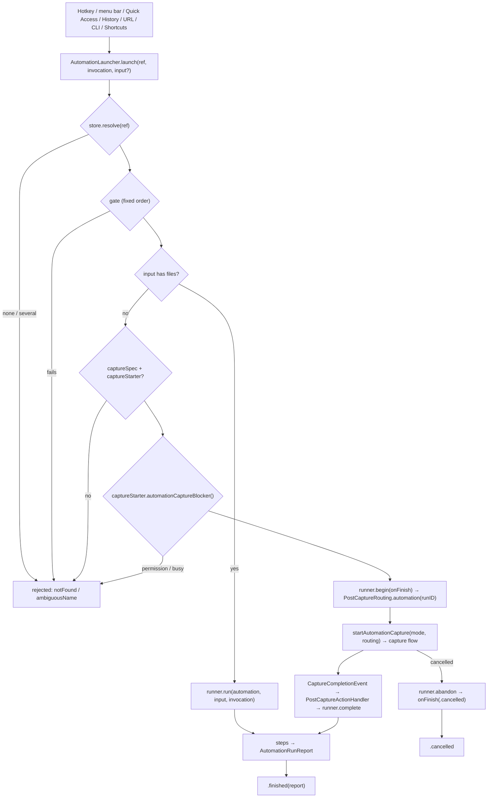

# Automations

An automation is a named pipeline: **trigger → source → ordered steps**. M1 (issue #675) shipped hotkey triggers, screenshot capture sources and five steps. M2 ("Triggers everywhere") adds menu bar, Quick Access, History, URL scheme, CLI and Shortcuts triggers, plus a source that runs on a handed-in file. Every trigger goes through one entry point, `AutomationLauncher`.

## Concepts

| Part | Values | Stored as |
| --- | --- | --- |
| Trigger | `hotkey(ShortcutConfig)`, `menuBar`, `quickAccessAction`, `historyAction` | `{"kind":"hotkey","shortcut":{…}}`, `{"kind":"menuBar"}`, … |
| Source | `capture(mode, saveToExportDirectory)` (modes `area`, `fullscreen`, `activeWindow`, `applicationWindow`) or `input` ("Run on a File") | `{"kind":"capture","mode":"area","saveToExportDirectory":false}`, `{"kind":"input"}` |
| Steps | `copyImage`, `uploadAndCopyLink(url \| markdown)`, `showQuickAccess`, `openAnnotate`, `notify` | `{"id":…,"kind":"uploadAndCopyLink","format":"markdown","isEnabled":true,"onFailure":"stop"}` |
| `externalInvocation` | Bool: URL scheme, CLI and Shortcuts may run it (see [External gate](#external-gate)) | `external_invocation` |

- **Forward compatibility**: a trigger, source or step kind this build does not know decodes to `.unsupported(raw JSON)` and re-encodes unchanged (`AutomationJSONValue`). Unsupported steps are skipped when run; an automation with an unsupported source is shown disabled ("made with a newer version") and rejected by the launcher.
- **Normalization** (`Automation.normalized()`): trimmed name (max 60, fallback "Automation"), one step per kind, `copyImage` moved before `uploadAndCopyLink`, at least one step, at most one hotkey, one of each simple trigger. An `.input` automation loses `hotkey` and `menuBar` (nothing to run on).
- **Presets** (`AutomationPreset`): **Quick Copy** (area → copy image → notify) and **Cloud Share** (area → copy image → upload and copy link → notify). Seeded once (`automations.seeded`), shortcuts unbound, temp destination. New seeds carry `quickAccessAction` + `historyAction`; existing users' automations are not migrated. Untouched preset names are stored in English and shown localized (`displayName`).
- **Store** (`AutomationStore`): JSON array in UserDefaults `automations.items`, cap 20, CRUD + move + duplicate (clears shortcut and preset id) + restore missing presets + `replaceAll` for config import. Lookup: `resolve(ref)` (id, or name trimmed + case-insensitive, matching stored or displayed name; several matches → `ambiguousName`), `duplicateNameIDs(for:)` (editor warning; names are not unique), `automations(for: slot, fileKind:)` (enabled, supported source, slot flag, and with `fileKind` at least one enabled step accepting it).

## Triggers

| Trigger | Invocation (`AutomationInvocation`) | Entry | External? | Capture source | Input file |
| --- | --- | --- | --- | --- | --- |
| Hotkey | `hotkey` | `ScreenCaptureViewModel.runAutomation(id:)` (rejections silent, logged) | no | yes | n/a |
| Menu bar → Automations submenu | `menuBar` | `AppStatusBarController.runAutomationMenuAction` (dispatched after menu tracking ends) | no | yes (`.input` never listed) | n/a |
| Quick Access card → Run Automation | `quickAccess` | `AutomationTriggerActions.runFromQuickAccess` | no | skipped (runs on the card's file) | card file |
| History item → Run Automation | `history` | `AutomationTriggerActions.runFromHistory` | no | skipped | record file |
| URL scheme `snapzy://automation/run?id=\|name=` | `urlScheme` | `SnapzyDeepLinkHandler.runAutomation` | yes + URL toggle | yes | never (`file=` ignored) |
| CLI `snapzy automation run` | `cli` | `CLIAutomationBridge.run` (`automation.run`; [CLI.md](CLI.md)) | yes + CLI approval | yes | `--file` (absolute paths) |
| Shortcuts / Spotlight / Siri | `appIntent` | `RunAutomationIntent` → `AutomationIntentSupport.launch` | yes | yes | `Files` parameter |

- `AutomationInvocation.isExternal` = `urlScheme`, `cli`, `appIntent`. Every run logs `Automation run started` with `invocation` and `source` (`capture` / `input`).
- Menu bar: `MenuBarItemKind.automations` (capture group, symbol `bolt`), hidden when no automation has the menu bar flag; submenu lists them (symbol, display name, hotkey as key equivalent, disabled without Screen Recording permission) + "Manage Automations…" (opens Settings → Automations). Customizable like other items in Settings → Menu Bar.
- Quick Access / History show a "Run Automation" submenu only when the store has matching automations for the item's file kind (see [QUICK_ACCESS.md](QUICK_ACCESS.md#run-automation), [HISTORY.md](HISTORY.md#run-automation)).
- Rejections from menu-less callers (URL, Quick Access, History) show an `AppToastManager` warning with `rejection.localizedMessage`; the menu bar path ignores the outcome; the CLI maps them to `CLIError`s; Shortcuts throws `AutomationIntentError`. Messages never list other automations' names.

## Launch flow

`AutomationLauncher.launch(_ ref, invocation:, input:) async -> AutomationLaunchOutcome` (`.finished(AutomationRunReport)`, `.cancelled`, `.rejected(reason)`). `AutomationLauncher.shared.captureStarter` is set to `environment.screenCaptureViewModel` in `AppCoordinator.init` (the `AutomationCaptureStarting` seam: `automationCaptureBlocker()` + `startAutomationCapture(mode:routing:)`).



Gate order (`AutomationLauncher.gate`, first failure wins):

1. `disabled` — automation off
2. `externalNotAllowed` — external invocation and `externalInvocation == false`
3. `urlSchemeDisabled` — `urlScheme` and the global toggle (`PreferencesKeys.urlSchemeEnabled`, default on) is off
4. `unsupportedSource`
5. No files: `needsFile` when the source is not a capture. With files, per file: `fileMissing` → `unsupportedFile` (UTType is not image / GIF / movie) → `noStepAcceptsFile(kind)`

Then, for a capture run: `needsFile` if no `captureSpec`, `captureInProgress` if `captureStarter` is nil, then the capture blocker (`permissionRequired` after triggering the permission request, or `captureInProgress` while a selection or capture is active). Input runs skip the permission and busy checks. Rejections log `Automation launch rejected` (`invocation`, `reason`, `automation`). Passing `input` to a capture-source automation runs on the files and skips the capture; empty `files` counts as no input.

- **Awaitable**: `begin(_:invocation:onFinish:)` keeps a callback per run; `complete` calls it with the report, `abandon` (capture cancelled) and the 30-minute stale prune call it with `.cancelled`. The CLI holds the request open until then (server limit for `automation.run`: 15 min, `CLIConnection.automationRunTimeout`; other methods have none while running).
- **Routing** (capture runs): `PostCaptureRouting` (`.standard` / `.automation(runID)`) rides inside `CaptureContext`, which travels from each capture entry point through every selection path to `saveImage`. Window selections rebuild the context from the window's PID and copy the routing over. Fullscreen calls the handler directly with the same routing.
- **Snapshot**: `begin` stores a copy of the automation under a run id; edits during a capture do not affect that run. An unknown run id falls back to standard routing so the capture is never dropped.
- **Override semantics** (capture runs): skips the global after-capture matrix entirely, including Save: `saveToExportDirectory` picks export vs temp directory (`TempCaptureManager.resolveSaveDirectory(saveOverride:)`). The default Annotate canvas preset is applied (`prepareScreenshot`) and History is recorded.
- **Scope**: only area (incl. switching to window selection inside the overlay), application window, fullscreen and active window flows carry routing. OCR, scrolling, object cutout, smart element, area annotate, delayed and repeat-area captures stay standard.

## External gate

Starting an automation from outside the app needs the per-automation opt-in **"Allow URL scheme, command line and Shortcuts"** (`externalInvocation`, default off, editor section "Run from Other Apps").

| Caller | Requires |
| --- | --- |
| URL scheme | `externalInvocation` + global URL scheme toggle (Settings → Advanced); no file input ever |
| CLI | `externalInvocation`; command line access on (`automation.*` is not in the agent-only router); the usual per-app CLI approval (`CLIAuthorizationCoordinator`) |
| Shortcuts / Spotlight / Siri | `externalInvocation`; entity list only shows opted-in automations |
| Hotkey, menu bar, Quick Access, History | nothing (user is at the app) |

A link or script cannot upload a local file: the URL route has no file parameter. CLI and Shortcuts may pass files because the user approved the caller. Importing `external_invocation = true` from `config.toml` is honored (user's own dotfile) and logged (`Automation imported with external invocation allowed`).

## Input source ("Run on a File")

`source = .input`: never captures; runs only on files a trigger hands in. Editor: Source picker → "Run on a File"; hides save-to-export and the shortcut recorder, disables "Show in menu bar". Started from Quick Access / History it works on that item; from CLI / Shortcuts on the passed files; without a file (hotkey, menu, URL, CLI without `--file`) the launcher rejects with `needsFile`.

Any automation, capture-sourced or not, can run on files when launched with `input`; the capture is skipped. `AutomationInput`:

| Field | Meaning |
| --- | --- |
| `files` | Files to run on; originals are never modified |
| `isAlreadyInHistory` | `true` from Quick Access / History: no new History row. `false` from CLI / Shortcuts: History records the files after the steps (screenshot or video/GIF by kind) |
| `sourceQuickAccessItemID` | Quick Access card the run started from; pre-seeds `quickAccessItemIDs` so `showQuickAccess` skips it and an upload sets the cloud link on that same card (no second card) |

Input runs differ from capture runs: no `prepareScreenshot`, so no default Annotate canvas preset or session data; `save_to_export` is ignored; the Quick Access countdown for the source card is paused while the run is in flight; Quick Access / History access the file inside `SandboxFileAccessManager` scoped access.

### File kinds

`AutomationFileKind` (`image`, `video`, `gif`) from the file's UTType: GIF → `gif`, image → `image`, movie/video → `video`; anything else → `unsupportedFile`. Each step handler declares `accepts`; the runner hands a step only the files it accepts and skips it (warning log, run continues) when none are left. The launcher refuses when no enabled step accepts a file (`noStepAcceptsFile`).

| Step | image | video | gif | Notes on non-images |
| --- | --- | --- | --- | --- |
| `copyImage` | ✓ | ✓ | ✓ | One video/GIF → `ClipboardHelper.copyMediaFile` (file reference); several files → file URLs. Result "File copied" instead of "Image copied" |
| `uploadAndCopyLink` | ✓ | ✓ | ✓ | First accepted file; Markdown is `` for images and GIFs, `[name](url)` for video (`isImage: kind != .video`) |
| `showQuickAccess` | ✓ | ✓ | ✓ | Image → `addScreenshot` (+ session data); video/GIF → `addVideo` |
| `openAnnotate` | ✓ | – | – | Image only |
| `notify` | ✓ | ✓ | ✓ | |

## Rejection reasons

`AutomationLaunchRejection.code` is the stable id used in logs; CLI maps codes to `CLIError`s ([CLI.md](CLI.md)); UI shows `localizedMessage`.

| Code | Meaning |
| --- | --- |
| `not_found` | No automation matches the id or name |
| `ambiguous_name` | Several share the name; carries their ids (CLI lists them; UI message says to use the id) |
| `disabled` | Automation is turned off |
| `external_not_allowed` | External caller, `externalInvocation` off |
| `url_scheme_disabled` | URL caller, global toggle off |
| `unsupported_source` | Source written by a newer Snapzy |
| `needs_file` | Source is `input` (or has no capture), no file passed |
| `unsupported_file` | File is not an image, video or GIF |
| `no_step_accepts_file` | No enabled step handles that file kind |
| `file_missing` | File path does not exist |
| `permission_required` | Capture needs Screen Recording permission (request is triggered) |
| `capture_in_progress` | A selection or capture is active (also when no capture starter is wired) |

`.cancelled` (not a rejection): capture cancelled or saved no file; the CLI returns state `cancelled`.

## Runner and steps

`AutomationRunner` runs steps sequentially (capture runs: `begin` / `complete`; input runs: `run(_:input:invocation:)`; both share `execute`) through `AutomationStepRegistry` handlers; handlers only wrap existing services via `AutomationRunEnvironment` (`LiveAutomationRunEnvironment` in the app, fakes in tests).

| Step | Effect |
| --- | --- |
| `copyImage` | `ClipboardHelper.copyImage` (respects image-only clipboard content); multi-display → file URLs; one video/GIF → file reference |
| `uploadAndCopyLink` | `CloudShareService.upload` (first accepted file only) → link text (`url`, ``, or `[name](url)` for video); updates the Quick Access card's cloud link if one exists |
| `showQuickAccess` | `addScreenshot` (image, keeps preset session data) or `addVideo` (video/GIF); skips files that already have a card (input run from Quick Access); attaches an earlier upload's link |
| `openAnnotate` | First image file, through its Quick Access item when present |
| `notify` | One notification at the end with the outcome (toast fallback) |

- **Failure policy**: each step has `onFailure` (`stop` default, `continue`). The M1 editor does not expose it.
- **Upload fallback**: on failure or missing cloud setup the runner copies the image (if not copied yet), adds a Quick Access card (if none) for retry, and always posts an error notification.
- **Pasteboard guard**: the link is written only when the pasteboard change count still equals the run's own last write; otherwise the notification says the link is in Cloud Uploads.

## Hotkeys

- Registered in `KeyboardShortcutManager.registerAutomationShortcuts()` after the fixed kinds, re-registered when `AutomationStore.$automations` changes (enabled / hotkey). Fn combos go through `fnBindings` like global kinds.
- Validation (`ShortcutValidationService.validateAutomationShortcut`): requires a modifier; rejects collisions with enabled global shortcuts, other enabled automations, Annotate and Video Editor action shortcuts. Global shortcut validation also rejects combos used by an automation (no swap offer). Hotkey press → `.runAutomation(id)` → `ScreenCaptureViewModel.runAutomation(id:)` → `AutomationLauncher.launch(.id, invocation: .hotkey)`; a rejected launch is only logged, never a toast.

## Shortcuts action (App Intents)

`Snapzy/Features/Automations/Triggers/AppIntents/AutomationAppIntents.swift`, in-process (no extension, `openAppWhenRun = false`), macOS 13+.

- `RunAutomationIntent` ("Run Snapzy Automation"): parameters `automation` (`AutomationEntity`) and optional `files` (`[IntentFile]`: image, movie, GIF; connects to the previous action's output). Phrases via `SnapzyAppShortcuts`: "Run Snapzy automation", "Run <automation> with Snapzy".
- `AutomationEntityQuery` (suggested, by id, string match) lists only `AutomationStore.automations(for: .external)`: enabled, supported source, `externalInvocation` on. Input-source automations are listed too; run without files they fail with `needs_file`.
- The store subscription in `AppCoordinator` calls `AutomationIntentSupport.refreshAppShortcuts()` (`updateAppShortcutParameters`, debounced 1 s) when an automation's id, name, enabled or external flag changes.
- Files are staged first (`AutomationIntentSupport.stage`): copied into `TempCaptureManager.tempCaptureRootDirectory()` under a unique name, because Shortcuts' copies are short-lived; normal temp-capture cleanup removes them unless History keeps them. Then `launcher.launch(.id, invocation: .appIntent, input: AutomationInput(files:, isAlreadyInHistory: false))`; no files → capture source.
- Result: `String` = the uploaded link when a step produced one, else the first file's path (empty string if neither), plus a dialog with the run message. `.cancelled` and rejections throw `AutomationIntentError` with the localized reason.

## Settings → Automations

`AutomationsSettingsView` (`Snapzy/Features/Automations/Settings/`): hero, list rows (shortcut recorder with enable toggle, or a plain toggle for input automations; summary; `link` badge when externally invocable; cloud-not-configured warning with link to Cloud; ⋯ menu: edit, duplicate, delete), drag reorder, New / Restore built-in buttons, cap message. Deep link: `snapzy://automations` or `snapzy://settings?tab=automations`.

`AutomationEditorSheet` sections:

| Section | Contents |
| --- | --- |
| General | Name (duplicate-name warning), **Source** picker (4 capture modes, divider, "Run on a File"), save-to-export toggle + shortcut recorder (capture sources only; input shows an explanation) |
| Steps | Checklist in canonical order, link format |
| **Show In** | Toggles "Menu bar" (off and disabled for input source), "Quick Access", "History" → triggers `menuBar`, `quickAccessAction`, `historyAction`; footer explains each |
| **Run from Other Apps** (`AutomationExternalSection`) | `externalInvocation` toggle. When on: copyable `snapzy://automation/run?id=<uuid>` (capture sources only) and `snapzy automation run '<name>'`; warning + link to Settings → Advanced when the URL scheme is off |

## Configuration (TOML)

One keyed table per automation (the parser has no arrays of tables); see `SnapzyConfigurationAutomationsCodec`.

```toml
[automations.8f0c2a6e-…]
order = 0
name = "Cloud Share"
preset = "cloud-share"
enabled = true
capture = "area"                # area | fullscreen | active_window | application_window | input
save_to_export = false          # ignored for capture = "input"
steps = ["copy_image", "upload_copy_link:markdown", "notify"]
shortcut_key = "4"
shortcut_modifiers = ["control", "shift"]
menu_bar = false
quick_access = true
history = true
external_invocation = false
```

`capture = "input"` is the "Run on a File" source (no `save_to_export`, no shortcut). `menu_bar`, `quick_access`, `history` are the Show In flags; absent keys keep the value from `data`. Importing `external_invocation = true` is kept and logged.

Each table also carries `data`, the automation's full JSON, so disabled or newer steps, failure policies and automations made by a newer Snapzy survive a sync. The flat keys win where they were edited (e.g. a changed `steps` list rebuilds the steps; a removed `shortcut_key` unbinds). The `[automations]` header is always written, so an empty list clears automations on import; without the section, import leaves them untouched. Invalid entries, unknown steps, modifier-less or duplicate shortcuts produce warnings, not errors. Fn shortcuts are not representable (same as global shortcuts).

The store also keeps stored entries it cannot decode and writes them back, so one bad entry never erases the rest.

## Key files

| File | Responsibility |
| --- | --- |
| `Snapzy/Features/Automations/Models/Automation.swift` | Model, Codable, normalization |
| `Snapzy/Features/Automations/Models/AutomationJSONValue.swift` | Raw JSON for unknown parts |
| `Snapzy/Features/Automations/Models/AutomationPreset.swift` | Built-in presets |
| `Snapzy/Features/Automations/Services/AutomationStore.swift` | Persistence, CRUD, seeding |
| `Snapzy/Features/Automations/Engine/AutomationLauncher.swift` | Single entry point: resolve, gate, capture or input run, outcome; `AutomationCaptureStarting` seam |
| `Snapzy/Features/Automations/Engine/AutomationInvocation.swift` | Invocation kinds, `AutomationRef`, file kinds, `AutomationInput`, rejections, run report, trigger slots |
| `Snapzy/Features/Automations/Engine/AutomationRunner.swift` | Run registry (`begin` / `complete` / `abandon` with `onFinish`), `run(input:)`, execution, fallback, outcome |
| `Snapzy/Features/Automations/Engine/AutomationStepHandlers.swift` | Step handlers (`accepts` per file kind), run state |
| `Snapzy/Features/Automations/Engine/AutomationRunEnvironment.swift` | Service seam + live implementation |
| `Snapzy/Features/Automations/Triggers/AutomationTriggerActions.swift` | Quick Access / History "Run Automation" actions, toast on rejection |
| `Snapzy/Features/Automations/Triggers/AppIntents/AutomationAppIntents.swift` | Entity, query, intent, App Shortcuts provider, file staging |
| `Snapzy/Features/Automations/Settings/AutomationExternalSection.swift` | Editor "Run from Other Apps" section |
| `Snapzy/Features/Automations/Settings/AutomationEditorSheet.swift` | Editor: source picker, Show In |
| `Snapzy/Services/CommandLine/Handlers/CLIAutomationHandlers.swift` | `automation.list` / `automation.run` bridge ([CLI.md](CLI.md)) |
| `Snapzy/App/SnapzyDeepLinkHandler.swift` | `snapzy://automation/run` route, toast on rejection |
| `Snapzy/App/AppStatusBarController.swift` | Menu bar Automations submenu |
| `Snapzy/Features/Capture/CaptureViewModel.swift` | Hotkey entry, `AutomationCaptureStarting` conformance |
| `Snapzy/Services/Capture/PostCaptureRouting.swift` | Routing + completion event |
| `Snapzy/Services/Cloud/CloudShareService.swift` | Upload, link text, pasteboard write (shared with Quick Access) |
| `Snapzy/Services/Configuration/SnapzyConfigurationAutomationsCodec.swift` | TOML export/import |
| `Snapzy/Shared/Localization/L10n+Automations.swift` | Strings (`automations.` → `Features/Automations.xcstrings`) |

## Tests

| Area | Tests |
| --- | --- |
| Model coding, normalization, triggers, `.input` | `SnapzyTests/Features/Automations/AutomationModelTests.swift` |
| Store, ref resolution, slot queries | `SnapzyTests/Features/Automations/AutomationStoreTests.swift` |
| Runner (fake environment, input runs, file kinds) | `SnapzyTests/Features/Automations/AutomationRunnerTests.swift` |
| Launcher gate order, outcomes, intent support | `SnapzyTests/Features/Automations/AutomationLauncherTests.swift` |
| URL route parsing | `SnapzyTests/App/SnapzyDeepLinkHandlerTests.swift` |
| CLI bridge and routing | `SnapzyTests/Services/CommandLine/CLIAutomationBridgeTests.swift`, `CLIRequestRouterTests.swift` |
| TOML | `SnapzyTests/Services/Configuration/SnapzyConfigurationAutomationsTests.swift` |

## Related docs

- [`POST_CAPTURE.md`](POST_CAPTURE.md) — standard routing and the after-capture matrix automations bypass
- [`SHORTCUTS.md`](SHORTCUTS.md) — hotkey engine and validation, `snapzy://automation/run`
- [`CLI.md`](CLI.md) — `snapzy automation list / run`
- [`QUICK_ACCESS.md`](QUICK_ACCESS.md), [`HISTORY.md`](HISTORY.md) — Run Automation menus
- [`CLOUD.md`](CLOUD.md) — providers behind `CloudShareService`
- [`CONFIGURATION.md`](CONFIGURATION.md) — TOML sync
- [`PREFERENCES.md`](PREFERENCES.md) — Settings tabs
