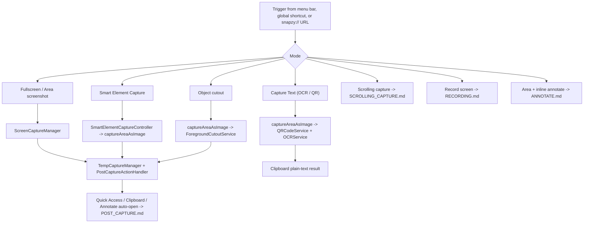
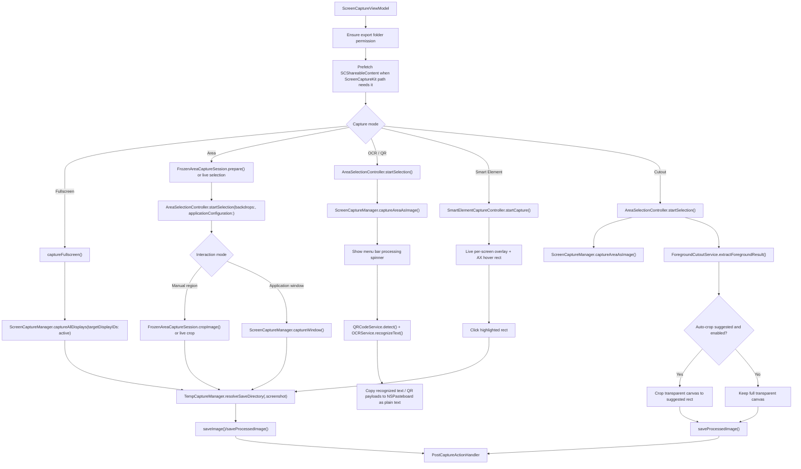

# Screenshot Capture Flows

This doc covers the screenshot capture pipeline: capture modes, the area-selection overlay, OCR/QR, object cutout, and Smart Element — from trigger to saved file. Scrolling capture, screen recording, post-capture routing, and the editors have their own docs (see Related docs).

User-facing copy in these flows is localized through `Snapzy/Shared/Localization/L10n.swift` and `Snapzy/Resources/Localization/{Shared,Features}/*.xcstrings`. Privacy permission copy lives in `InfoPlist.strings`. For localization ownership and rules, read [`LOCALIZATION.md`](LOCALIZATION.md).

## Flow Index

## Capture Modes

| Mode | Default trigger | Coordinating types | Output |
| --- | --- | --- | --- |
| Fullscreen | `⇧⌘3` | `ScreenCaptureViewModel.captureFullscreen()` → `ScreenCaptureManager.captureAllDisplays(targetDisplayIDs:)` | Image file per active display |
| Area (manual region) | `⇧⌘4` | `startAreaCapture(.manualRegion)` → `AreaSelectionController` + `FrozenAreaCaptureSession` or live path | Cropped image file |
| Application window | Menu / shortcut / `snapzy://capture/application` | Same overlay, `.applicationWindow` mode → `ScreenCaptureManager.captureWindow(target:)` | Normal window or an already open, menu-bar-anchored third-party popover; window image incl. shadow (macOS 14+) |
| Active window | Menu / shortcut / `snapzy://capture/active-window` | `ActiveWindowResolver` (AX focused window) → `captureWindow` | Window image |
| Area + inline annotate | `⇧⌘7` | `InlineAreaAnnotateCoordinator` (see [`ANNOTATE.md`](ANNOTATE.md)) | Annotated image file |
| Scrolling | `⇧⌘6` | `ScrollingCaptureCoordinator` (see [`SCROLLING_CAPTURE.md`](SCROLLING_CAPTURE.md)) | Stitched long image |
| OCR text | `⇧⌘2` | `OCRService` + `QRCodeService` | Clipboard text only (no file) |
| Object cutout | `⇧⌘1` (macOS 14+) | `ForegroundCutoutService` | Transparent PNG |
| Smart element | `⌥⇧4` | `SmartElementCaptureController` + AX services | Cropped image file |

All shortcut defaults are configurable; see [`SHORTCUTS.md`](SHORTCUTS.md). `ScreenCaptureViewModel` (`Snapzy/Features/Capture/CaptureViewModel.swift`) is the single entry point for every mode and implements `KeyboardShortcutDelegate`.

## Screenshot, OCR, and Cutout

### Fullscreen and area notes

- Fullscreen resolves the active display from `ScreenUtility.activeDisplayID()` when triggered, then runs through `ScreenCaptureManager.captureAllDisplays(targetDisplayIDs:)` so `Cmd+Shift+3` captures only the screen the user is interacting with. The hot path uses `CGDisplayCreateImage` (via `WindowListDisplaySnapshot`, see **Capture chrome visibility**) for the target display when cursor and desktop icon/widget exclusions are off; it falls back to ScreenCaptureKit for correctness when those options are enabled.
- The fullscreen capture engine can still run without `targetDisplayIDs` for explicit all-display captures. Multi-display post-capture remains batch-aware: Quick Access and history receive every file, clipboard receives file URLs for multi-file batches, and auto-open Annotate opens only the first saved screenshot.
- Screenshot outputs use each display's **native** pixel density. Non-Retina external monitors save at 1× (matching the system screenshot tool; see issue #414). When a selection spans Retina and non-Retina displays, the composite crop promotes and edge-enhances each low-density display slice up to the highest native scale in the selection before drawing it into the shared canvas, preserving native Retina slices without re-sharpening them.
- Area screenshot has two selection modes controlled by Preferences → Capture → "Freeze area capture". Default since v1.26.0 is **live (non-frozen)**: the on-screen content keeps animating during selection and the chosen region is captured at mouse-up through `ScreenCaptureManager.captureArea(rect:)` → `makePreparedAreaCaptureContext` → `capturePreparedArea`. When the live selection spans **multiple displays**, `captureArea` detects the cross-display condition via `displayIDsIntersecting`, captures all intersecting displays in parallel using `captureDisplaySnapshotsCore`, then composites them through `FrozenAreaCaptureSession.cropCompositeImage` — reusing the frozen path's multi-display composite algorithm (DRY). Single-display selections keep the optimized single-capture path. **Frozen** is opt-in and freezes the active display first via `FrozenAreaCaptureSession`, then either crops from that cached snapshot or switches into exact window capture for application mode. Live mode uses the passthrough input architecture (click-transparent overlay driven by a `CGEventTap`) described under "Selection overlay architecture" below.
- Repeat area capture (`repeatArea`, default ⌃⌘⇧4): re-captures the last manually selected area rect instantly, without re-entering selection mode. Every completed manual area selection (live or frozen) is persisted via `ScreenshotLastAreaStore` (UserDefaults `screenshot.lastAreaRect`, AppKit global screen points — same storage pattern as `recording.lastAreaRect`). `ScreenCaptureViewModel.captureRepeatArea()` validates the stored rect against the currently connected displays (notifying via native notification with in-app toast fallback when missing or off-screen — repeat never re-enters the selection flow), then calls `ScreenCaptureManager.captureArea(rect:)` directly, so post-capture routing (Quick Access, clipboard, annotate, history) is identical to a fresh selection. Pressing **Return** during an area-screenshot selection also repeats the stored area (per-session opt-in `allowsRepeatAreaCompletion` on `AreaSelectionController.startSelection`, so OCR/cutout selections sharing `.screenshot` mode keep their default behavior), and `snapzy://capture/repeat-area` exposes the same action to automation.
- Delayed capture shares one countdown (`CaptureDelayCountdownController`, length from `screenshot.delayedCaptureSeconds`: 3/5/10 s, default 3). The HUD never takes focus, so menus and hover states opened during the countdown stay open. Esc or clicking the HUD cancels. When it ends the HUD is hidden before the capture, so it is not in the screenshot.
  - Area (`delayedCapture`, unbound by default; menu bar item; `snapzy://capture/delayed`): `ScreenCaptureViewModel.captureDelayed()` starts area selection on a frozen snapshot regardless of the Freeze screen preference (`forceFrozenSelection`), so the transient UI is preserved.
  - Fullscreen (`delayedFullscreen`, unbound by default; menu bar item; `snapzy://capture/delayed-fullscreen` or `snapzy://capture/delayed?mode=fullscreen`): `ScreenCaptureViewModel.captureDelayedFullscreen()` captures the display the pointer is on through the same path as Capture Fullscreen. The HUD shows a "Full screen" line so the countdown is distinguishable from area capture.
- Pick Color (`pickColor`, unbound by default; menu bar item in Tools; `snapzy://tools/pick-color`): `ScreenCaptureViewModel.pickColor()` → `ColorPickerController` (`Snapzy/Services/Capture/ColorPicker/`). Nothing is frozen: one see-through, non-activating `ColorPickerOverlayWindow` per display (alpha 0.005 so it still takes clicks; Snapzy is never activated, so the app being picked from keeps its active look) goes up at once, then `ColorPickerScreenCapture` fetches shareable content, excludes those overlay windows, and `ColorPickerStreamPixelSource` streams only the display under the pointer through `SCStream` (native pixel size, 32BGRA converted to sRGB by ScreenCaptureKit, display refresh rate capped at 120 fps, `queueDepth` 3). Only the newest complete frame is kept and the main thread is woken at most once per pending frame; the loupe reads just its `(2r+1)²` neighborhood from that frame (`ColorPickerPixelBufferReader`), never a whole-frame copy, so video and animations stay live under it. Moving to another display stops that stream and starts one for the new display. The system cursor is hidden with `BackgroundCursorControl` + `LivePassthroughCursorHider` once the first stream is up, and `ColorPickerLoupe` stands in for it, modeled on dedicated pickers such as ColorSlurp: a circle centered on the sampled pixel, magnifying a pixel-aligned neighborhood so the outlined center cell is exactly the pixel copied; its ring takes the sampled color and a label below (above near the bottom edge) shows HEX, RGB and a hint. Arrow keys move one display pixel (⇧ = 10) and warp the pointer along (`LivePassthroughCursorRestorer`, so there is no post-warp stall); scroll zooms (6–30 pt per pixel), ⌥+scroll resizes (110–260 pt), both remembered in `colorPicker.loupeCellSizeIndex` / `colorPicker.loupeDiameterIndex`. Click, `C`, or Return copies the pixel the loupe shows (in the "Copy on pick" notation, HEX by default) and ends the session — no screenshot is saved — then `ColorPickerResultWindowController` shows the result in a regular titled window (system close and minimize buttons, movable; Snapzy switches to `.regular` while it is open, as Preferences does, and reverts on close). It opens next to the picked point (flipped and clamped to the visible frame) and is reused by later picks. On macOS 26 the window background is the system Liquid Glass material (`NSGlassEffectView` with no corner radius of its own, so the window clips the corners and draws a single border; clear window background). The window frame is set to exactly the measured content size, which lays itself out under the titlebar, so the margins are even; before that it is the standard window background. Content is plain SwiftUI: the color as a large swatch with its hex on it; a row per `ColorPickerFormat` (HEX, `rgb()`, `hsl()`, `hsb()`, naive `cmyk()`, CSS `oklch()`, SwiftUI `Color(red:green:blue:)`, all from the 8-bit sRGB sample) laid straight on the glass, where the whole row copies, a system-tinted checkmark marks the notation on the clipboard, and ⌘1–⌘7 copy by keyboard; the last 8 picked colors (`colorPicker.recentColors`), each click bringing that color back and copying it; a "Copy on pick" menu choosing which notation a pick copies (`colorPicker.copyFormat`, HEX by default, read by `ColorPickerPreferences`); and Pick Again as the default (Return) `.borderedProminent` button. Esc closes the window. Esc, right click, another app activating, a display change, or pressing the shortcut again cancels.
- Multi-display correctness (issue #308): for single-display selections, `makePreparedAreaCaptureContext` picks the display with the **largest intersection** area (mirroring `AreaSelectionWindow.primaryDisplayID` and the recording rule "display with the largest overlap wins"), not the first intersecting screen. For multi-display selections (≥2 displays), the composite path captures all intersecting displays and stitches them into one output image. To prevent ScreenCaptureKit from returning padded images (especially under macOS 14.2+ `.best` resolution) when the requested size exceeds the physical display bounds, config dimensions are set at the display's **native** pixel scale. `capturePreparedArea` then derives the actual scale from the returned `CGImage` dimensions and rebuilds the pixel crop in those real pixels — so HiDPI/scaled ("More Space") and mixed-DPI displays capture the correct region instead of clamping to upper-left. Low-density slices in a mixed-DPI selection are promoted to the highest native scale in that selection after capture; single-display native-density captures pass through without resampling.
- Frozen area screenshot also lazily prepares idle/hovered displays when possible. Area-selection overlay windows are excluded from screen capture, so lazy snapshots do not bake in the dim overlay or create a double-darkened backdrop. During an active cross-display drag, a newly crossed display stays live and is captured after mouse-up once the overlay has been hidden, avoiding a mid-drag freeze jump while preserving fast initial activation. Manual selection is tracked in global screen coordinates and rendered per display, so one selection rectangle can span multiple monitors.
- The live area-selection overlay has an adaptive inside-selection layer that flips between dark-on-light and light-on-dark based on the background luminance under the selection. It renders only when Preferences → Capture → "Show selection area overlay" is **off** (the standard dimming overlay path never uses it). To sample luminance, live mode captures an **invisible** backdrop (`AreaSelectionBackdrop(isVisible: false)`) via `CGWindowListCreateImage`. That capture is gated on the overlay-off state (skipped entirely by default) and runs off the main thread (`Task.detached`), because a synchronous full-screen composite blocks the run loop and lets WindowServer reset the crosshair to the arrow during overlay present / first drag.
- The live overlay is a `.nonactivatingPanel` and never becomes key (activating would dim live windows), so AppKit's cursor-rect machinery does not self-heal the crosshair after an external reset. The crosshair, key focus, and overlay windows ordering are kept sticky by re-asserting them via `NSWorkspace.activeSpaceDidChangeNotification` and `NSApplication.didBecomeActiveNotification` observers during a session (`handleSessionSpaceOrActivationChange`): they restore key focus on the keyboard-owner panel, order the overlays to the front, refresh cursors, force a layer recommit (`needsDisplay`), and re-arm the presentation watchdog (see "Selection overlay architecture"). Overlay pointer events (hover/drag) also request this recovery via `areaSelectionWindowDidRequestDisplayActivation`, coalesced to a low-rate safety net (`eventDrivenSessionRecoveryMinInterval`, 0.5s) — running it per pointer tick cost multiple ms of main-thread time per mouse event (watchdog WindowServer window-list query, per-window orderFront/cursor-rect/needsDisplay passes, log writes) and visibly starved the crosshair/coordinate updates that share the thread. The app itself is deliberately never reactivated — area selection is the one overlay flow that stays non-activating so foreground-window capture still observes the previously frontmost app.
- For screenshot sessions, the target display overlay now owns direct keyboard handling for `Escape` and the application-mode toggle key, so cancel still works when Snapzy starts from a background custom shortcut without depending on Accessibility-backed global key monitoring.
- `Cmd+Shift+4` area capture has two interaction modes inside the same overlay session: manual region by default, and application window mode toggled with the configurable `Application Capture` key (default `A`).
- Application-window capture can also start directly from the menu, independent shortcut, or `snapzy://capture/application`; it uses the same area capture flow with `.applicationWindow` as the initial interaction mode.
- Active-window capture resolves the AX focused window of the frontmost app via `ActiveWindowResolver`, maps it to the nearest `WindowCaptureTarget` candidate, and captures it through the same `captureWindow` path — no selection overlay appears.
- In live application window mode, Snapzy synchronously retains an already-open eligible menu-bar popover before showing any overlay. Because some transient WindowServer popovers can be enumerated but not rendered as an independent Core Graphics window, Snapzy takes one containing-display snapshot and crops the detected popover bounds from that pre-overlay image. After the overlay appears, it checks the exact `CGWindowID` during a short, bounded session-start interval: if the source closes, the retained image is restored beneath the existing dim-mask cutout; if it remains visible, no duplicate image is drawn. The retained image receives a 12pt transparent rounded-corner mask so flattened desktop pixels do not leak into exported PNG corners. The retained candidate is merged ahead of the normal front-to-back layer-0 list built from `CGWindowListCopyWindowInfo` plus `SCShareableContent`. Normal app windows keep their live behavior; only menu-bar-anchored third-party nonzero-layer popovers/dropdowns already open at capture start are retained. Snapzy, Dock, Control Center, and Notification Center are excluded.
- Exact window capture is handled by `ScreenCaptureManager.captureWindow()`. ScreenCaptureKit is preferred for every still-resolved `SCWindow`; its output scale uses the target display's backing scale (falling back to ScreenCaptureKit's point-pixel scale only when the display cannot be resolved), and a materially undersized returned image is routed through the existing display-area crop fallback. This keeps Retina windows from being saved at an intermittent nominal 1× while preserving native 1× external-display output. When the window shadow is included (macOS 14+), the output canvas gets 128pt of transparent padding per side with `scalesToFit` off: the filter's content rect excludes the shadow, and a frame-sized canvas made ScreenCaptureKit shrink the shadowed window to ~91% and blur it (issue #569). The unused padding is trimmed afterwards; with the cursor shown, the trim bounds come from a second cursor-free pass so a cursor in the padding cannot enlarge the image, and the undersize check runs on the trimmed image. Because the trimmed image still carries the shadow, a padded capture smaller than the native window on both axes (`WindowCaptureResolution.isScaledBelowNative`) is also routed to the display-crop fallback instead of being saved soft; a shrink smaller than the shadow's share of the image (about 0.89× and above for an 800×620pt window) still passes, so fresh frames are the primary guard. `WindowSelectionQueryService.resolveWindow` compares the cached `SCWindow.frame` with the window's live `CGWindowList` bounds and refetches `SCShareableContent` when they differ by more than 1pt: a frame cached before a resize sized the canvas for the old window and shrank the capture to 0.80–0.89× (issue #634). If a retained eligible menu-bar popover is no longer shareable, Snapzy saves the pre-overlay display crop instead of recapturing after it has disappeared. The legacy Core Graphics single-window path remains only as a fallback for a live eligible popover. Quick Look previews are detected as `QuickLookUIService` WindowServer windows and their pre-overlay display crops are composited back into filtered fullscreen, frozen-area, and live-area captures because ScreenCaptureKit may enumerate them as off-screen. Snapzy does not force third-party popovers to remain open.
- The frozen/manual and application-window paths both preserve existing desktop icon/widget exclusion, cursor, own-app exclusion, temp-save, Quick Access, clipboard, and annotate routing behavior.
- When own-app exclusion hides visible normal Snapzy windows for screenshot, OCR, cutout, scrolling capture, or pre-recording setup, those windows are ordered out temporarily (`HiddenWindowSession`) and restored after the capture/session finishes or is cancelled.
- Capture toasts, alerts, open-panel prompts, and error surfaces are localized through `L10n`.
- Known limitation: under macOS Accessibility Zoom (fullscreen style), screenshots capture the logical (unzoomed or top-left-anchored, version-dependent) display rather than the magnified on-screen view — no public API exposes the zoom pan offset. See "Known Limitations" in [`RECORDING.md`](RECORDING.md) (issue #423).

### Selection overlay architecture

- `AreaSelectionController` (`Snapzy/Services/Capture/AreaSelectionWindow.swift`, `@MainActor` singleton) orchestrates sessions: pooled per-display `AreaSelectionWindow` panels (`prepareWindowPool()` pre-allocates at launch for <150ms activation; pool refreshed on screen-parameter changes — mid-session, newly attached displays get configured and shown immediately so no hidden click fall-through hole appears; pool **rebuilt from scratch** on Space-churn signals — `NSWorkspace.activeSpaceDidChangeNotification` and `didWakeNotification`, debounced 500ms, idle only — because a long-lived ordered-out panel's WindowServer all-spaces membership rots as Spaces churn beneath it, and a fresh panel is the only reliable membership reset), Escape monitors (local + global), and Space/app-activation observers that trigger backdrop recapture.
- Session lifecycle is single-fire and re-entrancy safe. Starting a session while one is presenting tears the previous one down through the normal cancel path first — its completion is invoked once with `nil` (so each feature's own cancel cleanup runs: `ScreenCaptureViewModel.isAreaSelectionActive` resets, hidden windows restore, frozen sessions invalidate), its observers and Quick Access suspension are released, and the new session then starts clean. Completions are snapshotted and cleared before invocation, so a completion that synchronously calls back into the controller (live area mode calls `cancelSelection()` to dismiss) cannot fire twice.
- A bounded **presentation watchdog** (`scheduleSessionPresentationWatchdog`) verifies that pooled panels actually present, not just report `isVisible`: it checks once on the next run-loop turn after `activatePooledWindows`, then every 0.5s for the first ~3s of the session, and re-arms for the same window after every space/app-activation change (space switches are the prime suspect for a panel losing its all-spaces membership — the field failure where the overlay shows on one desktop Space but not another while live-passthrough selection keeps working invisibly). Each check evaluates `AreaSelectionPresentationLogic` — visibility, active-space membership, frame-vs-screen sync, alpha, occlusion, and the WindowServer's own on-screen list (`CGWindowList` `.optionOnScreenOnly` matched by window number, the ground truth AppKit properties can all miss for a `.canJoinAllSpaces` panel; a failed query is "unknown", never an anomaly). Heals escalate per display via `AreaSelectionPresentationLogic.healAction`: membership loss (`offActiveSpace` / `notOnScreenPerWindowServer`) goes straight to **pooled-window recreation** (`recreatePooledWindow` — a fresh panel's new WindowServer record re-establishes all-spaces membership at order-in time; the earlier order-out + `collectionBehavior`-toggle re-assert was field-proven to never repair membership loss and was removed), transient anomalies (occlusion turbulence, refused ordering, stale frame) get one cheap `orderFrontRegardless` + frame-resync re-assert before escalating to recreation on the next tick. Recreation is capped at 2 per display per session, defers while a non-passthrough drag is in progress, and has a single last-resort rung that activates the app before recreating once more (the inline-annotate formula) when the cap is spent. Anomalies are logged with the chosen heal action and the overlay's layer diagnostics (`AreaSelectionOverlayView.presentationDiagnostics()`), and a later clean check logs the recovery — so field reports from the diagnostic bundle show the failing state, the heal applied, and whether it worked.
- The dismiss policy is a `dismissesAfterSelection` start parameter (default `true`), applied after session-start teardown so it cannot be wiped by a replacement-cancel or leak across sessions; live area mode passes `false` and dismisses via `cancelSelection()` inside its completion after securing mouse-up snapshots. `setDismissesAfterSelection` remains for compatibility but new callers should use the parameter.
- `AreaSelectionWindow` is a nonactivating `NSPanel` per display, registered as capture chrome (see **Capture chrome visibility** below) so screen recorders see it while Snapzy's own captures leave it out; `collectionBehavior = [.canJoinAllSpaces, .fullScreenAuxiliary, .stationary]` joins every Space at `.screenSaver` level (membership loss is the watchdog's ground-truth check above); a pointer-tracking timer promotes "key-follows-pointer" keyboard ownership for non-activated live sessions. In live passthrough sessions (below) the timer stays off — Esc/arrows arrive via the event tap regardless of which window is key, and Space/application-toggle keys are passed through to the key overlay.
- **Live passthrough input** (default since the live-capture-passthrough change; Preferences → Capture → Screenshot → "Hover passthrough", `PreferencesKeys.screenshotLivePassthrough`): live (non-frozen) screenshot sessions make the overlay panels hit-transparent (`ignoresMouseEvents = true`, fully clear background — required for hover persistence: any hittable window under the pointer steals pointer ownership from the app beneath, which synthesizes tracking-exit and dismisses its hover UI) and drive the selection gesture from a global `CGEventTap` (`CaptureEventTapController` — active `.cgSessionEventTap`, head-insert, run-loop source on the main run loop). The tap **consumes every mouse event** (semantics corrected after user validation against CleanShot X, 260723): interaction with the apps beneath is frozen, so hover UI that is already visible when capture activates (tooltips, hover cards) is never dismissed by mouse-moved/exited events and persists into the captured pixels — the trade-off is that no *new* hovers trigger during the session. Observed `mouseMoved` still drives the crosshair/magnifier/coordinate indicator before it is consumed; button/drag events are consumed and routed into the same selection state machine the window-event path uses (shared point-based handlers in `AreaSelectionOverlayView`). The overlay never becomes key in a passthrough session: keying even a nonactivating panel resigns the key window of the app beneath, and Qt apps (e.g. DaVinci Resolve) dismiss their tooltips on that deactivation, so OCR/area capture lost them (#635). Keystrokes therefore arrive through the tap too (`keyDown`/`keyUp`): Esc, Space-drag move, the application-mode toggle, Return repeat-area and the magnifier's `C` copy are handled exactly as the key overlay would; every other key is consumed so it cannot dismiss hover UI or fire shortcuts in the app beneath. Unhandled ⌘ chords pass through (system shortcuts keep working), and a keyUp is consumed only when the session consumed its keyDown. Keys pressed before the session started — notably the capture hotkey — release normally: swallowing the hotkey's keyUp leaves the WindowServer treating the hotkey as still held, so it drops the next press of the same shortcut (every second press did nothing). If Secure Event Input is on at session start (the tap receives no keystrokes then) the overlay stays key as before so Esc keeps working. One tap is created per session and `stop()` disables it, removes its run-loop source, and invalidates its `CFMachPort` — invalidation is what unregisters it from the WindowServer; without it every session left a disabled active tap behind for the life of the process (#566). The tap re-enables itself on `tapDisabledByTimeout`/`tapDisabledByUserInput` (if the tap ever dies, events land on the overlay whose handlers are inert in passthrough mode — the apps beneath never see them either way), hover updates are gated to the fastest display's refresh rate (latest point wins per frame, the leading edge runs immediately — capping below display rate reads as a trailing crosshair on high-refresh screens) with a sub-1px hit-test guard that always processes display crossings, and signposts under subsystem = bundle id / category `CapturePassthrough` (DEBUG, `perf.signposts` default) cover the tap callback and hover update. The dim layer mirrors the legacy appearance: in manual-region mode it shows from session start when Preferences → Capture → "Show selection area overlay" is on (already-visible hover UI stays alive — the consumed events never dismiss it — but appears dimmed until the drag cutout and the final capture restore full brightness); with the preference off the dim layer is colorless and the pre-drag screen stays untouched. Window-selection mode always shows it with the hover cutout. The visible cursor is the exact legacy cursor image drawn at the pointer as a `CALayer` proxy (crosshair in manual mode, camera in window mode) for pixel-parity with the window-event path. In passthrough the real system cursor's image is never set — only the proxy renders the crosshair — so the crosshair cannot stick onto later UI (e.g. the Quick Access card) after the session now that `BackgroundCursorControl` makes background cursor changes take effect. The session hides the system cursor with `CGDisplayHideCursor` per display so only the proxy shows. Because `CGDisplayHideCursor` normally affects only the *foreground* application and Snapzy must never activate mid-capture, `BackgroundCursorControl` first grants this background agent cursor control via the private `SetsCursorInBackground` CGS connection property (resolved lazily by `dlsym`, idempotent, once per run); the hides then take effect and the system arrow disappears, leaving only the crosshair — matching the legacy window-event path. Residual edge: while the pointer is over the Dock the WindowServer keeps the Dock in cursor control, so the arrow can briefly reappear there; and if the private property is ever unavailable the hide silently no-ops and the previous arrow-visible baseline returns. Alternatives were evaluated and rejected: cursor rects require a hittable overlay (kills hover persistence), `NSCursor.hide()` only applies over our own windows, and cursor parking via disassociation + warp was rejected in user validation. Hide/show balance is tracked per display by `LivePassthroughCursorHider` so the cursor can never be left hidden where a hide did take effect, and restored in the single teardown funnel (`resetCallbacks`) on every exit path (commit, cancel, Esc, right-click, session replacement). The funnel also warps the cursor to the last pointer location the tap observed (then re-associates via `CGAssociateMouseAndMouseCursorPosition`) before showing it, because the consuming tap leaves the WindowServer's tracked cursor position stale — a plain `CGDisplayShowCursor` would otherwise reveal the arrow at the pre-session spot (a visible jump).
- Live passthrough requires Accessibility permission. Without it (or with the preference off) the session silently falls back to the legacy window-event overlay — same appearance and behavior as before, including the pointer-tracking timer; the system permission prompt is shown at most once per app run, and the preference row surfaces a "requires Accessibility permission" hint linking to System Settings.
- `AreaSelectionOverlayView` renders with CALayers: display backdrop, conditionally restored retained menu-bar popover crops, dim mask with punch-out, crosshair, size/coordinate indicators, and mode hint text. Manual drags render across displays; application-mode hover hit-tests the `WindowSelectionSnapshot.orderedCandidates` list. In live sessions, that list starts with retained menu-bar popover candidates captured at shortcut time, then merges asynchronously queried layer-0 candidates.
- Interaction modes (`AreaSelectionInteractionMode`): `.manualRegion` and `.applicationWindow`, toggled at runtime via the configurable overlay key. Recording sessions add `.fullDisplay` (Enter), see [RECORDING.md](RECORDING.md#picking-a-target-in-the-recording-overlay). Results flow as `AreaSelectionResult{target: .rect|.window|.display, displayID, mode, displayIDs, spansMultipleDisplays}`; `.display` is recording-only, and screenshot consumers treat it like `.rect`.
- `AreaSelectionMagnifier` provides a square pixel loupe with scroll-wheel zoom (⌘+scroll, 1–20×, direction reversible in Preferences), fed only from backdrop pixels so frozen sessions magnify the snapshot. It draws a pixel grid (zoom ≥ 6) and a crosshair on the target pixel, and an optional color picker panel below it (swatch, hex value, `C` to copy). Session-start preferences, read by `resetMagnifierZoomForNewSession` (area screenshot) and `InlineAreaAnnotateSession` (screenshot-and-annotate): show by default (starts at 7×), show color picker panel, and size (`MagnifierSizeOption`: small 128pt / medium 160pt default / large 200pt; the panel shares the preview width). These are independent — the color panel also shows on a magnifier opened with ⌘+scroll. When the copy hint's translation does not fit the panel width, its leading words are dropped ("[C] to Copy") and an overlong suffix ends in "…".
- `WindowSelectionQueryService` also resolves the exact `SCWindow` at capture time and propagates `ownerPID` into `WindowCaptureTarget` for capture metadata (drives `{appName}` output naming).

### Capture chrome visibility

Snapzy's capture UI shows up in screen recordings (Snapzy's own and third-party ones such as QuickTime, OBS, Zoom), like CleanShot X, but never in Snapzy's screenshots.

- `CaptureChromeWindowRegistry` (`Snapzy/Services/Capture/CaptureChromeWindowRegistry.swift`) is the single list of Snapzy windows captures must handle. Roles: `.captureOverlay` (area selection pool, smart element, color picker, scrolling HUD/preview/region, delayed-capture countdown), `.recordingControls` (recording toolbar, recording region overlay), `.appWindow` (Quick Access, toasts).
- `configure(_:role:)` sets `sharingType = .readOnly` (visible to every ScreenCaptureKit client) and registers the window. `configureAppWindow(_:)` makes app windows `.readOnly` only when `screenshot.includeOwnApp` or `recording.includeOwnApp` is on, else `.none`.
- Snapzy screenshots exclude `screenshotExcludedWindowIDs()` (all roles; app windows only when `screenshot.includeOwnApp` is off):
  - Core Graphics fast paths go through `WindowListDisplaySnapshot` (`Snapzy/Services/Capture/WindowListDisplaySnapshot.swift`). When no excluded window is on screen it runs the original `CGDisplayCreateImage` / `CGWindowListCreateImage(.optionOnScreenOnly)` call unchanged; otherwise it composites every other on-screen window with `CGWindowListCreateImageFromArray` (same cost, pixel-identical elsewhere; Quick Look previews render the same). Overlays are never ordered out for a snapshot — `orderOut` is asynchronous and the overlay still bakes in.
  - ScreenCaptureKit (`ScreenCaptureManager.buildFilter`): own-app exclusion already drops chrome; when Snapzy is included and chrome is visible, the filter excludes Snapzy and excepts its non-chrome windows (SCK cannot exclude an app and windows at once). Color picker and scrolling capture exclude their own windows / Snapzy as before.
- Snapzy recordings: with own app excluded (default), `ScreenRecordingManager.makeContentFilter` excepts `.captureOverlay` windows. Hidden pooled overlays are listed by `SCShareableContent` and excepted at stream start, so they appear from the first frame; overlays registered mid-recording trigger one coalesced `updateContentFilter`. With own app included, `RecordingCoordinator` excludes the `.recordingControls` windows.
- No preference hides capture chrome from third-party recorders or meeting screen shares.

### OCR and QR notes

- OCR is the only capture path that does not create a file; it captures a `CGImage`, shows a menu bar processing spinner (`AppStatusBarController.setProcessing`) while recognition runs, then copies text/QR payloads to the pasteboard as plain text.
- Recognition is routed by `OCRModelResolver` (from the persisted selection, `ocr.selectedModel`) to an `OCRProvider` for the active provider: `VisionOCRProvider` (built-in Apple Vision, default) or `RemoteOCRProvider` (custom OpenAI-compatible chat-completions endpoint, base64 JPEG, 60s timeout). `OCREngine` is `vision` / `remote`.
- The built-in engine is Vision `VNRecognizeTextRequest` (`OCREngine.vision`, `.accurate` level). `OCRService` runs per-language profiles (`VisionOCRProfile`: en, vi, es, ru, fr, de, ja, ko, zh-Hans, zh-Hant, plus code/dense-document/recovery profiles), then contrast-enhanced and vertical-CJK recovery passes, picking the best candidate by confidence (diacritic-aware for Vietnamese).
- Narrow vertical CJK OCR uses a constrained recovery path inside `OCRService`: if normal Vision profiles and contrast recovery find no usable text, upright CJK glyph rows are normalized into a horizontal recovery image (`VerticalCJKTextNormalizer`) before retrying Vision. This keeps horizontal OCR unchanged while improving traditional vertical text layouts.
- OCR providers are managed under Settings → Capture → OCR → OCR Model (see [`PREFERENCES.md`](PREFERENCES.md)). Apple Vision is always available. Custom endpoint metadata is JSON-persisted in `ocr.customModels`; optional API keys live in the macOS Keychain (service `com.trongduong.snapzy.ocr`) and are never exported.
- Only one provider is active. A removed or unavailable custom endpoint resolves to built-in Vision and is persisted back by `OCRModelResolver`. Legacy `dl:<id>` selections from older configurations are also canonicalized to `builtin`.
- QR detection (`QRCodeService`, `VNDetectBarcodesRequest`) runs as local Vision work alongside OCR where possible, with capture/processing duration logged for latency checks. `OCRQRPayloadComposer` merges deduped QR payloads into the clipboard text, skipping payloads already contained in the OCR text.
- QR payload handling is passive by design: Snapzy does not open decoded URLs, perform network requests, load WebViews, execute processes, or write QR payloads as file URL pasteboard items.
- Detected web links (NSDataDetector, max 3, http/https only) optionally surface in a floating clickable `OCRLinkPromptManager` panel (10s auto-dismiss) — pref `ocrLinkDetectionEnabled`, default on.
- Every OCR action reports exactly one result to the user, controlled by `ocrSuccessNotificationEnabled` (persisted key `ocr.successNotificationEnabled`, **default on**). With it on, `OCRResultNotifier` posts a native macOS notification through `SystemNotificationService` (`UserNotifications`): `Text has been copied` + a single-line preview of the recognized text (`OCRNotificationContent.preview`, 200 grapheme clusters max, whitespace collapsed, `…` suffix), `No Text Detected`, or `OCR Failed`. The clipboard always holds the full untruncated text.
- Notifications carry no sound (`content.sound = nil`) because Snapzy already plays `QuickAccessSound.complete` / `.failed`; identifiers are fresh UUIDs so consecutive captures never coalesce, and the `UNUserNotificationCenterDelegate` returns `[.banner, .list]` so the banner shows even when Snapzy is frontmost.
- Onboarding asks for notification permission up front via an optional row on the permissions step, so most users are already authorized before their first OCR. Otherwise authorization is requested lazily on the first OCR notification and at most once per launch. Explicit user actions (the onboarding row, the "Allow" button in Preferences → Capture → OCR) bypass that once-per-launch gate. When the preference is off, authorization is denied, or delivery throws, `OCRResultNotifier` falls back to the previous in-app `AppToastManager` toast — OCR itself never depends on notifications being available.

### Object cutout notes

- Object cutout is macOS 14+ only (`ForegroundCutoutService`, Vision `VNGenerateForegroundInstanceMaskRequest`, all subject instances masked on the full canvas). Fully on-device.
- Safe auto-crop: `ForegroundAutoCropPolicy` evaluates the alpha bounds (alphaThreshold 8, edge inset 2px, min subject 24px / 0.4% area, min reduction 8%, adaptive 1% padding clamped 2–16px) and returns `.suggested` or a skip reason. Applied only when Preferences keeps `backgroundCutoutAutoCropEnabled` on (default true).
- JPEG is overridden to PNG because transparency must be preserved.
- The same service powers the Annotate editor's Remove Background button; see [`ANNOTATE.md`](ANNOTATE.md).

### Smart Element notes

- Smart Element Capture is standalone. It starts from the menu, an optional user-bound global shortcut (default `Option+Shift+4`), or `snapzy://capture/smart-element`; it does not run inside the `Cmd+Shift+4` area overlay and does not freeze the desktop before hover.
- Smart Element Capture requires Accessibility permission. Startup gates through `AXIsProcessTrustedWithOptions`; without permission, Snapzy does not show the standalone overlay.
- During a Smart Element session, `SmartElementCaptureController` owns one live overlay panel per screen. `SmartElementWindowOwnerResolver` finds the topmost non-Snapzy window under the cursor, `SmartElementQueryService` uses the window PID with `AXUIElementCopyElementAtPosition`, and `AXElementInspector` normalizes AX bounds into AppKit bottom-left coordinates for highlight rendering. To ensure 60fps overlay performance, the AX queries run on a background queue with a throttle, preventing main thread blocking.
- Clicking inside the highlighted rect commits through `ScreenCaptureViewModel.captureSmartElement(rect:)`, which reuses the screenshot save and post-capture pipeline. Clicking outside the highlight or pressing `Escape` cancels without writing a capture.
- Known limitation: Chromium-based apps (Chrome, Slack, Claude desktop, Electron) may expose only `AXWebArea` for web content unless launched with `--force-renderer-accessibility` (Chromium) or `app.setAccessibilitySupportEnabled(true)` (Electron). Inside such apps the highlight may snap to the whole web view rather than individual DOM elements.

## Key Files

| File | Responsibility |
| --- | --- |
| `Snapzy/Features/Capture/CaptureViewModel.swift` | Entry point for screenshot, scrolling capture, OCR, cutout, smart element, and recording launch |
| `Snapzy/Features/Capture/OCRLinkPromptManager.swift` | Floating clickable link prompt panel after OCR |
| `Snapzy/Services/Capture/ScreenCaptureManager.swift` | Core screenshot engine, frozen snapshot capture, window capture, and file writing |
| `Snapzy/Services/Capture/AreaSelectionWindow.swift` | `AreaSelectionController`, `AreaSelectionWindow`, `AreaSelectionOverlayView` — the selection overlay stack |
| `Snapzy/Services/Capture/AreaSelectionBackdrop.swift` | Shared selection models: backdrops, `WindowCaptureTarget`, `AreaSelectionResult`, interaction modes |
| `Snapzy/Services/Capture/AreaSelectionMagnifier.swift` | Scroll-zoom pixel loupe for the selection overlay |
| `Snapzy/Services/Capture/FrozenAreaCaptureSession.swift` | Frozen display snapshots used by area screenshot selection |
| `Snapzy/Services/Capture/WindowSelectionQueryService.swift` | App-window candidate list and exact `SCWindow` resolution |
| `Snapzy/Services/Capture/ActiveWindowResolver.swift` | AX focused-window resolution for active-window capture |
| `Snapzy/Services/Capture/SmartElement/` | Standalone Smart Element overlay session, query service seams, capture performer |
| `Snapzy/Services/Capture/AXElementInspector.swift` | AX role allow/deny lists, parent-chain walk to the meaningful element, coordinate flip |
| `Snapzy/Services/Media/OCRService.swift` | OCR routing via `OCRModelResolver` + Vision orchestration: normalization, multi-profile passes, recovery paths, scoring |
| `Snapzy/Services/Media/OCR/` | `OCRProvider` engines (built-in Vision and remote OpenAI-compatible), custom endpoint persistence, OCR profiles and result normalization |
| `Snapzy/Services/Media/QRCodeService.swift` | Local QR payload detection for OCR capture |
| `Snapzy/Services/Media/ForegroundCutoutService.swift` | Vision subject-mask cutout + safe auto-crop policy |
| `Snapzy/Services/Wallpaper/DesktopIconManager.swift` | SCK content-filter exclusion to hide desktop icons/widgets at capture |
| `Snapzy/Services/Capture/TempCaptureManager.swift` | Save-vs-temp destination logic and temp capture lifecycle |
| `Snapzy/Services/Capture/PostCaptureActionHandler.swift` | After-capture action executor (see [`POST_CAPTURE.md`](POST_CAPTURE.md)) |

## Related docs

- [`SCROLLING_CAPTURE.md`](SCROLLING_CAPTURE.md) — long screenshot stitching subsystem
- [`RECORDING.md`](RECORDING.md) — screen recording, GIF output, Smart Camera metadata
- [`POST_CAPTURE.md`](POST_CAPTURE.md) — after-capture matrix, destinations, formats, clipboard
- [`ANNOTATE.md`](ANNOTATE.md) — inline area annotate (Capture Markup) and the full editor
- [`QUICK_ACCESS.md`](QUICK_ACCESS.md) — floating post-capture panel
- [`HISTORY.md`](HISTORY.md) — capture history and retention
- [`SHORTCUTS.md`](SHORTCUTS.md) — global shortcut defaults and `snapzy://` routes
- [`PREFERENCES.md`](PREFERENCES.md) — Settings → Capture reference
- [`STRUCTURE.md`](STRUCTURE.md) — source tree and runtime architecture
- [`LOCALIZATION.md`](LOCALIZATION.md) — localization ownership and rules
