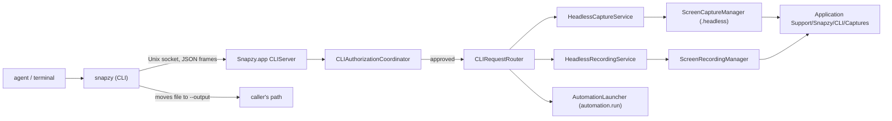

# snapzy Command Line Tool

`snapzy` lets AI agents, scripts, and terminals capture or record a display, a window, or an area through Snapzy — no overlay, no clicks — and get back a file path, JSON metadata, and an exit code. It can also run the user's [automations](#automations) (capture → copy / upload → link) and wait for the result. It ships inside the app at `Snapzy.app/Contents/Helpers/snapzy`.

Current as of HEAD (`v2.3.0-beta.14`, build 247, macOS 13.0+ deployment target).

## How it works



- The CLI is a thin client. Snapzy does the capture, so Screen Recording permission stays with Snapzy — the caller's terminal never needs it.
- If Snapzy is not running, the CLI opens it in the background (`--launched-by-cli`: no splash or feature intro when onboarding is complete; unfinished onboarding still shows and the CLI gets `onboardingIncomplete`) and waits for the socket. `--no-launch` fails instead.
- Headless captures and recordings never open Quick Access, touch the clipboard, add history rows, apply presets, play a sound, or prompt for permission.

## Install

| Channel | How `snapzy` gets on PATH |
| --- | --- |
| Homebrew | The cask links `binary "#{appdir}/Snapzy.app/Contents/Helpers/snapzy"`, added by the release workflow from the first stable release that ships the tool |
| `install.sh` | Links `/usr/local/bin/snapzy` when that directory is writable; otherwise prints the `sudo ln -sfn …` command. Never replaces a regular file or another tool's live link. Prints `brew reinstall --cask snapzy` instead when the cask is installed |
| Settings → Command Line | **Install** creates the link (administrator password only if `/usr/local/bin` is not writable); refused while Snapzy runs from a DMG or AppTranslocation. **Uninstall** removes only a link to this app's helper. Homebrew-managed links are shown, not changed; a cask install without that link shows **Copy Command** (`brew reinstall --cask snapzy`) instead of Install |
| Direct | Agents can always call `/Applications/Snapzy.app/Contents/Helpers/snapzy` |

Debug builds (`com.trongduong.snapzy.debug`) link `/usr/local/bin/snapzy-debug` instead (`CommandName`, keyed by bundle ID like the socket), so a development copy never takes the installed app's `snapzy`. Settings → Command Line in a Debug build only replaces links into `Snapzy Debug*.app`; a release build replaces any link into a `Snapzy*.app`, which reclaims a `snapzy` link made by a Debug build from before the split. `snapzy doctor` from a Debug helper checks and hints `snapzy-debug`.

`uninstall.sh` removes `/usr/local/bin/snapzy` only if it points into a `Snapzy*.app`.

### Homebrew and Sparkle

Sparkle replaces the whole bundle at the same path, so the helper updates with the app and every link keeps working. Homebrew only links the helper when it installs or upgrades the cask, so:

- A cask installed before the tool shipped and then updated in-app has no link. `CLIToolInstaller` reports `homebrewLinkMissing` (`Caskroom/snapzy` exists, the app is named `Snapzy.app`, no link works) and refuses to link, and `snapzy doctor` prints the same hint: `brew reinstall --cask snapzy`. Until a stable release adds the `binary` stanza (Sparkle beta users), link by hand or call the helper's full path.
- On Intel Macs the cask's link and Snapzy's own link are both `/usr/local/bin/snapzy`. The cask's `preflight_steps` removes `$(brew --prefix)/bin/snapzy` when it is a symlink into an app's `Contents/Helpers/snapzy`, so `brew install`/`upgrade` never stops at "already a Binary". Anything else there is left alone; on Apple Silicon that path is never Snapzy's own link.
- The cask keeps `auto_updates true`, as homebrew-cask requires for Sparkle apps. `brew upgrade` then reinstalls Snapzy only when the installed bundle is older than the tap, so a user Sparkle already updated never gets the link from it; the hint is `brew reinstall`, which always reruns the cask.
- `Casks/snapzy.rb` mirrors [the official cask](https://github.com/Homebrew/homebrew-cask/blob/main/Casks/s/snapzy.rb). The release workflow only bumps the local copy and adds `binary`; Homebrew users get the link once a PR adds `binary` (and optionally `preflight_steps`) to homebrew-cask.

## Commands

| Command | Does |
| --- | --- |
| `snapzy status` | App version, command line access, onboarding, Screen Recording, this app's approval. Never needs approval |
| `snapzy doctor` | Checks CLI path, PATH, app, connection, and status; explains each failure. Never launches Snapzy |
| `snapzy version` | CLI and app versions. Never launches Snapzy; exits 5 after printing when Snapzy is unreachable |
| `snapzy list displays` | Connected displays |
| `snapzy list windows [--app NAME] [--all]` | Capturable windows, front to back; `--all` adds off-screen windows |
| `snapzy list apps` | Running apps with windows |
| `snapzy capture screen [--display main\|all\|ID]` | One file per display |
| `snapzy capture window --id ID \| --app NAME [--title REGEX] [--index N] \| --active [--no-shadow]` | One window, even when covered. `--id` and `--app` only find on-screen windows; IDs from `list windows --all` that are off screen give `targetNotFound` |
| `snapzy capture area --rect x,y,w,h` | A rectangle; must lie fully on screen |
| `snapzy record screen [--display main\|ID]` | Records one display. Stays attached until Ctrl-C/SIGTERM/`--duration`, then prints the file — see [Recording](#recording) |
| `snapzy record window --id ID \| --app NAME [--title REGEX] [--index N] \| --active` | Records one on-screen window, even when covered |
| `snapzy record area --rect x,y,w,h` | Records a rectangle; one spanning displays records the part on the display it overlaps most |
| `snapzy record stop [--id ID] [-o PATH] [--force]` | Stops the `snapzy` recording (or collects one stopped from the menu bar) and prints its file |
| `snapzy record status` | The `snapzy` recording in progress, if any. Never starts or stops anything |
| `snapzy automation list` | Every automation with its id, source, enabled steps and whether the command line may run it; runnable ones first — see [Automations](#automations) |
| `snapzy automation run ID\|NAME [--file PATH]…` | Runs an automation like its shortcut would and waits for the result (link, files). With `--file` the capture is skipped and the steps run on those files |
| `snapzy measure image PATH (--at x,y \| --box x,y,w,h)…` | Measures an image file **in the CLI process**: no app, no approval, no Screen Recording permission |
| `snapzy measure screen [--display main\|ID] (--at … \| --box …)…` | Captures one display, then measures it locally |
| `snapzy measure window --id ID \| --app NAME … \| --active (--at … \| --box …)…` | Captures one window without its shadow, then measures it |
| `snapzy measure area --rect x,y,w,h (--at … \| --box …)…` | Captures a rectangle, then measures it |
| `snapzy mcp [--session TOKEN] [--timeout S]` | Hidden. stdio MCP server for an agent CLI that Snapzy itself started for Annotate's AI prompt — see [snapzy mcp](#snapzy-mcp) |

App matching (`--app`): exact bundle ID, else exact name, else name prefix — case-insensitive, best tier only (so `Code` never mixes VS Code's windows with Codex's; with no app named exactly `Code`, the prefix tier still matches `Codex`). With several matches the frontmost window wins and `matchedCandidates` reports the count; `--index` picks another (0-based).

### Options

| Option | Applies to | Meaning |
| --- | --- | --- |
| `-o, --output PATH` | capture | File path (`name-1.ext`, `name-2.ext`… for several displays), directory (trailing `/` or existing dir: keeps staging names), or `-` for stdout (single file only). Without it the file stays in staging. An existing single-file target fails **before** capturing unless `--force`; directory and multi-display collisions are found after capturing, and the error names the staged file. With `-`, image bytes go to stdout and the JSON metadata goes to stderr only with `--json` |
| `--format png\|jpg\|webp\|heic\|avif` | capture | Defaults to the `--output` extension (`.heif` maps to heic), else png. A conflicting extension is an error. `avif` fails with `invalidArguments` on a macOS without an AVIF encoder |
| `--quality 0…1` | capture | JPEG, HEIC and AVIF; default 0.9 |
| `--max-dimension PX` | capture | Downscale so the longest edge is at most PX (never upscales) — e.g. `1568` for vision models |
| `--cursor` | capture | Include the pointer |
| `--force` | capture | Overwrite `--output` |
| `--at x,y` | measure | Repeatable. Measures the run of matching pixels around this point to the nearest edges (Screen Ruler's hover span) |
| `--box x,y,w,h` | measure | Repeatable. A rectangle shrunk to the sharp edges of the content inside it (Screen Ruler's drag box). Clamped to the image; a box entirely outside is an error |
| `--axis both\|horizontal\|vertical` | measure | Directions `--at` measures; default `both` |
| `--tolerance 0…64` | measure | Smallest per-channel step read as an edge on flat UI; default 3 (noise raises it automatically) |
| `--no-snap` | measure | Keep `--box` as given |
| `--pixels` | measure | `--at`/`--box` are image pixels instead of points |
| `--scale S` | measure image | Pixels per point; default from the file's DPI (DPI ÷ 72), else 1 |
| `--keep PATH` | measure screen/window/area | Also keep the captured PNG (file, or directory with trailing `/`; `--force` overwrites). Otherwise it is deleted after measuring |
| `-o, --output PATH` | record | A `.mov`/`.mp4` file or a directory (trailing `/` or existing dir: keeps the staging name). No `-`. Other extensions, or none, are `invalidArguments` before recording. An existing file fails before recording unless `--force`. Without it the video stays in staging |
| `--format mov\|mp4` | record | Defaults to the `--output` extension, else `mov`. A conflicting extension is an error |
| `--quality high\|medium\|low` | record | Default `high` |
| `--fps 30\|60` | record | Default 30 |
| `--no-cursor` | record | Leave the pointer out (recordings include it by default) |
| `--system-audio` | record | Record what the Mac plays. Off by default |
| `--mic` | record | Record the default microphone. Snapzy must already have Microphone access (it never prompts); otherwise `permissionDenied` |
| `--duration S` | record | Stop after S seconds |
| `--detach` | record | Return once recording starts (prints the recording); stop it later with `snapzy record stop` |
| `--file PATH` | automation run | Repeatable. An image, GIF or video to run the steps on instead of capturing. Resolved to an absolute path and checked to exist **before** contacting Snapzy (missing → `targetNotFound`, directory → `invalidArguments`). Never modified |
| `--json` | all | JSON even on a terminal (pretty-printed there) |
| `--timeout S` | all | Per-request timeout, default 30 (`automation run`: 300, since an area selection waits for the user) |
| `--launch-timeout S` | all | Wait for Snapzy to start, default 15 |
| `--no-launch` | all | Fail instead of starting Snapzy |

| Environment | Meaning |
| --- | --- |
| `SNAPZY_APP_PATH` | App to use when the binary is not inside an app (development: `swift run snapzy-dev`). Ignored by the embedded binary, which always uses its own app |
| `SNAPZY_SOCKET` | Socket path override for both sides (tests, very long home paths). The CLI forwards it to an app it launches; the app only checks that the parent directory is the user's |

## Output

Stdout is JSON when it is not a terminal (or with `--json`); a terminal gets one readable line per item. Errors go to stderr in the same mode. JSON keys are sorted and slashes are not escaped. Wire models live in `Packages/SnapzyCLIKit/Sources/SnapzyCLIProtocol/Models/`.

```json
{"durationMs":244,"files":[{"bytes":1204134,"displayID":1,"format":"png","height":2338,
 "path":"/Users/me/shot.png","scale":2,"width":3600}]}
```

- `scale` is pixels per point of the written file (lower than the display scale after `--max-dimension`).
- Window captures add `window` (`id`, `title`, `app {name, bundleID, pid}`, `frame`, `displayID`, `isOnScreen`, `isActive`) and `matchedCandidates`.
- `format` is `png`, `jpeg` (for `--format jpg`), `webp`, `heic`, or `avif`.
- Errors: `{"error":{"code":"targetNotFound","message":"…","hint":"…"}}`.

`snapzy measure` prints one object. Spans come first (in `--at` order), then boxes (in `--box` order); every measurement has `points` and `pixels`, each with `width`, `height` (`null` on an axis a single-axis span did not measure) and the measured `rect` from the image's top-left. A terminal gets one line per measurement, such as `span @120,80  240 × 32 pt  (480 × 64 px)`.

```json
{"measurements":[{"at":{"x":60,"y":40},"axis":"both","kind":"span",
 "pixels":{"height":80,"rect":{"height":80,"width":160,"x":80,"y":40},"width":160},
 "points":{"height":40,"rect":{"height":40,"width":80,"x":40,"y":20},"width":80}}],
 "source":{"height":200,"kind":"image","path":"/Users/me/card@2x.png","scale":2,"width":400},"tolerance":3}
```

- The engine is the one Screen Ruler and Annotate's Measure tool use (`SnapzyMeasureCore`), so the numbers match.
- `measure screen|window|area` call the same `capture.*` methods (and approval) as `capture`, forced to PNG at native pixels with no cursor or window shadow; no new wire method. Capture sources add `displayID` and, for windows, `window`. `--display all` is rejected.
- `measure image` reads the file with the caller's own rights, never through the app; files over 100 megapixels are rejected.

### Recording

`snapzy record screen|window|area` starts a recording in Snapzy with no toolbar, region overlay, camera, countdown or sound. The menu bar shows the usual recording timer with **Stop Recording** and **Pause**; the icon is tinted while the CLI owns the recording.

- **Attached (default).** The command waits. Ctrl-C, SIGTERM, SIGHUP or `--duration` stop the recording; the CLI then moves the video to `--output` and prints it. A second Ctrl-C while stopping exits at once (exit 130); Snapzy still finishes the file and `snapzy record stop` collects it. The CLI polls `record.status` once a second, so it also notices when the recording ends elsewhere and collects the file itself.
- **Detached (`--detach`).** Prints the recording (`id`, `rect`, `output`, …) and exits. `snapzy record stop` ends it later from any approved app.
- **Who gets the file.** Each finished recording is handed out once, to the first `record.stop`. Snapzy keeps the starting command's `--output` (and `--force`) and returns it with the file, so `snapzy record stop` puts it there unless given its own `-o`. If an attached command loses that race (another `snapzy record stop` collected it), it says so on stderr and exits 4.
- **Stopped from Snapzy.** Menu bar **Stop Recording**, the recording shortcut, or ScreenCaptureKit ending the stream stop it without post-capture actions; the attached command (or the next `snapzy record stop`) collects the file. Snapzy's own **Record** menu items are disabled while it runs, and the recording shortcut stops it instead of starting another.
- **Limits.** One recording at a time: starting while any recording runs (CLI or Snapzy's toolbar) is `busy` (5). `snapzy record stop` never stops a recording started from Snapzy's toolbar (`targetNotFound`, 4). Video only — no GIF, Studio recording, camera, click highlights or keystrokes. Mouse-movement metadata is not kept, since the file leaves Snapzy. Max resolution is Auto.
- **Timeouts.** `record.stop` waits for the file to finish writing; its timeout is `max(--timeout, 120)` seconds.

```json
{"file":{"bytes":5320114,"durationSeconds":10.034,"format":"mov","height":1964,
 "path":"/Users/me/demo.mov","width":3024},"id":"snapzy-cli-20261123-101500-a1b2c3"}
```

`--detach` and `snapzy record status` print the recording instead: `{"recording":{"displayID":1,"elapsedSeconds":4,"format":"mov","id":"snapzy-cli-…","output":{"force":false,"path":"/Users/me/demo.mov"},"rect":{…},"state":"recording"},"interactiveRecordingActive":false}` (status; `recording` is absent when none runs). `rect` is the recorded region in global top-left points, clamped to the recorded display; window recordings add `window` and `matchedCandidates`.

### Automations

`snapzy automation run` goes through the same `AutomationLauncher` as the automation's shortcut, the menu bar, the URL scheme and Shortcuts, so the steps behave identically (clipboard, upload, Quick Access, notification, History). Unlike other commands this is **not** headless: an `area` automation shows the selection overlay and the command waits until the user finishes or cancels.

- **Gate.** Only automations with **Allow URL scheme, command line and Shortcuts** on (Settings → Automations, `external_invocation` in `config.toml`) can run; others give `notAuthorized` (7) with that hint. The calling app still needs [approval](#approval); the prompt names `automation run`. With command line access off, `automation.*` is not served even while `snapzy mcp` holds the socket in agent-only mode.
- **Reference.** A UUID from `automation list`, or the name — trimmed, case-insensitive, matching the stored or the shown (localized preset) name. Several matches → `invalidArguments` listing the ids.
- **Files.** With `--file` the capture source is skipped; each enabled step that accepts the file kind (image, GIF, video) runs, others are skipped. No canvas preset is applied, the file gets a History row like a capture, and the original is never modified. An `input` automation (source "files only") needs `--file`.
- **Result.** Exit 0 when the steps ran, 1 when one failed (`isError`, e.g. the upload failed but the image was still copied), 6 when the capture was cancelled or saved nothing (`state: "cancelled"`; `runId` is empty).
- **Older Snapzy.** An app speaking protocol 1.0 (or answering `unknownMethod`) → exit 5, `Update Snapzy to use automations`.
- **Timeouts.** The CLI waits `--timeout` (default 300 s). Snapzy closes an `automation.run` request after 15 minutes regardless.

`snapzy automation list --json`:

```json
{"automations":[{"enabled":true,"external":true,"id":"3F2A…","name":"Cloud Share","source":"area",
 "steps":["copyImage","uploadAndCopyLink"]}]}
```

`source` is `area`, `fullscreen`, `activeWindow`, `applicationWindow`, `input` (files only), or `unsupported` (made by a newer Snapzy). A terminal gets `3F2A…  Cloud Share  area → copyImage, uploadAndCopyLink`, flagged `disabled` / `not allowed from the command line`.

`snapzy automation run "Cloud Share" --json` (after the user selects an area):

```json
{"automationId":"3F2A…","files":["/Users/me/Desktop/Snapzy 2026-11-23 at 10.15.00.png"],"isError":false,
 "link":"https://share.example.com/a1b2.png","message":"Link copied","runId":"9C1D…","state":"finished"}
```

`message` is Snapzy's own summary, in the app's language; branch on `state`, `isError` and the exit code. `files` are the files the run delivered (the saved file after a Save to Folder step, else the final, possibly transformed, files); `text` is present when an OCR / Translate step produced text. A terminal gets `Link copied: https://…` (or `Image copied`), then the text if any, then one file path per line.

Agent example — upload a file it already has and use the link:

```bash
link=$(snapzy automation run "Cloud Share" --file ./build/screenshot.png --json | jq -r .link)
```

| Rejection | Code (exit) |
| --- | --- |
| no such automation; `--file` missing at run time | `targetNotFound` (4) |
| ambiguous name; `input` automation without `--file`; unsupported file; no enabled step accepts the file kind | `invalidArguments` (2) |
| automation turned off | `disabled` (5) |
| another capture in progress | `busy` (5) |
| made by a newer Snapzy | `versionMismatch` (5) |
| Screen Recording missing | `permissionDenied` (3) |
| external invocation off for this automation | `notAuthorized` (7) |

### Coordinates

All frames and `--rect` use **global points with the origin at the top-left of the main display** (CoreGraphics/Accessibility convention). Displays left of or above the main one have negative x/y; `--rect -1440,0,800,600` works without `=`. A frame from `list windows` can be passed straight to `capture area`.

`measure`'s `--at` and `--box` are different: **points from the top-left of the measured image** (window-local for `measure window`, rectangle-local for `measure area`, display-local for `measure screen`), or image pixels with `--pixels`.

### Exit codes

| Exit | Error codes | Meaning |
| --- | --- | --- |
| 0 | — | Success |
| 1 | `internal` | Unexpected failure (also unknown codes from a newer Snapzy); `automation run` whose step failed (`isError`) |
| 2 | `invalidArguments` | Bad flags, partly off-screen area, existing `--output`, a recording `--output` that is not `.mov`/`.mp4`, a measure point outside the image, a file that is not an image |
| 3 | `permissionDenied`, `onboardingIncomplete` | Screen Recording (or Microphone, for `--mic`) missing or not active yet; setup unfinished |
| 4 | `targetNotFound` | No such display/window/app, area off screen, no file at the `measure image` or `--file` path, no `snapzy` recording to stop, or no such automation |
| 5 | `appUnavailable`, `launchTimeout`, `disabled`, `busy`, `versionMismatch`, `unknownMethod` | Snapzy not reachable, command line access off, another capture or recording running, screen locked, version skew, automation turned off, Snapzy too old for `automation` |
| 6 | — | `automation run`: the capture was cancelled (`state: "cancelled"`) |
| 7 | `notAuthorized` | This app was denied, not approved in time, or could not be identified; or the automation does not allow the command line |

## Approval

Every command except `status` (and the handshake) needs the **calling app** to be approved. `CLIClientIdentityResolver` walks the CLI process's parents to the first LaunchServices-registered app that is not Snapzy — Terminal, iTerm, Claude, Cursor, VS Code. Interpreters and helpers inside `.app` bundles (Homebrew `Python.app`, `Code Helper`) are skipped.

- **Verified** apps (valid signature on the running process; Apple apps via `anchor apple`) are keyed `team:<TeamID>:<bundleID>` and named from their Info.plist.
- **Unverified** apps are keyed by path, named by their bundle file name, and the prompt shows a generic icon plus a warning with the real path.
- No app in the chain (ssh, cron): keyed by the top-most process path.

The first request shows **Always Allow / Allow Once / Don't Allow**:

- No button answers Return; Escape is Don't Allow.
- The prompt times out after 25 s (before the CLI's default 30 s timeout) → exit 7.
- Allow Once covers the rest of that connection only.
- At most 3 different apps wait for a prompt at once; a closed connection's queued prompt is never shown.
- Decisions are stored in `UserDefaults` (`cliApprovedCallers`), never exported to `config.toml`, and managed in Settings → Command Line → Allowed apps.

While a CLI capture or recording runs the menu bar icon is tinted; if the icon is hidden, a toast names the app (at most every 30 s per app). See [`../SECURITY.md`](../SECURITY.md) for the threat model and limits.

## snapzy mcp

Hidden (`shouldDisplay: false`) subcommand Snapzy hands to Claude Code, Codex or OpenCode when an Annotate AI prompt runs through them ([AI.md](AI.md)). Not meant to be configured by hand.

- Transport: MCP over stdio, one JSON-RPC message per line; capability `tools` only. `initialize` echoes the client's `protocolVersion` when it is a known one (2024-11-05 … 2025-11-25).
- Token: `SNAPZY_AGENT_SESSION` (or `--session`), created by Snapzy for one run and dead once that run ends or is stopped. No token → exits `invalidArguments`; an expired token → each tool call returns `isError` the model can read.
- Each tool call opens a fresh socket connection (`agent.tools` / `agent.call`), so a model that thinks longer than the 60 s idle timeout still works. `--timeout` (default 90 s) bounds one call. It never launches Snapzy.
- `agent.*` methods skip per-app approval — the token authorizes them. While a run is in flight Snapzy opens the socket even with Command Line access off, in agent-only mode (only `hello`, `system.status`, `agent.*`).

## Socket and files

| Path | Purpose |
| --- | --- |
| `~/Library/Application Support/Snapzy/CLI/<bundleID>.sock` | Socket (dir 0700, socket 0600). Falls back to `$(getconf DARWIN_USER_TEMP_DIR)snapzy-cli/` when the path exceeds 103 bytes |
| `~/Library/Application Support/Snapzy/CLI/Captures/` | Staging for headless captures and recordings (0700), outside the temp-capture sweep; files older than 24 h are removed on each capture and at server start |

Debug (`com.trongduong.snapzy.debug`) and release builds use separate sockets. The embedded binary finds its own app by resolving its path (`…/Snapzy.app/Contents/Helpers/snapzy`, symlinks followed), so a shipped `snapzy` always talks to the app it came with.

## Wire protocol

`SnapzyCLIProtocol` (Foundation-only, linked by the app): 4-byte big-endian length + one UTF-8 JSON document, max 1 MiB. The first request must be `hello` with `protocolVersion` (`"1.1"`; 1.1 added `automation.*`); a different major version gets `versionMismatch`, and an older minor answers new methods with `unknownMethod`. Requests are `{id, method, params}`, responses `{id, result}` or `{id, error}`; errors to unreadable requests use `id: 0`. Methods: `hello`, `system.status`, `list.displays|windows|apps`, `capture.screen|window|area`, `record.screen|window|area|stop|status`, `automation.list|run`, `agent.tools|call` (token-bound, for `snapzy mcp`). One request at a time per connection; 5 s handshake and 60 s idle timeouts (idle = between requests; a running request has no server limit except `automation.run`, closed after 15 min); over 8 connections the server answers `busy` instead of refusing.

## Source map

| Path | Owns |
| --- | --- |
| `Packages/SnapzyCLIKit/` | `SnapzyCLIProtocol` (wire), `SnapzyCLIClient` (socket, app locator/launcher), `SnapzyCLICore` (commands, output; `Commands/Measure/`, `Measure/`, `Commands/Record/`), `SnapzyMeasureCore` (pixel edge engine shared with the app), `snapzy-dev` (dev executable) |
| `SnapzyCLI/main.swift` | Xcode Command Line Tool target `SnapzyCLI` (product `snapzy`, module `SnapzyCLIMain`), embedded by the app's "Embed Command Line Tool" phase |
| `Snapzy/Services/CommandLine/` | `CLIServer`, `CLISocketListener`, `CLIConnection`, `CLIRequestRouter`, authorization, identity, installer, activity indicator, handlers (`CLIAutomationHandlers` → `AutomationLauncher`) |
| `Snapzy/Services/Capture/HeadlessCapture/` | `HeadlessCaptureService`, `HeadlessRecordingService`, `CaptureTargetResolver`, staging, post-processor, `AppNameMatcher` |
| `Snapzy/Features/CommandLine/` | Approval prompt |
| `Snapzy/Features/Preferences/Components/PreferencesCommandLineSection.swift` | Settings section |

## Development

```bash
swift test --package-path Packages/SnapzyCLIKit
SNAPZY_APP_PATH="$PWD/.build/xcode-derived-data/Build/Products/Debug/Snapzy Debug.app" \
  swift run --package-path Packages/SnapzyCLIKit snapzy-dev doctor
```

Or call the helper embedded in a Debug build: `…/Snapzy Debug.app/Contents/Helpers/snapzy`, or link it as `snapzy-debug` from the Debug app's Settings → Command Line → **Install**.

## Troubleshooting

Run `snapzy doctor` first. Common cases:

| Symptom | Cause |
| --- | --- |
| `disabled` (5) right after a 3 s wait | Snapzy was already running but command line access is off (Settings → Command Line) |
| `launchTimeout` (5) | The CLI started Snapzy but no socket appeared within `--launch-timeout` — most often because command line access is off, or the app is slow to start |
| `permissionDenied` (3), "granted but not usable yet" | Screen Recording was granted while Snapzy was running — relaunch; if it persists, remove and re-add Snapzy in System Settings |
| `appUnavailable` (5), "The screen is locked or asleep" | ScreenCaptureKit sees no displays while the session is locked |
| `notAuthorized` (7) | The calling app was denied or nobody answered the prompt; check Allowed apps |
