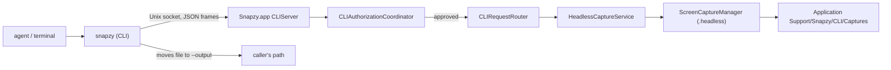

# snapzy Command Line Tool

`snapzy` lets AI agents, scripts, and terminals capture a display, a window, or an area through Snapzy — no overlay, no clicks — and get back a file path, JSON metadata, and an exit code. It ships inside the app at `Snapzy.app/Contents/Helpers/snapzy`.

Current as of HEAD (`v2.1.0-beta.15`, build 215, macOS 13.0+ deployment target).

## How it works



- The CLI is a thin client. Snapzy does the capture, so Screen Recording permission stays with Snapzy — the caller's terminal never needs it.
- If Snapzy is not running, the CLI opens it in the background (`--launched-by-cli`: no splash or feature intro when onboarding is complete; unfinished onboarding still shows and the CLI gets `onboardingIncomplete`) and waits for the socket. `--no-launch` fails instead.
- Headless captures never open Quick Access, touch the clipboard, add history rows, apply presets, play a sound, or prompt for permission.

## Install

| Channel | How `snapzy` gets on PATH |
| --- | --- |
| Homebrew | The cask links `binary "#{appdir}/Snapzy.app/Contents/Helpers/snapzy"`, added by the release workflow from the first stable release that ships the tool |
| `install.sh` | Links `/usr/local/bin/snapzy` when that directory is writable; otherwise prints the `sudo ln -sfn …` command. Never replaces a regular file or another tool's live link. Prints `brew reinstall --cask snapzy` instead when the cask is installed |
| Settings → Command Line | **Install** creates the link (administrator password only if `/usr/local/bin` is not writable); refused while Snapzy runs from a DMG or AppTranslocation. **Uninstall** removes only a link to this app's helper. Homebrew-managed links are shown, not changed; a cask install without that link shows **Copy Command** (`brew reinstall --cask snapzy`) instead of Install |
| Direct | Agents can always call `/Applications/Snapzy.app/Contents/Helpers/snapzy` |

Debug builds (`com.trongduong.snapzy.debug`) link `/usr/local/bin/snapzy-debug` instead (`CommandName`, keyed by bundle ID like the socket), so a development copy never takes the installed app's `snapzy`. Settings → Command Line in a Debug build only replaces links into `Snapzy Debug*.app`; a release build replaces any link into a `Snapzy*.app`, which reclaims a `snapzy` link made by a Debug build from before the split. `snapzy doctor` from a Debug helper checks and hints `snapzy-debug`.

`uninstall.sh` removes `/usr/local/bin/snapzy` only if it points into a `Snapzy*.app`.

### Homebrew and Sparkle

Sparkle replaces the whole bundle at the same path, so the helper updates with the app and every link keeps working. Homebrew only links the helper when it installs or upgrades the cask, so:

- A cask installed before the tool shipped and then updated in-app has no link. `CLIToolInstaller` reports `homebrewLinkMissing` (`Caskroom/snapzy` exists, the app is named `Snapzy.app`, no link works) and refuses to link, and `snapzy doctor` prints the same hint: `brew reinstall --cask snapzy`. Until a stable release adds the `binary` stanza (Sparkle beta users), link by hand or call the helper's full path.
- On Intel Macs the cask's link and Snapzy's own link are both `/usr/local/bin/snapzy`. The cask's `preflight_steps` removes `$(brew --prefix)/bin/snapzy` when it is a symlink into an app's `Contents/Helpers/snapzy`, so `brew install`/`upgrade` never stops at "already a Binary". Anything else there is left alone; on Apple Silicon that path is never Snapzy's own link.
- The cask keeps `auto_updates true`, as homebrew-cask requires for Sparkle apps. `brew upgrade` then reinstalls Snapzy only when the installed bundle is older than the tap, so a user Sparkle already updated never gets the link from it; the hint is `brew reinstall`, which always reruns the cask.
- `Casks/snapzy.rb` mirrors [the official cask](https://github.com/Homebrew/homebrew-cask/blob/main/Casks/s/snapzy.rb). The release workflow only bumps the local copy and adds `binary`; Homebrew users get the link once a PR adds `binary` (and optionally `preflight_steps`) to homebrew-cask.

## Commands

| Command | Does |
| --- | --- |
| `snapzy status` | App version, command line access, onboarding, Screen Recording, this app's approval. Never needs approval |
| `snapzy doctor` | Checks CLI path, PATH, app, connection, and status; explains each failure. Never launches Snapzy |
| `snapzy version` | CLI and app versions. Never launches Snapzy; exits 5 after printing when Snapzy is unreachable |
| `snapzy list displays` | Connected displays |
| `snapzy list windows [--app NAME] [--all]` | Capturable windows, front to back; `--all` adds off-screen windows |
| `snapzy list apps` | Running apps with windows |
| `snapzy capture screen [--display main\|all\|ID]` | One file per display |
| `snapzy capture window --id ID \| --app NAME [--title REGEX] [--index N] \| --active [--no-shadow]` | One window, even when covered. `--id` and `--app` only find on-screen windows; IDs from `list windows --all` that are off screen give `targetNotFound` |
| `snapzy capture area --rect x,y,w,h` | A rectangle; must lie fully on screen |

App matching (`--app`): exact bundle ID, else exact name, else name prefix — case-insensitive, best tier only (so `Code` never mixes VS Code's windows with Codex's; with no app named exactly `Code`, the prefix tier still matches `Codex`). With several matches the frontmost window wins and `matchedCandidates` reports the count; `--index` picks another (0-based).

### Options

| Option | Applies to | Meaning |
| --- | --- | --- |
| `-o, --output PATH` | capture | File path (`name-1.ext`, `name-2.ext`… for several displays), directory (trailing `/` or existing dir: keeps staging names), or `-` for stdout (single file only). Without it the file stays in staging. An existing single-file target fails **before** capturing unless `--force`; directory and multi-display collisions are found after capturing, and the error names the staged file. With `-`, image bytes go to stdout and the JSON metadata goes to stderr only with `--json` |
| `--format png\|jpg\|webp` | capture | Defaults to the `--output` extension, else png. A conflicting extension is an error |
| `--quality 0…1` | capture | JPEG only; default 0.9 |
| `--max-dimension PX` | capture | Downscale so the longest edge is at most PX (never upscales) — e.g. `1568` for vision models |
| `--cursor` | capture | Include the pointer |
| `--force` | capture | Overwrite `--output` |
| `--json` | all | JSON even on a terminal (pretty-printed there) |
| `--timeout S` | all | Per-request timeout, default 30 |
| `--launch-timeout S` | all | Wait for Snapzy to start, default 15 |
| `--no-launch` | all | Fail instead of starting Snapzy |

| Environment | Meaning |
| --- | --- |
| `SNAPZY_APP_PATH` | App to use when the binary is not inside an app (development: `swift run snapzy-dev`). Ignored by the embedded binary, which always uses its own app |
| `SNAPZY_SOCKET` | Socket path override for both sides (tests, very long home paths). The CLI forwards it to an app it launches; the app only checks that the parent directory is the user's |

## Output

Stdout is JSON when it is not a terminal (or with `--json`); a terminal gets one readable line per item. Errors go to stderr in the same mode. JSON keys are sorted and slashes are not escaped. Wire models live in `Packages/SnapzyCLIKit/Sources/SnapzyCLIProtocol/Models/`.

```json
{"durationMs":244,"files":[{"bytes":1204134,"displayID":1,"format":"png","height":2338,
 "path":"/Users/me/shot.png","scale":2,"width":3600}]}
```

- `scale` is pixels per point of the written file (lower than the display scale after `--max-dimension`).
- Window captures add `window` (`id`, `title`, `app {name, bundleID, pid}`, `frame`, `displayID`, `isOnScreen`, `isActive`) and `matchedCandidates`.
- `format` is `png`, `jpeg` (for `--format jpg`), or `webp`.
- Errors: `{"error":{"code":"targetNotFound","message":"…","hint":"…"}}`.

### Coordinates

All frames and `--rect` use **global points with the origin at the top-left of the main display** (CoreGraphics/Accessibility convention). Displays left of or above the main one have negative x/y; `--rect -1440,0,800,600` works without `=`. A frame from `list windows` can be passed straight to `capture area`.

### Exit codes

| Exit | Error codes | Meaning |
| --- | --- | --- |
| 0 | — | Success |
| 1 | `internal` | Unexpected failure (also unknown codes from a newer Snapzy) |
| 2 | `invalidArguments` | Bad flags, partly off-screen area, existing `--output` |
| 3 | `permissionDenied`, `onboardingIncomplete` | Screen Recording missing or not active yet; setup unfinished |
| 4 | `targetNotFound` | No such display/window/app, or area off screen |
| 5 | `appUnavailable`, `launchTimeout`, `disabled`, `busy`, `versionMismatch`, `unknownMethod` | Snapzy not reachable, command line access off, another capture running, screen locked, version skew |
| 7 | `notAuthorized` | This app was denied, not approved in time, or could not be identified |

## Approval

Every command except `status` (and the handshake) needs the **calling app** to be approved. `CLIClientIdentityResolver` walks the CLI process's parents to the first LaunchServices-registered app that is not Snapzy — Terminal, iTerm, Claude, Cursor, VS Code. Interpreters and helpers inside `.app` bundles (Homebrew `Python.app`, `Code Helper`) are skipped.

- **Verified** apps (valid signature on the running process; Apple apps via `anchor apple`) are keyed `team:<TeamID>:<bundleID>` and named from their Info.plist.
- **Unverified** apps are keyed by path, named by their bundle file name, and the prompt shows a generic icon plus a warning with the real path.
- No app in the chain (ssh, cron): keyed by the top-most process path.

The first request shows **Always Allow / Allow Once / Don't Allow**:

- No button answers Return; Escape is Don't Allow.
- The prompt times out after 25 s (before the CLI's default 30 s timeout) → exit 7.
- Allow Once covers the rest of that connection only.
- At most 3 different apps wait for a prompt at once; a closed connection's queued prompt is never shown.
- Decisions are stored in `UserDefaults` (`cliApprovedCallers`), never exported to `config.toml`, and managed in Settings → Command Line → Allowed apps.

While a CLI capture runs the menu bar icon is tinted; if the icon is hidden, a toast names the app (at most every 30 s per app). See [`../SECURITY.md`](../SECURITY.md) for the threat model and limits.

## Socket and files

| Path | Purpose |
| --- | --- |
| `~/Library/Application Support/Snapzy/CLI/<bundleID>.sock` | Socket (dir 0700, socket 0600). Falls back to `$(getconf DARWIN_USER_TEMP_DIR)snapzy-cli/` when the path exceeds 103 bytes |
| `~/Library/Application Support/Snapzy/CLI/Captures/` | Staging for headless captures (0700), outside the temp-capture sweep; files older than 24 h are removed on each capture and at server start |

Debug (`com.trongduong.snapzy.debug`) and release builds use separate sockets. The embedded binary finds its own app by resolving its path (`…/Snapzy.app/Contents/Helpers/snapzy`, symlinks followed), so a shipped `snapzy` always talks to the app it came with.

## Wire protocol

`SnapzyCLIProtocol` (Foundation-only, linked by the app): 4-byte big-endian length + one UTF-8 JSON document, max 1 MiB. The first request must be `hello` with `protocolVersion` (`"1.0"`); a different major version gets `versionMismatch`. Requests are `{id, method, params}`, responses `{id, result}` or `{id, error}`; errors to unreadable requests use `id: 0`. Methods: `hello`, `system.status`, `list.displays|windows|apps`, `capture.screen|window|area`. One request at a time per connection; 5 s handshake and 60 s idle timeouts; over 8 connections the server answers `busy` instead of refusing.

## Source map

| Path | Owns |
| --- | --- |
| `Packages/SnapzyCLIKit/` | `SnapzyCLIProtocol` (wire), `SnapzyCLIClient` (socket, app locator/launcher), `SnapzyCLICore` (commands, output), `snapzy-dev` (dev executable) |
| `SnapzyCLI/main.swift` | Xcode Command Line Tool target `SnapzyCLI` (product `snapzy`, module `SnapzyCLIMain`), embedded by the app's "Embed Command Line Tool" phase |
| `Snapzy/Services/CommandLine/` | `CLIServer`, `CLISocketListener`, `CLIConnection`, `CLIRequestRouter`, authorization, identity, installer, activity indicator, handlers |
| `Snapzy/Services/Capture/HeadlessCapture/` | `HeadlessCaptureService`, `CaptureTargetResolver`, staging, post-processor, `AppNameMatcher` |
| `Snapzy/Features/CommandLine/` | Approval prompt |
| `Snapzy/Features/Preferences/Components/PreferencesCommandLineSection.swift` | Settings section |

## Development

```bash
swift test --package-path Packages/SnapzyCLIKit
SNAPZY_APP_PATH="$PWD/.build/xcode-derived-data/Build/Products/Debug/Snapzy Debug.app" \
  swift run --package-path Packages/SnapzyCLIKit snapzy-dev doctor
```

Or call the helper embedded in a Debug build: `…/Snapzy Debug.app/Contents/Helpers/snapzy`, or link it as `snapzy-debug` from the Debug app's Settings → Command Line → **Install**.

## Troubleshooting

Run `snapzy doctor` first. Common cases:

| Symptom | Cause |
| --- | --- |
| `disabled` (5) right after a 3 s wait | Snapzy was already running but command line access is off (Settings → Command Line) |
| `launchTimeout` (5) | The CLI started Snapzy but no socket appeared within `--launch-timeout` — most often because command line access is off, or the app is slow to start |
| `permissionDenied` (3), "granted but not usable yet" | Screen Recording was granted while Snapzy was running — relaunch; if it persists, remove and re-add Snapzy in System Settings |
| `appUnavailable` (5), "The screen is locked or asleep" | ScreenCaptureKit sees no displays while the session is locked |
| `notAuthorized` (7) | The calling app was denied or nobody answered the prompt; check Allowed apps |
