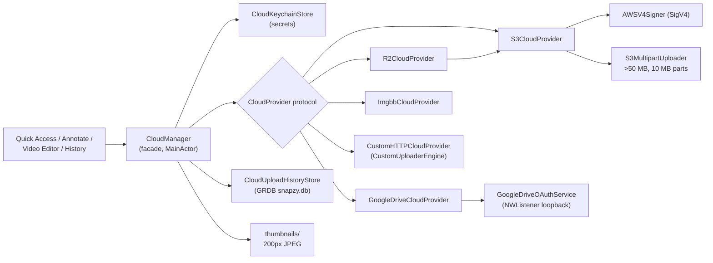

# Cloud Uploads

Bring-your-own-storage cloud uploads for captures: AWS S3, Cloudflare R2, Google Drive, the imgbb image host, and user-defined HTTP uploaders (ShareX `.sxcu` compatible). No Snapzy servers, no telemetry — files go straight from the Mac to the user's bucket, drive, imgbb account, or server.

Verified against `Snapzy/Services/Cloud/`, `Snapzy/Features/Preferences/Components/PreferencesCloud*.swift`, and upload call sites at HEAD (`v2.3.0-beta.12`).

## Current state (as of `dd4ccd5`)

- The after-capture **auto-upload** preference (`AfterCaptureAction.uploadToCloud`) was removed at `dd4ccd5`.
- Uploads are **manual-only**, from:
  - **Quick Access card** — `.uploadToCloud` action, default `bottomTrailing` slot (`QuickAccessActionKind.defaultAssignments`).
  - **Annotate** — bottom-bar button + ⌘U (`AnnotateShortcutManager.defaultCloudUpload`); re-upload on save/copy uploads the new render, then deletes the old cloud object in the background (`AnnotateWindowController`, `oldCloudKey` cleanup).
  - **Video Editor** — bottom-bar button (label flips to "Re-upload" once a `cloudKey` exists; overwrite path) + post-export upload offer via `.videoEditorCloudUpload` notification (`VideoEditorWindowController` guards).
  - **History** — context menu (`HistoryContextMenu`, gated on `CloudManager.shared.isConfigured`).
- **Automations** — the `upload` step ([AUTOMATIONS.md](AUTOMATIONS.md)) uploads the current file (the capture, or its transformed working copy) and a following `copyLink` step copies it as URL, Markdown, HTML, BBCode or a custom template. Failures fall back to copying the file and showing a Quick Access card; the failure notification has a Retry button. (Milestone 1's combined `uploadAndCopyLink` step migrates to the pair.)
- `CloudShareService` (`Snapzy/Services/Cloud/CloudShareService.swift`) is the shared upload-and-share path for the Quick Access card and automations: scoped file access, `CloudManager.upload`, background delete of a replaced key, link text, pasteboard write.
- Editor/card entry points are gated on `CloudManager.shared.isConfigured` **and** `QuickAccessActionConfigurationStore.shared.isEnabled(.uploadToCloud)` (Quick Access action customization can hide the action).

## Provider architecture

- `CloudProvider` protocol (`CloudProvider.swift`): `upload(fileURL:contentType:expireTime:existingKey:progress:)`, `generatePublicURL(for:)`, `delete(key:)`, `setExpiration(days:)`, `removeExpiration()`, `validate()`.
- `S3CloudProvider`: pure-Foundation SigV4 signing (`AWSV4Signer`), path-style URLs, multipart above 50 MB (`S3MultipartUploader.multipartThreshold`, 10 MB parts), optional custom domain for public URLs. Objects live under the `snapzy/` prefix, named by the share link style (`CloudShareLinkStyle`): `snapzy/<timestamp>-<8 hex>-<name>.<ext>` for `descriptive` (default), `snapzy/<12 random base62 characters>.<ext>` for `short`. Names and extensions are reduced to URL-safe ASCII, and a long name is cut so the key stays within the 1,024 bytes S3 and R2 accept. Lifecycle rule ID `snapzy-auto-expire`.
- `R2CloudProvider`: thin wrapper over S3 with `region = "auto"` and the account endpoint.
- `GoogleDriveCloudProvider`: OAuth desktop flow via `GoogleDriveOAuthService` (NWListener loopback on `127.0.0.1`), uploads into a named folder (default `Snapzy`, cached folder ID), multipart for ≤5 MB else resumable, sets anyone-with-link reader permission. Lifecycle/expiration **unsupported** (`setExpiration`/`removeExpiration` are no-ops) → expire time forced to permanent for this provider.
- `ImgbbCloudProvider`: one multipart `POST https://api.imgbb.com/1/upload` per image. The API key and optional `expiration` (seconds, from `CloudExpireTime`; omitted for permanent) go in the form body, never the URL. Images only (`image/*`) and at most 32 MB (`ImgbbCloudProvider.maxFileSize`); videos and larger files are rejected before any request with `CloudError.unsupportedFileType` / `.fileTooLarge`. The public URL is imgbb's direct link (`data.url`), the history key is `data.id`, and `data.delete_url` is stored as the record's `deleteURL`. imgbb can't overwrite, so `existingKey` is ignored and every re-upload is a new link. There is no delete API: `delete(key:)`, `setExpiration` and `removeExpiration` are no-ops. Save & Test posts the key with no image: error code 100 means a bad key, and the "empty upload source" error (code 130) means imgbb accepted the key, so validation never creates an image. Any other answer (rate limit, outage) fails the test. Cancelling the upload task cancels the request. Re-uploads from Annotate, Quick Access and Video Editor keep the old imgbb history row (`deleteByKey` skips imgbb), because it holds the only link to that image's delete page. `CloudProviderType.usesObjectStorage` is false for imgbb and Google Drive, which hides usage stats and share link style and skips lifecycle rules.
- `CloudManager` (`CloudManager.swift`): facade — non-secret config in UserDefaults (`cloud.*` keys), secrets in Keychain, upload orchestration with `isUploading`/`uploadProgress`, history record insert, thumbnail generation (200 px max-dimension JPEG in `Application Support/Snapzy/thumbnails/<recordUUID>.jpg`; video uploads get frame thumbnails).

## Credentials & secrets

- `CloudKeychainStore`: service `com.trongduong.snapzy.cloud`; items `accessKey`, `secretKey`, `passwordHash`, `googleRefreshToken`, `googleClientId`, `googleClientSecret`, `imgbbAPIKey`. imgbb has only the API key (`CloudManager.credentialItems(for:)` returns no secret item); `.snapzycloud` archives carry it in `accessKey` with an empty `secretKey`. Legacy service `com.snapzy.cloud` auto-migrated. Data-protection keychain primary, file (legacy) keychain fallback when `errSecMissingEntitlement`.
- Protection password (`CloudPasswordService`): optional; SHA-256 hash in Keychain; min 4 characters; gates Edit / Import / Export of the config. Forgot password → reset configuration (`cloudPasswordEnabled` / `cloudPasswordSkipped` flags).
- Encrypted transfer archives (`CloudCredentialTransferService`): `.snapzycloud` files — AES-GCM-256 with PBKDF2-SHA256 key derivation, 300,000 iterations; passphrase ≥ 12 characters.

## Configuration UI (Settings → Cloud)

`PreferencesCloudSettingsView.swift` (+ import/export sheets):

- Provider picker (AWS S3 / Cloudflare R2 / Google Drive / imgbb / Custom Uploader).
- S3/R2: access key + secret key, bucket, region (S3) or endpoint (R2), optional custom domain.
- Google Drive: client ID + secret + OAuth authorize, folder name.
- imgbb: API key (secure field, "Get an API key" link to `api.imgbb.com`) and expiration. The form and the configured summary both show a warning that imgbb links are public, plus a note that deleting opens imgbb's delete page and that imgbb takes images up to 32 MB, not videos.
- Expire time: 1/3/7/14/30/60/90 days or **permanent** (`CloudExpireTime`). Non-permanent writes the bucket lifecycle rule `snapzy-auto-expire` on the `snapzy/` prefix (`CloudManager.applyLifecycleRule`); permanent warns and removes the rule. Google Drive forced to permanent.
- Optional protection password on save.
- Save & Test: `validate()` credentials before persisting.
- Configured state: masked summary (access key masked, "stored securely in Keychain") + Edit (password-gated) / Import / Export (`.snapzycloud`) / Reset.
- Usage stats grid (`CloudUsageService`): ListObjectsV2 scan of the `snapzy/` prefix, 10-minute cache (`cloud.usageStatsCache`), monthly cost estimates — R2 $0.015/GB (10 GB free), S3 $0.023/GB (5 GB free); skipped for Google Drive.
- Share link style pref (S3/R2, shown once configured): `cloud.shareLinkStyle` (`CloudShareLinkStyle`), `descriptive` by default. `short` hides the file name and capture time from new links. Video Editor re-uploads keep their key. Annotate and Quick Access re-uploads use a new key in the current style and delete the old object, so a link shared before the re-upload stops working. Google Drive is unaffected. Carried in `.snapzycloud` archives (optional `shareLinkStyle`, applied after Save & Test; older archives and unknown values are ignored) and cleared by Reset.
- Uploads window position pref: `cloud.uploads.floatingPosition` (`CloudUploadFloatingPosition`).

## Cloud Uploads window

- `CloudUploadHistoryWindowController` (`PreferencesCloudUploadHistoryView.swift`): 1040×680 floating panel (`panelSize`).
- Open via: menu bar → Cloud Uploads (enabled only when `CloudManager.isConfigured`), ⇧⌘L, `snapzy://open/cloud-uploads`.
- Browse / search / filter (status active-expired, provider, expire time) / sort.
- Per-card actions: copy link, open URL, delete (`CloudManager.deleteFromCloud` — deletes cloud object + history record + thumbnail). imgbb records have no delete API: delete opens the stored `deleteURL` page in the browser, where the user confirms, and removes the local record.
- Clear-all: **Delete from cloud and clear** vs **Clear history only**. Bulk delete skips imgbb records (one browser tab per image would flood the browser), so imgbb images stay online until they expire or the user deletes them on imgbb.
- No upload button inside the window — uploads originate from capture surfaces only.

## Upload history storage

- GRDB `snapzy.db` via `CloudUploadHistoryStore`; table `cloudUploadRecord` (migration `v1_createCloudUploadRecords` in `DatabaseManager`).
- `CloudUploadRecord` fields: `id` (UUID), `fileName`, `publicURL`, `key`, `fileSize`, `uploadedAt`, `providerType`, `expireTime`, `contentType?`, `deleteURL?` (imgbb delete page; migration `v3_addCloudUploadDeleteURL`).
- Derived: `isExpired` (local check from `expireTime.seconds`), `isImageType`, `thumbnailURL`.

## Custom uploader

ShareX-style uploader to any HTTP endpoint (issue #600). Code in `Snapzy/Services/Cloud/CustomUploader/`, UI in `Snapzy/Features/Preferences/Components/CustomUploader/`.

- **Storage**: `CustomUploaderStore.shared` keeps up to 20 definitions as JSON in UserDefaults `cloud.customUploaders`. Definitions never hold secret values, only `{secret:NAME}` references. Provider `custom_http` (`CloudProviderType.customHTTP`) uses the uploader in `cloud.customUploaderID`. Automations reference uploaders by id too, independent of the Cloud provider.
- **Fields**: name; method `POST`/`PUT`/`PATCH`; request URL; headers; query parameters; body (multipart form data with a file field and extra fields, binary = the raw file, or URL-encoded form fields without the file); response extractors for URL (required), thumbnail, deletion URL and error message; timeout (default 60 s).
- **Request templates**: `{filename}` / `{file.name}` and `{secret:NAME}`. Values spliced into the URL are percent-encoded, except a URL that is a single token (e.g. `{secret:WEBHOOK_URL}`). The request URL must be http/https.
- **Response extractors**: whole response, JSON path subset (`data.url`, `$.data.url`, `[0].url`, `files[0].url`, `data["odd key"]`), regex (first capture group, else whole match; `pattern|group` picks a group), or a template mixing text with `{json:path}`, `{regex:pattern|group}`, `{response}`, `{responseurl}`, `{header:name}`, `{filename}`. The extracted URL must be absolute http/https (`file:`, `javascript:`, `data:` and relative values are rejected); a bad optional link (thumbnail/deletion) is dropped.
- **Upload**: `CustomUploaderEngine` resolves templates, streams the multipart body from a temp file (1 MB chunks, so videos never sit in memory), sends one URLSession upload task, and maps non-2xx to `CloudError.uploadFailed` with the ErrorMessage extractor's text (else the first 200 characters of the body). The history key is the public URL; `deleteURL` holds the extracted deletion link. There is no delete API, lifecycle rule or expiration: deleting a history row opens the deletion link (if any), and replaced uploads stay online (`CloudProviderType.supportsRemoteDelete == false`, same path as imgbb). Usage stats, share link style and the protection password are hidden for this provider, and `.snapzycloud` export refuses it (`CustomUploaderError.transferUnsupported`).
- **Secrets**: `{secret:NAME}` is looked up through `CustomUploaderSecrets.provider` (the Keychain-backed automation secret store installed at launch). A missing secret fails the upload with `CustomUploaderError.unresolvedSecret` before any request, so the literal token is never sent. Secret and header values are never logged.
- **`.sxcu` import** (`CustomUploaderSXCUImporter`): maps `RequestMethod` (or legacy `RequestType`), `RequestURL`, `Parameters`, `Headers`, `Body` (`MultipartFormData`, `Binary`, `FormURLEncoded`), `FileFormName`, `Arguments`, `URL`, `ThumbnailURL`, `DeletionURL`, `ErrorMessage`, keeping header/parameter order. Legacy `$json:path$`, `$response$`, `$filename$` and `$regex:i,g$` (with `RegexList`) become `{…}` syntax.
- **Unsupported ShareX syntax** is imported but reported as warnings in the review sheet: `GET`/`DELETE` methods (POST is used), `JSON`/`XML` bodies and `Data` (multipart is used), `Body: None`/`FormURLEncoded` (fields only, no file), `ResponseType` other than `Text`, and tokens such as `{input}`, `{random:…}`, `{select:…}`, `{prompt:…}`, `{base64:…}`, `{outputurl}`, `{xml:…}` (they fail at upload time).
- **Credential candidates**: header, query and form-field names containing `authorization`, `key`, `token`, `secret`, `password` or `auth` are offered **Store as Secret**, which writes the value through `CustomUploaderSecrets.provider?.storeSecret` and replaces it with `{secret:NAME}` (suggested name like `ZIPLINE_AUTHORIZATION`). The option is hidden when no secret store is installed.
- **Settings UI**: with Custom Uploader selected, Settings → Cloud lists uploaders with an active-uploader picker and New / Edit / Duplicate / Delete / Import .sxcu… Saving marks Cloud configured through `CloudManager.saveCustomUploaderConfiguration(uploaderID:)` (no Keychain writes). The editor's **Test** button uploads a generated 1×1 PNG with the unsaved settings via `CustomUploaderEngine.send` and shows the HTTP status, the first 2 KB of the response, and the extracted URL or the error.

## Security boundaries

- Secrets never leave the Keychain except via explicit, passphrase-encrypted `.snapzycloud` export.
- TOML config export excludes secrets — see [CONFIGURATION.md](CONFIGURATION.md).
- Public URLs are bearer links (custom domain / presigned-style path); deletion requires the stored credentials.
- imgbb links are public image URLs on imgbb's servers. Settings says so before the key is saved. The imgbb delete page link is stored only in the local history database.
- Custom uploaders send captures to whatever server the user configures. Credentials belong in `{secret:NAME}` references; links from responses are accepted only as http/https.

## Related docs

- [PREFERENCES.md](PREFERENCES.md) — Cloud tab + after-capture matrix (auto-upload removal)
- [SHORTCUTS.md](SHORTCUTS.md) — ⇧⌘L and `snapzy://open/cloud-uploads`
- [QUICK_ACCESS.md](QUICK_ACCESS.md) — card action slots
- [ANNOTATE.md](ANNOTATE.md) — ⌘U upload + re-upload flow
- [VIDEO_EDITOR.md](VIDEO_EDITOR.md) — editor upload + post-export offer
- [HISTORY.md](HISTORY.md) — context-menu uploads
- [UPDATES.md](UPDATES.md) — diagnostics (cloud category logging)
- [CONFIGURATION.md](CONFIGURATION.md) — TOML export excludes secrets
