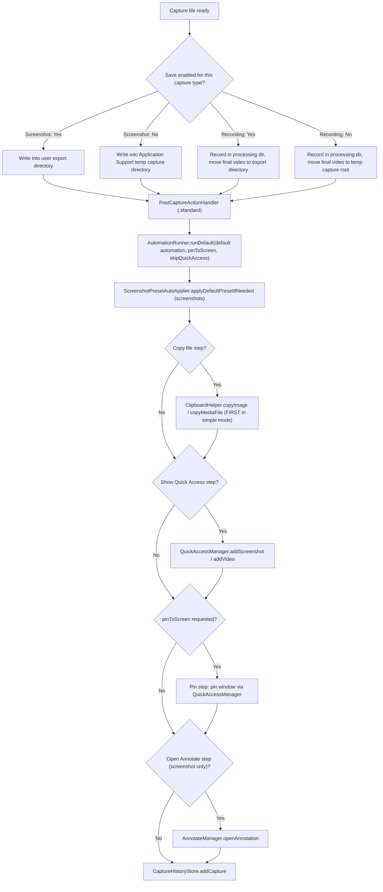

# Post-Capture Routing

Post-capture routing is everything that happens after a capture file exists: destination selection, clipboard copy, Quick Access handoff, annotate auto-open, and history recording. Since milestone 6 a standard capture runs its **default after-capture automation**, the editable form of the after-capture matrix. This doc covers `PostCaptureActionHandler`, `TempCaptureManager`, and their supporting services as of HEAD.

## Trigger Wiring

- Screenshots: `ScreenCaptureManager` emits every saved file URL on `captureCompletedPublisher` (sent from `saveImage(...)` when `emitCompletion` is true). The single subscription lives in `ScreenCaptureViewModel`'s init (`Snapzy/Features/Capture/CaptureViewModel.swift`) and calls `PostCaptureActionHandler.handleScreenshotCapture(url:)`.
- Batch screenshots (multi-display fullscreen) call `handleScreenshotCaptures(urls:)` directly from the capture flow instead of the publisher.
- Recordings: `RecordingCoordinator` calls `handleVideoCapture(url:)` after the writer finishes and the file is moved to its destination; the GIF flow calls `handleVideoCapture(url:skipQuickAccess: true)` after conversion because the placeholder card was already inserted. See [`RECORDING.md`](RECORDING.md).
- **OCR exception**: Capture Text is the only capture path that writes no file — recognized text/QR payloads go straight to the pasteboard as plain text, so no post-capture routing runs. See [`CAPTURE.md`](CAPTURE.md).
- Scrolling capture saves through `saveProcessedImage`, so it enters routing through the same publisher as any screenshot. See [`SCROLLING_CAPTURE.md`](SCROLLING_CAPTURE.md).

## Routing

Every interactive screenshot carries a `PostCaptureRouting` inside its `CaptureContext`; `ScreenCaptureManager` emits `CaptureCompletionEvent(url, routing)`.

| Routing | Set by | What runs |
| --- | --- | --- |
| `.standard` | every normal capture (shortcut, menu, deep link, recording stop) | The **default after-capture automation** for the capture type (below) |
| `.automation(runID)` | `AutomationLauncher` through `ScreenCaptureViewModel.startAutomationCapture` | `AutomationRunner.complete` runs that automation's steps instead: the default automation — including its Save flag, which the automation decides through `TempCaptureManager.resolveSaveDirectory(saveOverride:)` — is skipped, the default canvas preset is still applied (unless the automation has an Apply canvas preset step), and history is still recorded. See [`AUTOMATIONS.md`](AUTOMATIONS.md) |

Scrolling captures pass the routing into `saveProcessedImage(context:)`, so the stitched image takes the same path. Recordings started by an automation keep the routing in `RecordingCoordinator`: on stop, GIF output is converted and studio recordings flattened without a Quick Access card, then `AutomationRunner.complete` runs the steps instead of `handleVideoCapture`; the recording's save folder follows the automation (`makeRecordingSavePlan(saveOverride:)`). Deleting or cancelling a recording, or cancelling a scrolling session, abandons the run. A stale toolbar session never drops a capture: it falls back to `.standard`. Cancelling the toolbar's area selection ends its session; toolbar fallbacks and automation buttons apply the default Save choice before running.

## Default After-Capture Automations

Since milestone 6 the after-capture matrix is stored as two editable **system automations** ("Default after screenshot" / "Default after recording", `AutomationStore.defaultAutomation(for:)`). `PostCaptureActionHandler` no longer decides what happens: its `.standard` branch (`handleScreenshotCapture`, `handleScreenshotCaptures`, `handleVideoCapture`) calls `runDefaultAutomation`, which runs the automation through `AutomationRunner.runDefault` with a `StandardCaptureRunEnvironment`. Model, store, mapping and UI: [`AUTOMATIONS.md`](AUTOMATIONS.md#default-automations-after-capture-milestone-6).

- **Simple mode** (what the matrix can show): steps are exactly copy file → Show Quick Access → Open Annotate for the enabled cells, Save is a flag on the source. The matrix UI edits it, one cell at a time. Anything else (other steps, order, disabled steps) is a **custom pipeline**, edited with Settings → Capture → After Capture → **Customize Pipeline…** or Settings → Automations → Default after capture; the matrix then keeps only its Save cell for that type, and **Reset to Simple** rebuilds the matrix form.
- **Needs review**: an imported custom default pipeline flagged for review runs only its simple matrix form until it is reviewed in the editor.
- **Runtime flags** (capture path, not settings): `pinToScreen` (inline annotate Pin) inserts a `pin` step before Open Annotate; `skipQuickAccess` (GIF flow, recording toolbars that already added a card) drops Show Quick Access. Both apply to simple and custom pipelines.
- **Quiet runs**: while the default is simple, the run shows no progress HUD and writes an Activity-log row only on failure (it runs for every capture). A custom pipeline behaves like any automation run (HUD after 1.5 s, logged), invocation `afterCapture`.
- **Same behavior as before** for existing users: the first launch of M6 builds both defaults from the stored matrix (`afterCaptureActions`), so nothing changes until the user customizes. The matrix key stays written for readers of it (temp-vs-export decision, `copyEditedCaptureToClipboardIfEnabled`, TOML `capture.after.*`) and for a downgrade.

### Parity and dual-run diagnostics

The default run must equal the legacy matrix handler. Locked by `AutomationSystemDefaultTests.testEveryMatrixCombinationRunsLegacyEffectsInOrder` (all 16 matrix combinations × screenshot / recording × `pinToScreen` × `skipQuickAccess`, against golden effects written out from the legacy handler; also asserts History, preset prepare and quiet run) and `PostCaptureActionHandlerTests` (the automation path next to the legacy executor, including recordings with `skipQuickAccess`). At runtime `PostCaptureActionHandler.logParity` computes what `executeActions` would have done (stored matrix + flags: `AutomationSystemDefault.legacyEffects`) and compares it with the effective automation steps (`runtimeSteps` → `effects(of:)`). A difference logs **"After-capture parity mismatch"** with `captureType`, `legacy`, `automation` and `custom` — `.warning` for a simple pipeline (a bug), `.debug` for a custom one (on purpose).

`executeActions` (below) is intentionally still in the tree: it is the fallback when no default automation is injected (unit tests) and the dual-run reference. Removing it, the diagnostics and the legacy matrix write-through is gated on one beta without parity-mismatch reports (M6 phase 06).

## After-Capture Action Matrix

`AfterCaptureAction` (`Snapzy/Features/Preferences/PreferencesManager.swift`) has 4 cases as of HEAD, each gated per `CaptureType` (`.screenshot`, `.recording`). They are the simple-mode view of the default automations:

| Action | Screenshot default | Recording default | Effect |
| --- | --- | --- | --- |
| `save` | ON | ON | Chooses export directory vs temp capture directory |
| `showQuickAccess` | ON | ON | Adds a card to the Quick Access stack |
| `copyFile` | ON | ON | Copies file/image to the pasteboard |
| `openAnnotate` | OFF (screenshot only) | n/a | Auto-opens the Annotate editor |

- The matrix is stored as `[AfterCaptureAction: [CaptureType: Bool]]` JSON-encoded in `UserDefaults` under the `afterCaptureActions` key via `PreferencesManager`; unset entries fall back to the defaults above. Since M6 the default automations (`automations.systemDefaults`) are the source of truth and mirror into this key on every change (`adoptDefaultAutomationMatrix`); `PreferencesManager.setAction` writes through `AutomationStore.setDefaultMatrixAction`. See [`PREFERENCES.md`](PREFERENCES.md).
- `AfterCaptureAction.uploadToCloud` was **removed** at commit `dd4ccd5` (with its TOML key `upload_to_cloud`). Cloud upload is now manual-only: Quick Access cards, Annotate, Video Editor, and History surfaces, gated on `CloudManager.isConfigured` plus the `uploadToCloud` Quick Access action configuration. Nothing in `PostCaptureActionHandler` auto-uploads (a custom default pipeline may add an Upload step on purpose). See [`CLOUD.md`](CLOUD.md) and [`CONFIGURATION.md`](CONFIGURATION.md).

## Execution Order

`AutomationRunner.runDefault` runs on the main actor; `PostCaptureActionHandler.runDefaultAutomation` wraps it:

1. **Scoped file access** — `SandboxFileAccessing.beginAccessingURL(url)` wraps the whole sequence (security-scoped bookmark access for files outside the container); missing files bail out with a diagnostic log.
2. **Parity log** — `logParity` (see above).
3. **Preset auto-apply (screenshots)** — `StandardCaptureRunEnvironment.prepareScreenshot` → `applyDefaultPreset(toScreenshot:)` → `ScreenshotPresetAutoApplier.applyDefaultPresetIfNeeded(to:)`: when the default Annotate canvas preset changes the canvas it renders effects through the lightweight `AnnotateExporter.renderCanvasEffects(sourceImage:effects:)` path (no full `AnnotateState`), atomically rewrites the screenshot file, and returns `AnnotationSessionData` which is persisted via `AnnotationSessionStore` and cached on the Quick Access item so the capture reopens editable. Skipped when the default pipeline itself has an Apply canvas preset step. See [`ANNOTATE.md`](ANNOTATE.md).
4. **Steps in order** — simple mode: **copyFile FIRST** (clipboard copy runs before any thumbnail generation, overlay presentation, or editor work so auto-copy is never blocked by slower UI actions), **showQuickAccess** (`addScreenshot(url:)` / `addVideo(url:)`; dropped by `skipQuickAccess`), **pin** (flag only: pins the card this run created, or pins directly from the URL), **openAnnotate** (screenshots only; opens the run's card item when one exists, otherwise from the URL with the preset session data).
5. **History record** — the runner records the capture (`recordsHistory` for standard captures): screenshots read pixel dimensions via `CGImageSource`; videos read duration and track `naturalSize` via `AVURLAsset` (macOS 15 async load APIs with older fallbacks); `.gif` extension maps to the GIF history type.

Batch variant `handleScreenshotCaptures(urls:)`: filters missing files, delegates single-URL batches to the normal path, runs the default automation once over all files (preset auto-applied per file, all file URLs copied at once through `ClipboardHelper.copyFileURLs`, every file added to Quick Access, only the **first** capture opened in Annotate), and records each file in history.

`copyEditedCaptureToClipboardIfEnabled(for:url:)` re-runs the clipboard automation after an in-place edit save (Annotate/Video Editor) when `copyFile` is enabled for that capture type (read from the mirrored matrix).

### Legacy executor

`executeActions(for:url:skipQuickAccess:pinToScreen:)` is the pre-M6 implementation with the same order (scoped access, preset auto-apply, copyFile first, showQuickAccess, pinToScreen, openAnnotate, History). It runs only when `PostCaptureActionHandler` has no default automation provider (tests construct it that way) and defines the legacy effects the diagnostics compare against. `scripts/check-automation-signals.sh` asserts nothing outside `PostCaptureActionHandler.swift` calls it.

## Destination Logic

- `AfterCaptureAction.save` is **not** a post-write callback (since M6 it is the default automation's `saveToExportDirectory` flag, mirrored into the matrix key that these resolvers read):
  - **Screenshots**: `TempCaptureManager.resolveSaveDirectory(for:exportDirectory:)` decides the destination **before** the write — export directory when ON, temp directory when OFF.
  - **Recordings**: the AVAssetWriter always writes into a per-session `Captures/RecordingProcessing/<UUID>/` directory first (`TempCaptureManager.makeRecordingSavePlan`); after the writer finishes, the final video moves to the export directory (Save ON) or the temp capture root (Save OFF) and the processing directory plus writer sidecars are deleted. A failed final move falls back to a unique name in the temp root (`makeRecoveredRecordingURL`).
- **Export directory**: `SandboxFileAccessManager.resolvedExportDirectoryURL()` resolves the stored security-scoped bookmark (removing invalid bookmarks), falling back to a default location; first-use flows prompt through `ensureExportDirectoryForOperation(promptMessage:)`. See [`PREFERENCES.md`](PREFERENCES.md).
- **Temp directory**: `~/Library/Application Support/Snapzy/Captures/` — Application Support, deliberately not `/tmp`, so macOS never purges temp files mid drag-and-drop and paste-time reads stay valid.
- **Saving a temp capture later** (Quick Access Save action): `TempCaptureManager.saveToExportLocation(tempURL:)` moves the file into the export directory **preserving its relative path** (naming-template subfolders survive), moves the recording metadata sidecar for videos, and prunes emptied temp subdirectories.
- **Editor commit vs promotion**: Video Editor Save never performs the later temp promotion. When `after capture → save = false`, it replaces the edited recording/GIF at the existing temp URL, keeps the Quick Access card and history path, and returns control to the card. The card’s Save action remains the only temp-to-export promotion. When `save = true`, the editor’s Replace Original branch updates the existing export destination in place.
- **Video Editor session continuity**: A successful video editor commit also stores the cut/trim, zoom, speed, background/audio settings, and recording metadata beside a private source snapshot. The session package follows a temp capture when Quick Access later promotes it to the export destination, so reopening does not start from the already-rendered output.
- **Deletion**: `deleteTempFile(at:)` removes the file plus its recording metadata sidecar and prunes empty directories.
- **Launch cleanup**: `cleanupOrphanedFiles()` (called from `SnapzyApp` init) sweeps the temp directory but preserves files that have an active history record, and — while history is enabled — files still inside the retention window or files it cannot reconcile against the database; retention sweeps and explicit cache clearing are the mechanisms that actually delete those.

## Output Formats and Naming

- `ImageFormat` (`Snapzy/Services/Capture/ScreenCaptureManager.swift`): `.png`, `.jpeg(quality:)`, `.webp`, `.heic(quality:)`, `.avif(quality:)`; extensions `png` / `jpg` / `webp` / `heic` / `avif`. Settings-driven captures use quality 0.9 (`ImageEncoderSupport.defaultLossyQuality`).
- PNG/JPEG/HEIC/AVIF write through `CGImageDestination` (`public.png`, `public.jpeg`, `public.heic`, `public.avif`) with DPI metadata set to `scaleFactor × 72` (PNG also gets pixels-per-meter); the lossy formats carry `kCGImageDestinationLossyCompressionQuality`. HEIC and AVIF keep alpha and the source color profile, so cutouts stay transparent (only JPEG flattens).
- **Encoder availability**: `ImageEncoderSupport` (`Snapzy/Services/ImageEncoderSupport.swift`) reads `CGImageDestinationCopyTypeIdentifiers()` once. AVIF encoding exists only on macOS releases that ship an ImageIO AVIF encoder (older releases only decode it). When the saved format cannot be encoded, `ImageFormatOption.current` and `ScreenCaptureManager.saveImage` fall back to PNG and log a warning; Settings shows the option as unsupported plus a note, and the CLI rejects the request instead of writing PNG under an `.avif` name.
- WebP writes through `WebPEncoderService` (`Snapzy/Services/WebPEncoder.swift`, libwebp via Swift-WebP): `.photo` preset, `method = 1`, multithreaded, atomic file write.
- Screenshot outputs use each display's **native** pixel density (`minimumScreenshotOutputScaleFactor` floor is 1.0). Non-Retina external-display captures stay at 1×; mixed-DPI composites may still promote low-density slices to the highest native scale in the selection.
- Naming goes through `CaptureOutputNaming` (`Snapzy/Services/Capture/CaptureOutputNaming.swift`):
  - Default templates: `Snapzy_{datetime}_{ms}` (screenshot), `Snapzy_Recording_{datetime}` (recording), overridable per kind in Settings.
  - Tokens: `{datetime}`, `{date}`, `{year}`, `{yearShort}`, `{month}`, `{monthName}`, `{monthShort}`, `{day}`, `{time}`, `{ms}`, `{timestamp}`, `{type}`, `{appName}` plus snake/short aliases, `{windowTitle}` / `{window.title}` (window captures; `/` → `-`); `{appName}` resolves from the captured app (or frontmost app for fullscreen/area) and is empty when unavailable.
  - `/` creates sanitized subfolders under the destination; traversal segments and invalid path characters are stripped; known media extensions embedded in templates are removed.
  - `makeUniqueFileURL` dedupes with `_2`, `_3`, … suffixes.
- Annotate Save/Save As/Copy/drag and Mockup export encode by extension through `AnnotateExporter.imageData(from:for:)`, so editing a `.heic`/`.avif` capture writes the same format back (annotation sidecars key on the file path, so they restore for HEIC/AVIF like any other image). Save panels offer every format this Mac can encode (`ImageFormatOption.savePanelContentTypes`).
- Quick Access Optimize can rewrite PNG/JPEG/WebP/HEIC/AVIF files and convert to HEIC/AVIF; its quality slider applies to JPEG, WebP, HEIC and AVIF. Presets whose format this Mac cannot encode fall back to PNG.

## Clipboard Behavior

`Snapzy/Services/Clipboard/ClipboardHelper.swift` writes one pasteboard item per capture so receiving apps pick their preferred representation:

- `copyImage(from:)` — `writeObjects([NSURL])` (grants the receiver a sandbox extension), then augments the same item with the encoded data type (`.png`/JPEG/WebP/HEIC/AVIF UTI) and `.tiff` pixel data. When `NSImage` cannot decode the file (e.g. WebP on macOS 13), the item still carries the file URL and original encoded bytes.
- `copyMediaFile(from:)` — videos/GIFs: file-URL write plus same-item `.URL` and `.string` fallbacks for Teams/Electron/WebView paste targets.
- `copyFileURLs(_:)` — batch file-URL copy for multi-display screenshot sets.
- Render-based `copyImage(_:format:)` — Annotate/Mockup copies render to the configured format, write a temp file (`Snapzy_clipboard_<uuid>`), then copy like a file.
- **Clipboard content** (`clipboard.imageContent`, `ClipboardImageContentOption`): `image_and_file` (default, behavior above) or `image_only`. Image-only skips `writeObjects([NSURL])` and writes one `NSPasteboardItem` with the encoded data type + `.tiff`, so Citrix/RDP sessions and some terminals paste an inline image instead of a file attachment (#699). Render-based copies then skip the temp file, and nothing is recorded for pasteboard-reference tracking. If the image cannot be decoded (no TIFF), the copy falls back to the file reference. Applies to `copyImage` only; media and multi-file copies always use file URLs. Callers may pass `content:` to override the preference.
- Temp files must **not** be deleted after copying: receivers read them at paste time. Orphans are reclaimed by `cleanupOrphanedFiles()` on the next launch.

## Quick Access Handoff

- Quick Access cards expose hover actions and a matching context menu (copy, save/open, edit, cloud upload, dismiss, delete/trash); temp captures show Save, saved captures keep Open in the same slot even when the after-capture Save preference is off. Action visibility, order, and card slots come from `QuickAccessActionConfigurationStore`. See [`QUICK_ACCESS.md`](QUICK_ACCESS.md).
- Card countdowns **pause** while the item is being edited (Annotate/Video Editor), converted to GIF, or uploaded to cloud, and resume when the activity ends.
- Video Editor Save commits edits to the current file and leaves Quick Access ownership unchanged; the card reappears with the refreshed thumbnail after the editor closes. See [`VIDEO_EDITOR.md`](VIDEO_EDITOR.md).
- GIF output is a two-step flow: record video → placeholder Quick Access card → `GIFConverter` → card URL swapped to the GIF → `handleVideoCapture(skipQuickAccess: true)` finishes routing. See [`RECORDING.md`](RECORDING.md).
- Screenshot pin opens an independent always-on-top pin window (zoom, drag-to-app, click-through lock mode). See [`QUICK_ACCESS.md`](QUICK_ACCESS.md).

## Cache and Storage Management

- `CaptureStorageManager` (`Snapzy/Services/FileAccess/CaptureStorageManager.swift`) owns the `Application Support/Snapzy/Captures` cache: `calculateCacheSize()` (background enumeration) and `clearCache()`.
- The UI lives in **Settings → History** (`PreferencesHistorySettingsView`): shows the formatted cache size and offers cache clearing. `clearCache()` refuses to run while a capture or recording is in progress (`CacheCleanupError.operationInProgress`), removes every file in the captures directory (skipping locked files), and deletes matching history records and recording metadata sidecars. See [`HISTORY.md`](HISTORY.md).

## Key Files

| File | Responsibility |
| --- | --- |
| `Snapzy/Services/Capture/PostCaptureActionHandler.swift` | `.standard` routing: runs the default automation, parity diagnostics, batch handling; legacy `executeActions` fallback / reference |
| `Snapzy/Features/Automations/Models/AutomationSystemDefaults.swift` | Matrix ↔ default-automation mapping, projection, runtime flags (`pinToScreen`, `skipQuickAccess`), legacy effects |
| `Snapzy/Features/Automations/Engine/StandardCaptureRunEnvironment.swift` | Run environment for the default automation (Quick Access manager, preset applier, Pin / Annotate on the run's card) |
| `Snapzy/Features/Automations/Engine/AutomationRunner.swift` | `runDefault`: quiet standard-capture run, invocation `afterCapture` |
| `Snapzy/Features/Automations/Services/AutomationStore.swift` | `systemAutomations`, migration from the matrix, mirror back into `PreferencesManager` |
| `Snapzy/Services/Capture/TempCaptureManager.swift` | Save-vs-temp destination, recording save plan, temp lifecycle, orphan cleanup |
| `Snapzy/Services/Capture/ScreenCaptureManager.swift` | `captureCompletedPublisher`, `ImageFormat`, file writing, native output scale |
| `Snapzy/Services/Capture/CaptureOutputNaming.swift` | Naming templates, context tokens, sanitization, unique dedupe |
| `Snapzy/Services/Capture/ScreenshotPresetAutoApplier.swift` | Default Annotate canvas preset bake-in during routing |
| `Snapzy/Services/WebPEncoder.swift` | libwebp-backed WebP encoding |
| `Snapzy/Services/Clipboard/ClipboardHelper.swift` | Format-aware single-item pasteboard writes |
| `Snapzy/Services/FileAccess/SandboxFileAccessManager.swift` | Security-scoped export-directory bookmarks and scoped access |
| `Snapzy/Services/FileAccess/CaptureStorageManager.swift` | Captures cache sizing and clearing (Settings → History) |
| `Snapzy/Features/Preferences/PreferencesManager.swift` | `AfterCaptureAction` matrix storage and defaults (mirror of the default automations) |

## Related docs

- [`CAPTURE.md`](CAPTURE.md) — capture modes that feed this pipeline
- [`SCROLLING_CAPTURE.md`](SCROLLING_CAPTURE.md) — long-screenshot save path into routing
- [`RECORDING.md`](RECORDING.md) — recording writer, GIF two-step flow
- [`QUICK_ACCESS.md`](QUICK_ACCESS.md) — card stack, actions, countdown, pin windows
- [`AUTOMATIONS.md`](AUTOMATIONS.md) — default automations, runner, steps, triggers
- [`ANNOTATE.md`](ANNOTATE.md) — preset auto-apply and editable sessions
- [`HISTORY.md`](HISTORY.md) — history records, retention, cache clearing
- [`CLOUD.md`](CLOUD.md) — manual cloud upload entry points
- [`PREFERENCES.md`](PREFERENCES.md) — after-capture matrix and export folder settings
- [`CONFIGURATION.md`](CONFIGURATION.md) — TOML keys for after-capture actions and custom default pipelines
- [`LOCALIZATION.md`](LOCALIZATION.md) — ownership of post-capture copy
